

# DevOps World

### Veriqta DevOps World

**Build your foundation. Automate delivery. Engineer reliability. Grow your career.**

A complete learning home for DevOps, cloud engineering, site reliability engineering, platform engineering, and DevSecOps—from the first Linux command to senior system design.

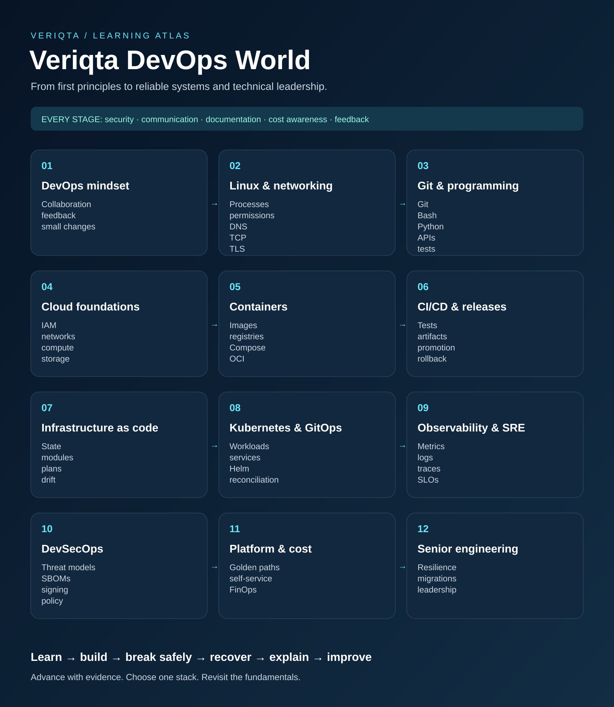

**Explore the tools. Follow the roadmap. Build real projects. Prepare for the role you want.**

## Contents

- [Start here](#start-here)
- [The complete DevOps roadmap](#roadmap)
- [DevOps tools: the visual atlas](#tool-atlas)
- [Linux, networking, Git, and programming](#foundations)
- [Cloud engineering and architecture](#cloud-engineering)
- [Containers and Kubernetes in depth](#containers-and-kubernetes)
- [CI/CD, releases, and infrastructure automation](#delivery-and-automation)
- [Observability, reliability, and incident response](#observability-and-sre)
- [DevSecOps and software supply chains](#devsecops)
- [Platform engineering, FinOps, and developer experience](#platform-engineering)
- [Data operations, backup, and disaster recovery](#data-and-recovery)
- [AI-assisted engineering and MLOps](#ai-and-mlops)
- [Courses, documentation, books, and hands-on learning](#learning-resources)
- [YouTube videos, full courses, and conference talks](#videos)
- [Certifications and professional learning paths](#certifications)
- [Hands-on projects and portfolio challenges](#projects)
- [Foundation interview preparation](#foundation-interviews)
- [50 senior DevOps, SRE, and platform interview scenarios](#senior-interviews)
- [Practical interview exercises](#practical-interviews)
- [Resumes, portfolios, profiles, and career growth](#career)
- [AI resume builders and application tools](#ai-resume-builders)
- [Operational checklists and troubleshooting](#operations)
- [Architecture, runbook, incident, and portfolio templates](#templates)
- [Study plans and readiness milestones](#study-plans)
- [Open-source projects, communities, and continued learning](#community)
- [DevOps glossary](#glossary)

## Start here

DevOps World brings together the concepts, official documentation, tools, courses, practical projects, certifications, and career resources needed to build and operate useful software. Start at your level and keep connecting what you learn to something you can demonstrate.

| Your starting point | Begin with | Work toward |
| --- | --- | --- |
| Completely new to technology | Linux, networking, Git, and a programming language | Run a service and explain a request from client to application |
| Developer moving into DevOps | Containers, CI/CD, cloud identity, infrastructure, and observability | Deliver a tested artifact and recover a failed release |
| System administrator moving into engineering | Git, software testing, configuration as code, and cloud automation | Replace repeated manual work with reviewed, reliable automation |
| Working DevOps engineer | SRE, security, data recovery, cost, and platform design | Improve outcomes across several services or teams |
| Senior or staff candidate | Architecture, migrations, incident leadership, and organizational tradeoffs | Defend decisions with evidence and explain their consequences |

**A focused first stack:** Linux → Git → Bash and Python → Docker → GitHub Actions or GitLab CI/CD → one cloud → OpenTofu or Terraform → Kubernetes when it serves the workload → Prometheus, Grafana, and OpenTelemetry.

Choose one tool per capability while learning. Compare alternatives after completing a coherent project. The goal is to understand how the system works and how to recover it.

#### What DevOps means

DevOps connects people, practices, and technology across the software lifecycle. It emphasizes shared ownership, small reviewable changes, fast feedback, repeatable delivery, and continuous improvement.

| Discipline | Main emphasis | Shared responsibilities |
| --- | --- | --- |
| DevOps | Improve software delivery and operation together | Collaboration, automation, feedback, ownership |
| Cloud engineering | Design and operate cloud capabilities | Identity, networks, compute, managed services, governance |
| SRE | Apply engineering to reliability | SLIs, SLOs, incident response, capacity, toil reduction |
| Platform engineering | Provide supported capabilities for other engineering teams | Self-service, golden paths, developer experience, platform reliability |
| DevSecOps | Integrate security throughout delivery and runtime | Threat modeling, identity, supply chain, policy, risk handling |

These disciplines overlap. A job title alone does not define a team's responsibilities; read the role's actual scope.

[Back to contents](#contents)

## The complete DevOps roadmap

Use the stages as a dependency-aware guide. Revisit earlier stages as your systems grow. There is no fixed completion timeline: advance when you can demonstrate the exit evidence.

### 01. DevOps mindset

**Focus:** Collaboration • feedback • small changes.

**Understand:** Explain ownership, delivery flow, continuous improvement, and the difference between deployment and release.

**Practice:** Map a change from idea to production. Identify one queue, one handoff, and one feedback loop.

**Exit evidence:** A one-page value-stream map with a measurable improvement hypothesis.

**Start reading:** https://dora.dev/guides/

### 02. Linux & networking

**Focus:** Processes • permissions • DNS • TCP • TLS.

**Understand:** Understand filesystems, users, signals, services, logs, sockets, routing, CIDR, DNS resolution, and TLS trust.

**Practice:** Run a service under a non-root user; trace a failed request from DNS through the application.

**Exit evidence:** A reproducible troubleshooting transcript that separates symptoms from root cause.

**Start reading:** https://linuxjourney.com/

### 03. Git & programming

**Focus:** Git • Bash • Python • APIs • tests.

**Understand:** Use branches, commits, pull requests, conflict resolution, shell quoting, exit codes, JSON, HTTP APIs, and unit tests.

**Practice:** Write an idempotent health-check script with timeouts, structured output, and failure tests.

**Exit evidence:** A reviewed pull request with tests, readable history, and documented failure behavior.

**Start reading:** https://git-scm.com/book/en/v2

### 04. Cloud foundations

**Focus:** IAM • networks • compute • storage.

**Understand:** Choose one cloud. Learn identity, least privilege, subnets, load balancing, encryption, budgets, quotas, and shared responsibility.

**Practice:** Design a private application tier with controlled ingress, workload identity, and a teardown plan.

**Exit evidence:** An architecture decision explaining security, availability, costs, and alternatives.

**Start reading:** https://docs.aws.amazon.com/

### 05. Containers

**Focus:** Images • registries • Compose • OCI.

**Understand:** Understand layers, build context, image provenance, volumes, networking, signals, and runtime isolation.

**Practice:** Package an application with a non-root runtime, health endpoint, and reproducible dependency installation.

**Exit evidence:** An image build and local deployment that stop cleanly and contain no embedded credentials.

**Start reading:** https://docs.docker.com/

### 06. CI/CD & releases

**Focus:** Tests • artifacts • promotion • rollback.

**Understand:** Design fast feedback, immutable artifacts, protected environments, short-lived credentials, and safe rollback.

**Practice:** Test and build once; promote the same digest through environments with explicit gates.

**Exit evidence:** A pipeline diagram, failure analysis, and demonstrated rollback to a known artifact.

**Start reading:** https://docs.github.com/en/actions

### 07. Infrastructure as code

**Focus:** State • modules • plans • drift.

**Understand:** Understand desired state, provider behavior, locking, state sensitivity, imports, dependency graphs, and drift.

**Practice:** Create a small module; review its plan; test a second apply and an intentional drift scenario.

**Exit evidence:** A plan review, safe state strategy, recovery procedure, and verified teardown.

**Start reading:** https://opentofu.org/docs/

### 08. Kubernetes & GitOps

**Focus:** Workloads • services • Helm • reconciliation.

**Understand:** Learn scheduling, requests and limits, probes, RBAC, storage, network policy, controllers, and declarative delivery.

**Practice:** Deploy locally; induce a bad rollout; diagnose it; restore service through a Git change.

**Exit evidence:** A runbook with rollout evidence, access boundaries, and resource decisions.

**Start reading:** https://kubernetes.io/docs/

### 09. Observability & SRE

**Focus:** Metrics • logs • traces • SLOs.

**Understand:** Define user-facing SLIs, SLO windows, error budgets, actionable alerts, cardinality limits, and incident roles.

**Practice:** Instrument a request path, define an availability SLI, and simulate a dependency failure.

**Exit evidence:** A useful dashboard, an alert linked to a runbook, and a blameless incident review.

**Start reading:** https://sre.google/books/

### 10. DevSecOps

**Focus:** Threat models • SBOMs • signing • policy.

**Understand:** Apply security through design, build, deployment, and runtime. Learn secrets handling, supply-chain controls, and risk prioritization.

**Practice:** Generate an SBOM, scan an image, assess a finding, and enforce a narrow admission policy.

**Exit evidence:** A threat model and documented exception workflow with owner and expiry.

**Start reading:** https://slsa.dev/

### 11. Platform & cost

**Focus:** Golden paths • self-service • FinOps.

**Understand:** Treat the platform as a product. Understand tenancy, developer experience, policy, unit economics, and service ownership.

**Practice:** Prototype a service template with ownership metadata, budget guardrails, and an escape hatch.

**Exit evidence:** A product brief with adoption signals, support model, cost model, and tradeoffs.

**Start reading:** https://tag-app-delivery.cncf.io/

### 12. Senior engineering

**Focus:** Resilience • migrations • leadership.

**Understand:** Reason about consistency, capacity, disaster recovery, dependencies, organizational constraints, and technical strategy.

**Practice:** Run a recovery exercise and lead a design review for a risky migration.

**Exit evidence:** A measured restore result, migration plan, architecture decision, and evidence-based retrospective.

**Start reading:** https://aws.amazon.com/builders-library/

### Specialize after the shared foundation

| Direction | Deepen | Demonstrate |
| --- | --- | --- |
| Cloud engineering | IAM, network design, managed services, governance | A secure account layout and costed architecture |
| SRE | SLIs, capacity, toil, incident command, recovery | A measured SLO and a tested failure response |
| Platform engineering | Product discovery, self-service, tenancy, developer experience | A supported golden path with adoption feedback |
| DevSecOps | Threat modeling, identity, provenance, policy, detection | Risk-based gates and an auditable exception process |
| Data platform operations | Replication, schema changes, queues, retention, recovery | A restore test and safe migration procedure |
| ML platform operations | Data lineage, artifact provenance, model rollout, drift | A versioned model release with evaluation and rollback |

### Progress checklist

- [ ] I can explain the system without naming tools.
- [ ] Another person can reproduce my project from the README.
- [ ] I can show a failure, diagnose it, and recover.
- [ ] I can identify sensitive data, costs, and access boundaries.
- [ ] I can explain why I rejected an alternative.
- [ ] I have recorded what I measured and what remains uncertain.

[Back to contents](#contents)

## DevOps tools: the visual atlas

Find a capability, explore its tools, and open the official documentation directly from the logo or the full URL beneath it.

<table>
<tr>
<td valign="top" width="33%"><table><tr><td align="center" valign="top" width="50%"> <strong>Git</strong> <a href="https://git-scm.com/doc">https://git-scm.com /<wbr>doc</a></td><td align="center" valign="top" width="50%"> <strong>GitHub</strong> <a href="https://docs.github.com/">https://docs.github.com /<wbr></a></td></tr><tr><td align="center" valign="top" width="50%"> <strong>GitLab</strong> <a href="https://docs.gitlab.com/">https://docs.gitlab.com /<wbr></a></td><td align="center" valign="top" width="50%"> <strong>Bitbucket</strong> <a href="https://support.atlassian.com/bitbucket-cloud/">https://support.atlassian.com /<wbr>bitbucket-cloud/<wbr></a></td></tr><tr><td align="center" valign="top" width="50%"> <strong>Gitea</strong> <a href="https://docs.gitea.com/">https://docs.gitea.com /<wbr></a></td><td align="center" valign="top" width="50%"> <strong>Forgejo</strong> <a href="https://forgejo.org/docs/latest/">https://forgejo.org /<wbr>docs/<wbr>latest/<wbr></a></td></tr><tr><td align="center" valign="top" width="50%"> <strong>Mercurial</strong> <a href="https://www.mercurial-scm.org/help/commands">https://www.mercurial-scm.org /<wbr>help/<wbr>commands</a></td><td align="center" valign="top" width="50%"> <strong>Subversion</strong> <a href="https://subversion.apache.org/docs/">https://subversion.apache.org /<wbr>docs/<wbr></a></td></tr></table></td><td valign="top" width="33%"><table><tr><td align="center" valign="top" width="50%"> <strong>Jenkins</strong> <a href="https://www.jenkins.io/doc/">https://www.jenkins.io /<wbr>doc/<wbr></a></td><td align="center" valign="top" width="50%"> <strong>GitHub Actions</strong> <a href="https://docs.github.com/en/actions">https://docs.github.com /<wbr>en/<wbr>actions</a></td></tr><tr><td align="center" valign="top" width="50%"> <strong>GitLab CI/CD</strong> <a href="https://docs.gitlab.com/ci/">https://docs.gitlab.com /<wbr>ci/<wbr></a></td><td align="center" valign="top" width="50%"> <strong>CircleCI</strong> <a href="https://circleci.com/docs/">https://circleci.com /<wbr>docs/<wbr></a></td></tr><tr><td align="center" valign="top" width="50%"> <strong>Azure Pipelines</strong> <a href="https://learn.microsoft.com/en-us/azure/devops/pipelines/">https://learn.microsoft.com /<wbr>en-us/<wbr>azure/<wbr>devops/<wbr>pipelines/<wbr></a></td><td align="center" valign="top" width="50%"> <strong>TeamCity</strong> <a href="https://www.jetbrains.com/help/teamcity/">https://www.jetbrains.com /<wbr>help/<wbr>teamcity/<wbr></a></td></tr><tr><td align="center" valign="top" width="50%"> <strong>Buildkite</strong> <a href="https://buildkite.com/docs">https://buildkite.com /<wbr>docs</a></td><td align="center" valign="top" width="50%"><a href="https://docs.travis-ci.com/">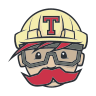</a> <strong>Travis CI</strong> <a href="https://docs.travis-ci.com/">https://docs.travis-ci.com /<wbr></a></td></tr></table></td><td valign="top" width="33%"><table><tr><td align="center" valign="top" width="50%"><a href="https://docs.docker.com/">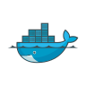</a> <strong>Docker</strong> <a href="https://docs.docker.com/">https://docs.docker.com /<wbr></a></td><td align="center" valign="top" width="50%"> <strong>containerd</strong> <a href="https://containerd.io/docs/">https://containerd.io /<wbr>docs/<wbr></a></td></tr><tr><td align="center" valign="top" width="50%"><a href="https://docs.podman.io/">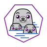</a> <strong>Podman</strong> <a href="https://docs.podman.io/">https://docs.podman.io /<wbr></a></td><td align="center" valign="top" width="50%"><a href="https://buildah.io/">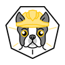</a> <strong>Buildah</strong> <a href="https://buildah.io/">https://buildah.io /<wbr></a></td></tr><tr><td align="center" valign="top" width="50%"> <strong>BuildKit</strong> <a href="https://docs.docker.com/build/buildkit/">https://docs.docker.com /<wbr>build/<wbr>buildkit/<wbr></a></td><td align="center" valign="top" width="50%"> <strong>Skopeo</strong> <a href="https://github.com/containers/skopeo/tree/main/docs">https://github.com /<wbr>containers/<wbr>skopeo/<wbr>tree/<wbr>main/<wbr>docs</a></td></tr><tr><td align="center" valign="top" width="50%"> <strong>Harbor</strong> <a href="https://goharbor.io/docs/">https://goharbor.io /<wbr>docs/<wbr></a></td><td align="center" valign="top" width="50%"> <strong>Portainer</strong> <a href="https://docs.portainer.io/">https://docs.portainer.io /<wbr></a></td></tr></table></td>
</tr>
<tr>
<td valign="top" width="33%"><table><tr><td align="center" valign="top" width="50%"> <strong>Kubernetes</strong> <a href="https://kubernetes.io/docs/">https://kubernetes.io /<wbr>docs/<wbr></a></td><td align="center" valign="top" width="50%"> <strong>OpenShift</strong> <a href="https://docs.redhat.com/en/documentation/openshift_container_platform">https://docs.redhat.com /<wbr>en/<wbr>documentation/<wbr>openshift_container_platform</a></td></tr><tr><td align="center" valign="top" width="50%"> <strong>Rancher</strong> <a href="https://ranchermanager.docs.rancher.com/">https://ranchermanager.docs.rancher.com /<wbr></a></td><td align="center" valign="top" width="50%"> <strong>Nomad</strong> <a href="https://developer.hashicorp.com/nomad/docs">https://developer.hashicorp.com /<wbr>nomad/<wbr>docs</a></td></tr><tr><td align="center" valign="top" width="50%"> <strong>K3s</strong> <a href="https://docs.k3s.io/">https://docs.k3s.io /<wbr></a></td><td align="center" valign="top" width="50%"> <strong>Helm</strong> <a href="https://helm.sh/docs/">https://helm.sh /<wbr>docs/<wbr></a></td></tr><tr><td align="center" valign="top" width="50%"> <strong>Docker Swarm</strong> <a href="https://docs.docker.com/engine/swarm/">https://docs.docker.com /<wbr>engine/<wbr>swarm/<wbr></a></td><td align="center" valign="top" width="50%"> <strong>Talos Linux</strong> <a href="https://www.talos.dev/">https://www.talos.dev /<wbr></a></td></tr></table></td><td valign="top" width="33%"><table><tr><td align="center" valign="top" width="50%"> <strong>Terraform</strong> <a href="https://developer.hashicorp.com/terraform/docs">https://developer.hashicorp.com /<wbr>terraform/<wbr>docs</a></td><td align="center" valign="top" width="50%"> <strong>OpenTofu</strong> <a href="https://opentofu.org/docs/">https://opentofu.org /<wbr>docs/<wbr></a></td></tr><tr><td align="center" valign="top" width="50%"> <strong>Pulumi</strong> <a href="https://www.pulumi.com/docs/">https://www.pulumi.com /<wbr>docs/<wbr></a></td><td align="center" valign="top" width="50%"> <strong>CloudFormation</strong> <a href="https://docs.aws.amazon.com/cloudformation/">https://docs.aws.amazon.com /<wbr>cloudformation/<wbr></a></td></tr><tr><td align="center" valign="top" width="50%"> <strong>Packer</strong> <a href="https://developer.hashicorp.com/packer/docs">https://developer.hashicorp.com /<wbr>packer/<wbr>docs</a></td><td align="center" valign="top" width="50%"> <strong>Vagrant</strong> <a href="https://developer.hashicorp.com/vagrant/docs">https://developer.hashicorp.com /<wbr>vagrant/<wbr>docs</a></td></tr><tr><td align="center" valign="top" width="50%"> <strong>Crossplane</strong> <a href="https://docs.crossplane.io/">https://docs.crossplane.io /<wbr></a></td><td align="center" valign="top" width="50%"> <strong>Terramate</strong> <a href="https://terramate.io/docs/">https://terramate.io /<wbr>docs/<wbr></a></td></tr></table></td><td valign="top" width="33%"><table><tr><td align="center" valign="top" width="50%"> <strong>Ansible</strong> <a href="https://docs.ansible.com/">https://docs.ansible.com /<wbr></a></td><td align="center" valign="top" width="50%"> <strong>Chef</strong> <a href="https://docs.chef.io/">https://docs.chef.io /<wbr></a></td></tr><tr><td align="center" valign="top" width="50%"> <strong>Puppet</strong> <a href="https://www.puppet.com/docs">https://www.puppet.com /<wbr>docs</a></td><td align="center" valign="top" width="50%"> <strong>Salt</strong> <a href="https://docs.saltproject.io/">https://docs.saltproject.io /<wbr></a></td></tr><tr><td align="center" valign="top" width="50%"> <strong>AWX</strong> <a href="https://ansible.readthedocs.io/projects/awx/en/latest/">https://ansible.readthedocs.io /<wbr>projects/<wbr>awx/<wbr>en/<wbr>latest/<wbr></a></td><td align="center" valign="top" width="50%"> <strong>CFEngine</strong> <a href="https://docs.cfengine.com/">https://docs.cfengine.com /<wbr></a></td></tr><tr><td align="center" valign="top" width="50%"> <strong>NixOS</strong> <a href="https://nixos.org/manual/nixos/stable/">https://nixos.org /<wbr>manual/<wbr>nixos/<wbr>stable/<wbr></a></td><td align="center" valign="top" width="50%"> <strong>PowerShell DSC</strong> <a href="https://learn.microsoft.com/en-us/powershell/dsc/overview">https://learn.microsoft.com /<wbr>en-us/<wbr>powershell/<wbr>dsc/<wbr>overview</a></td></tr></table></td>
</tr>
<tr>
<td valign="top" width="33%"><table><tr><td align="center" valign="top" width="50%"> <strong>AWS</strong> <a href="https://docs.aws.amazon.com/">https://docs.aws.amazon.com /<wbr></a></td><td align="center" valign="top" width="50%"> <strong>Microsoft Azure</strong> <a href="https://learn.microsoft.com/en-us/azure/">https://learn.microsoft.com /<wbr>en-us/<wbr>azure/<wbr></a></td></tr><tr><td align="center" valign="top" width="50%"> <strong>Google Cloud</strong> <a href="https://cloud.google.com/docs">https://cloud.google.com /<wbr>docs</a></td><td align="center" valign="top" width="50%"> <strong>Oracle Cloud</strong> <a href="https://docs.oracle.com/en-us/iaas/Content/home.htm">https://docs.oracle.com /<wbr>en-us/<wbr>iaas/<wbr>Content/<wbr>home.htm</a></td></tr><tr><td align="center" valign="top" width="50%"> <strong>DigitalOcean</strong> <a href="https://docs.digitalocean.com/">https://docs.digitalocean.com /<wbr></a></td><td align="center" valign="top" width="50%"> <strong>IBM Cloud</strong> <a href="https://cloud.ibm.com/docs">https://cloud.ibm.com /<wbr>docs</a></td></tr><tr><td align="center" valign="top" width="50%"> <strong>Alibaba Cloud</strong> <a href="https://www.alibabacloud.com/help/">https://www.alibabacloud.com /<wbr>help/<wbr></a></td><td align="center" valign="top" width="50%"> <strong>Hetzner</strong> <a href="https://docs.hetzner.com/">https://docs.hetzner.com /<wbr></a></td></tr></table></td><td valign="top" width="33%"><table><tr><td align="center" valign="top" width="50%"> <strong>Prometheus</strong> <a href="https://prometheus.io/docs/">https://prometheus.io /<wbr>docs/<wbr></a></td><td align="center" valign="top" width="50%"> <strong>Grafana</strong> <a href="https://grafana.com/docs/">https://grafana.com /<wbr>docs/<wbr></a></td></tr><tr><td align="center" valign="top" width="50%"> <strong>Datadog</strong> <a href="https://docs.datadoghq.com/">https://docs.datadoghq.com /<wbr></a></td><td align="center" valign="top" width="50%"><a href="https://docs.newrelic.com/">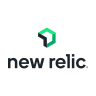</a> <strong>New Relic</strong> <a href="https://docs.newrelic.com/">https://docs.newrelic.com /<wbr></a></td></tr><tr><td align="center" valign="top" width="50%"> <strong>OpenTelemetry</strong> <a href="https://opentelemetry.io/docs/">https://opentelemetry.io /<wbr>docs/<wbr></a></td><td align="center" valign="top" width="50%"><a href="https://www.jaegertracing.io/docs/">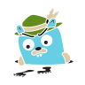</a> <strong>Jaeger</strong> <a href="https://www.jaegertracing.io/docs/">https://www.jaegertracing.io /<wbr>docs/<wbr></a></td></tr><tr><td align="center" valign="top" width="50%"> <strong>Dynatrace</strong> <a href="https://docs.dynatrace.com/">https://docs.dynatrace.com /<wbr></a></td><td align="center" valign="top" width="50%"> <strong>Zabbix</strong> <a href="https://www.zabbix.com/documentation/current/en/manual">https://www.zabbix.com /<wbr>documentation/<wbr>current/<wbr>en/<wbr>manual</a></td></tr></table></td><td valign="top" width="33%"><table><tr><td align="center" valign="top" width="50%"> <strong>Elasticsearch</strong> <a href="https://www.elastic.co/docs">https://www.elastic.co /<wbr>docs</a></td><td align="center" valign="top" width="50%"> <strong>Logstash</strong> <a href="https://www.elastic.co/docs/reference/logstash">https://www.elastic.co /<wbr>docs/<wbr>reference/<wbr>logstash</a></td></tr><tr><td align="center" valign="top" width="50%"> <strong>Kibana</strong> <a href="https://www.elastic.co/docs/explore-analyze">https://www.elastic.co /<wbr>docs/<wbr>explore-analyze</a></td><td align="center" valign="top" width="50%"> <strong>Loki</strong> <a href="https://grafana.com/docs/loki/latest/">https://grafana.com /<wbr>docs/<wbr>loki/<wbr>latest/<wbr></a></td></tr><tr><td align="center" valign="top" width="50%"> <strong>Fluentd</strong> <a href="https://docs.fluentd.org/">https://docs.fluentd.org /<wbr></a></td><td align="center" valign="top" width="50%"> <strong>Fluent Bit</strong> <a href="https://docs.fluentbit.io/">https://docs.fluentbit.io /<wbr></a></td></tr><tr><td align="center" valign="top" width="50%"> <strong>Splunk</strong> <a href="https://docs.splunk.com/">https://docs.splunk.com /<wbr></a></td><td align="center" valign="top" width="50%"> <strong>Elastic Beats</strong> <a href="https://www.elastic.co/docs/reference/beats">https://www.elastic.co /<wbr>docs/<wbr>reference/<wbr>beats</a></td></tr></table></td>
</tr>
<tr>
<td valign="top" width="33%"><table><tr><td align="center" valign="top" width="50%"> <strong>NGINX</strong> <a href="https://nginx.org/en/docs/">https://nginx.org /<wbr>en/<wbr>docs/<wbr></a></td><td align="center" valign="top" width="50%"> <strong>HAProxy</strong> <a href="https://www.haproxy.org/#docs">https://www.haproxy.org /<wbr>#docs</a></td></tr><tr><td align="center" valign="top" width="50%"> <strong>Traefik</strong> <a href="https://doc.traefik.io/traefik/">https://doc.traefik.io /<wbr>traefik/<wbr></a></td><td align="center" valign="top" width="50%"> <strong>Cilium</strong> <a href="https://docs.cilium.io/">https://docs.cilium.io /<wbr></a></td></tr><tr><td align="center" valign="top" width="50%"> <strong>Calico</strong> <a href="https://docs.tigera.io/calico/latest/about">https://docs.tigera.io /<wbr>calico/<wbr>latest/<wbr>about</a></td><td align="center" valign="top" width="50%"> <strong>CoreDNS</strong> <a href="https://coredns.io/manual/toc/">https://coredns.io /<wbr>manual/<wbr>toc/<wbr></a></td></tr><tr><td align="center" valign="top" width="50%"> <strong>Cloudflare</strong> <a href="https://developers.cloudflare.com/">https://developers.cloudflare.com /<wbr></a></td><td align="center" valign="top" width="50%"> <strong>WireGuard</strong> <a href="https://www.wireguard.com/quickstart/">https://www.wireguard.com /<wbr>quickstart/<wbr></a></td></tr></table></td><td valign="top" width="33%"><table><tr><td align="center" valign="top" width="50%"> <strong>Istio</strong> <a href="https://istio.io/latest/docs/">https://istio.io /<wbr>latest/<wbr>docs/<wbr></a></td><td align="center" valign="top" width="50%"> <strong>Linkerd</strong> <a href="https://linkerd.io/2/overview/">https://linkerd.io /<wbr>2/<wbr>overview/<wbr></a></td></tr><tr><td align="center" valign="top" width="50%"> <strong>Consul</strong> <a href="https://developer.hashicorp.com/consul/docs">https://developer.hashicorp.com /<wbr>consul/<wbr>docs</a></td><td align="center" valign="top" width="50%"> <strong>Envoy</strong> <a href="https://www.envoyproxy.io/docs">https://www.envoyproxy.io /<wbr>docs</a></td></tr><tr><td align="center" valign="top" width="50%"> <strong>Kuma</strong> <a href="https://kuma.io/docs/">https://kuma.io /<wbr>docs/<wbr></a></td><td align="center" valign="top" width="50%"> <strong>Kong Gateway</strong> <a href="https://developer.konghq.com/gateway/">https://developer.konghq.com /<wbr>gateway/<wbr></a></td></tr><tr><td align="center" valign="top" width="50%"> <strong>Envoy Gateway</strong> <a href="https://gateway.envoyproxy.io/docs/">https://gateway.envoyproxy.io /<wbr>docs/<wbr></a></td><td align="center" valign="top" width="50%"><a href="https://cert-manager.io/docs/">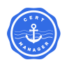</a> <strong>cert-manager</strong> <a href="https://cert-manager.io/docs/">https://cert-manager.io /<wbr>docs/<wbr></a></td></tr></table></td><td valign="top" width="33%"><table><tr><td align="center" valign="top" width="50%"> <strong>PostgreSQL</strong> <a href="https://www.postgresql.org/docs/">https://www.postgresql.org /<wbr>docs/<wbr></a></td><td align="center" valign="top" width="50%"> <strong>MySQL</strong> <a href="https://dev.mysql.com/doc/">https://dev.mysql.com /<wbr>doc/<wbr></a></td></tr><tr><td align="center" valign="top" width="50%"> <strong>MongoDB</strong> <a href="https://www.mongodb.com/docs/">https://www.mongodb.com /<wbr>docs/<wbr></a></td><td align="center" valign="top" width="50%"> <strong>Redis</strong> <a href="https://redis.io/docs/latest/">https://redis.io /<wbr>docs/<wbr>latest/<wbr></a></td></tr><tr><td align="center" valign="top" width="50%"> <strong>Cassandra</strong> <a href="https://cassandra.apache.org/doc/latest/">https://cassandra.apache.org /<wbr>doc/<wbr>latest/<wbr></a></td><td align="center" valign="top" width="50%"> <strong>MariaDB</strong> <a href="https://mariadb.com/docs/">https://mariadb.com /<wbr>docs/<wbr></a></td></tr><tr><td align="center" valign="top" width="50%"> <strong>SQLite</strong> <a href="https://www.sqlite.org/docs.html">https://www.sqlite.org /<wbr>docs.html</a></td><td align="center" valign="top" width="50%"> <strong>ClickHouse</strong> <a href="https://clickhouse.com/docs">https://clickhouse.com /<wbr>docs</a></td></tr></table></td>
</tr>
<tr>
<td valign="top" width="33%"><table><tr><td align="center" valign="top" width="50%"> <strong>RabbitMQ</strong> <a href="https://www.rabbitmq.com/docs">https://www.rabbitmq.com /<wbr>docs</a></td><td align="center" valign="top" width="50%"> <strong>Apache Kafka</strong> <a href="https://kafka.apache.org/documentation/">https://kafka.apache.org /<wbr>documentation/<wbr></a></td></tr><tr><td align="center" valign="top" width="50%"> <strong>NATS</strong> <a href="https://docs.nats.io/">https://docs.nats.io /<wbr></a></td><td align="center" valign="top" width="50%"> <strong>Apache Pulsar</strong> <a href="https://pulsar.apache.org/docs/">https://pulsar.apache.org /<wbr>docs/<wbr></a></td></tr><tr><td align="center" valign="top" width="50%"> <strong>Redis Streams</strong> <a href="https://redis.io/docs/latest/develop/data-types/streams/">https://redis.io /<wbr>docs/<wbr>latest/<wbr>develop/<wbr>data-types/<wbr>streams/<wbr></a></td><td align="center" valign="top" width="50%"> <strong>Apache Spark</strong> <a href="https://spark.apache.org/docs/latest/">https://spark.apache.org /<wbr>docs/<wbr>latest/<wbr></a></td></tr><tr><td align="center" valign="top" width="50%"> <strong>Apache Flink</strong> <a href="https://nightlies.apache.org/flink/flink-docs-stable/">https://nightlies.apache.org /<wbr>flink/<wbr>flink-docs-stable/<wbr></a></td><td align="center" valign="top" width="50%"> <strong>ActiveMQ</strong> <a href="https://activemq.apache.org/components/">https://activemq.apache.org /<wbr>components/<wbr></a></td></tr></table></td><td valign="top" width="33%"><table><tr><td align="center" valign="top" width="50%"> <strong>Vault</strong> <a href="https://developer.hashicorp.com/vault/docs">https://developer.hashicorp.com /<wbr>vault/<wbr>docs</a></td><td align="center" valign="top" width="50%"> <strong>Keycloak</strong> <a href="https://www.keycloak.org/documentation">https://www.keycloak.org /<wbr>documentation</a></td></tr><tr><td align="center" valign="top" width="50%"> <strong>Trivy</strong> <a href="https://trivy.dev/">https://trivy.dev /<wbr></a></td><td align="center" valign="top" width="50%"> <strong>Falco</strong> <a href="https://falco.org/docs/">https://falco.org /<wbr>docs/<wbr></a></td></tr><tr><td align="center" valign="top" width="50%"> <strong>SOPS</strong> <a href="https://getsops.io/docs/">https://getsops.io /<wbr>docs/<wbr></a></td><td align="center" valign="top" width="50%"> <strong>Sigstore</strong> <a href="https://docs.sigstore.dev/">https://docs.sigstore.dev /<wbr></a></td></tr><tr><td align="center" valign="top" width="50%"> <strong>Kyverno</strong> <a href="https://kyverno.io/docs/">https://kyverno.io /<wbr>docs/<wbr></a></td><td align="center" valign="top" width="50%"> <strong>Open Policy Agent</strong> <a href="https://www.openpolicyagent.org/docs/">https://www.openpolicyagent.org /<wbr>docs/<wbr></a></td></tr></table></td><td valign="top" width="33%"><table><tr><td align="center" valign="top" width="50%"> <strong>Harbor</strong> <a href="https://goharbor.io/docs/">https://goharbor.io /<wbr>docs/<wbr></a></td><td align="center" valign="top" width="50%"> <strong>JFrog Artifactory</strong> <a href="https://jfrog.com/help/">https://jfrog.com /<wbr>help/<wbr></a></td></tr><tr><td align="center" valign="top" width="50%"> <strong>Nexus Repository</strong> <a href="https://help.sonatype.com/en/sonatype-nexus-repository.html">https://help.sonatype.com /<wbr>en/<wbr>sonatype-nexus-repository.html</a></td><td align="center" valign="top" width="50%"> <strong>Docker Hub</strong> <a href="https://docs.docker.com/docker-hub/">https://docs.docker.com /<wbr>docker-hub/<wbr></a></td></tr><tr><td align="center" valign="top" width="50%"> <strong>GitHub Packages</strong> <a href="https://docs.github.com/en/packages">https://docs.github.com /<wbr>en/<wbr>packages</a></td><td align="center" valign="top" width="50%"> <strong>GitLab Registry</strong> <a href="https://docs.gitlab.com/user/packages/container_registry/">https://docs.gitlab.com /<wbr>user/<wbr>packages/<wbr>container_registry/<wbr></a></td></tr><tr><td align="center" valign="top" width="50%"> <strong>Helm Charts</strong> <a href="https://helm.sh/docs/topics/charts/">https://helm.sh /<wbr>docs/<wbr>topics/<wbr>charts/<wbr></a></td><td align="center" valign="top" width="50%"> <strong>NuGet</strong> <a href="https://learn.microsoft.com/en-us/nuget/">https://learn.microsoft.com /<wbr>en-us/<wbr>nuget/<wbr></a></td></tr></table></td>
</tr>
<tr>
<td valign="top" width="33%"><table><tr><td align="center" valign="top" width="50%"> <strong>Jira</strong> <a href="https://support.atlassian.com/jira-software-cloud/">https://support.atlassian.com /<wbr>jira-software-cloud/<wbr></a></td><td align="center" valign="top" width="50%"> <strong>Confluence</strong> <a href="https://support.atlassian.com/confluence/">https://support.atlassian.com /<wbr>confluence/<wbr></a></td></tr><tr><td align="center" valign="top" width="50%"> <strong>Slack</strong> <a href="https://docs.slack.dev/">https://docs.slack.dev /<wbr></a></td><td align="center" valign="top" width="50%"> <strong>Microsoft Teams</strong> <a href="https://learn.microsoft.com/en-us/microsoftteams/">https://learn.microsoft.com /<wbr>en-us/<wbr>microsoftteams/<wbr></a></td></tr><tr><td align="center" valign="top" width="50%"> <strong>Trello</strong> <a href="https://support.atlassian.com/trello/">https://support.atlassian.com /<wbr>trello/<wbr></a></td><td align="center" valign="top" width="50%"> <strong>Notion</strong> <a href="https://developers.notion.com/">https://developers.notion.com /<wbr></a></td></tr><tr><td align="center" valign="top" width="50%"> <strong>Linear</strong> <a href="https://linear.app/docs">https://linear.app /<wbr>docs</a></td><td align="center" valign="top" width="50%"> <strong>Mattermost</strong> <a href="https://docs.mattermost.com/">https://docs.mattermost.com /<wbr></a></td></tr></table></td><td valign="top" width="33%"><table><tr><td align="center" valign="top" width="50%"> <strong>Bash</strong> <a href="https://www.gnu.org/software/bash/manual/">https://www.gnu.org /<wbr>software/<wbr>bash/<wbr>manual/<wbr></a></td><td align="center" valign="top" width="50%"><a href="https://docs.python.org/3/">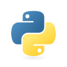</a> <strong>Python</strong> <a href="https://docs.python.org/3/">https://docs.python.org /<wbr>3/<wbr></a></td></tr><tr><td align="center" valign="top" width="50%"> <strong>PowerShell</strong> <a href="https://learn.microsoft.com/en-us/powershell/">https://learn.microsoft.com /<wbr>en-us/<wbr>powershell/<wbr></a></td><td align="center" valign="top" width="50%"><a href="https://go.dev/doc/">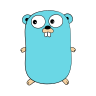</a> <strong>Go</strong> <a href="https://go.dev/doc/">https://go.dev /<wbr>doc/<wbr></a></td></tr><tr><td align="center" valign="top" width="50%"> <strong>Perl</strong> <a href="https://perldoc.perl.org/">https://perldoc.perl.org /<wbr></a></td><td align="center" valign="top" width="50%"> <strong>Ruby</strong> <a href="https://www.ruby-lang.org/en/documentation/">https://www.ruby-lang.org /<wbr>en/<wbr>documentation/<wbr></a></td></tr><tr><td align="center" valign="top" width="50%"> <strong>Node.js</strong> <a href="https://nodejs.org/en/learn">https://nodejs.org /<wbr>en/<wbr>learn</a></td><td align="center" valign="top" width="50%"> <strong>GNU Make</strong> <a href="https://www.gnu.org/software/make/manual/">https://www.gnu.org /<wbr>software/<wbr>make/<wbr>manual/<wbr></a></td></tr></table></td><td valign="top" width="33%"><table><tr><td align="center" valign="top" width="50%"> <strong>Argo CD</strong> <a href="https://argo-cd.readthedocs.io/en/stable/">https://argo-cd.readthedocs.io /<wbr>en/<wbr>stable/<wbr></a></td><td align="center" valign="top" width="50%"> <strong>Flux</strong> <a href="https://fluxcd.io/flux/">https://fluxcd.io /<wbr>flux/<wbr></a></td></tr><tr><td align="center" valign="top" width="50%"> <strong>Tekton</strong> <a href="https://tekton.dev/docs/">https://tekton.dev /<wbr>docs/<wbr></a></td><td align="center" valign="top" width="50%"> <strong>Backstage</strong> <a href="https://backstage.io/docs/">https://backstage.io /<wbr>docs/<wbr></a></td></tr><tr><td align="center" valign="top" width="50%"> <strong>Apache Airflow</strong> <a href="https://airflow.apache.org/docs/">https://airflow.apache.org /<wbr>docs/<wbr></a></td><td align="center" valign="top" width="50%"> <strong>SonarQube</strong> <a href="https://docs.sonarsource.com/sonarqube-server/">https://docs.sonarsource.com /<wbr>sonarqube-server/<wbr></a></td></tr><tr><td align="center" valign="top" width="50%"> <strong>Kubeflow</strong> <a href="https://www.kubeflow.org/docs/">https://www.kubeflow.org /<wbr>docs/<wbr></a></td><td align="center" valign="top" width="50%"> <strong>Crossplane</strong> <a href="https://docs.crossplane.io/">https://docs.crossplane.io /<wbr></a></td></tr></table></td>
</tr>
<tr>
<td valign="top" width="33%"><table><tr><td align="center" valign="top" width="50%"> <strong>Maven</strong> <a href="https://maven.apache.org/guides/">https://maven.apache.org /<wbr>guides/<wbr></a></td><td align="center" valign="top" width="50%"> <strong>Gradle</strong> <a href="https://docs.gradle.org/">https://docs.gradle.org /<wbr></a></td></tr><tr><td align="center" valign="top" width="50%"> <strong>Bazel</strong> <a href="https://bazel.build/docs">https://bazel.build /<wbr>docs</a></td><td align="center" valign="top" width="50%"> <strong>npm</strong> <a href="https://docs.npmjs.com/">https://docs.npmjs.com /<wbr></a></td></tr><tr><td align="center" valign="top" width="50%"> <strong>pytest</strong> <a href="https://docs.pytest.org/">https://docs.pytest.org /<wbr></a></td><td align="center" valign="top" width="50%"> <strong>Playwright</strong> <a href="https://playwright.dev/docs/intro">https://playwright.dev /<wbr>docs/<wbr>intro</a></td></tr><tr><td align="center" valign="top" width="50%"><a href="https://grafana.com/docs/k6/latest/">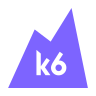</a> <strong>k6</strong> <a href="https://grafana.com/docs/k6/latest/">https://grafana.com /<wbr>docs/<wbr>k6/<wbr>latest/<wbr></a></td><td align="center" valign="top" width="50%"> <strong>Cypress</strong> <a href="https://docs.cypress.io/">https://docs.cypress.io /<wbr></a></td></tr></table></td>
</tr>
</table>

Related services share the relevant product or vendor mark where appropriate—for example, GitHub Packages, GitLab Registry, CloudFormation, and BuildKit.

#### Tool quick reference

| Category | Tool | Official documentation |
| --- | --- | --- |
| Version Control | Git | https://git-scm.com/doc |
| Version Control | GitHub | https://docs.github.com/ |
| Version Control | GitLab | https://docs.gitlab.com/ |
| Version Control | Bitbucket | https://support.atlassian.com/bitbucket-cloud/ |
| Version Control | Gitea | https://docs.gitea.com/ |
| Version Control | Forgejo | https://forgejo.org/docs/latest/ |
| Version Control | Mercurial | https://www.mercurial-scm.org/help/commands |
| Version Control | Subversion | https://subversion.apache.org/docs/ |
| CI/CD | Jenkins | https://www.jenkins.io/doc/ |
| CI/CD | GitHub Actions | https://docs.github.com/en/actions |
| CI/CD | GitLab CI/CD | https://docs.gitlab.com/ci/ |
| CI/CD | CircleCI | https://circleci.com/docs/ |
| CI/CD | Azure Pipelines | https://learn.microsoft.com/en-us/azure/devops/pipelines/ |
| CI/CD | TeamCity | https://www.jetbrains.com/help/teamcity/ |
| CI/CD | Buildkite | https://buildkite.com/docs |
| CI/CD | Travis CI | https://docs.travis-ci.com/ |
| Containerization | Docker | https://docs.docker.com/ |
| Containerization | containerd | https://containerd.io/docs/ |
| Containerization | Podman | https://docs.podman.io/ |
| Containerization | Buildah | https://buildah.io/ |
| Containerization | BuildKit | https://docs.docker.com/build/buildkit/ |
| Containerization | Skopeo | https://github.com/containers/skopeo/tree/main/docs |
| Containerization | Harbor | https://goharbor.io/docs/ |
| Containerization | Portainer | https://docs.portainer.io/ |
| Orchestration | Kubernetes | https://kubernetes.io/docs/ |
| Orchestration | OpenShift | https://docs.redhat.com/en/documentation/openshift_container_platform |
| Orchestration | Rancher | https://ranchermanager.docs.rancher.com/ |
| Orchestration | Nomad | https://developer.hashicorp.com/nomad/docs |
| Orchestration | K3s | https://docs.k3s.io/ |
| Orchestration | Helm | https://helm.sh/docs/ |
| Orchestration | Docker Swarm | https://docs.docker.com/engine/swarm/ |
| Orchestration | Talos Linux | https://www.talos.dev/ |
| Infrastructure as Code | Terraform | https://developer.hashicorp.com/terraform/docs |
| Infrastructure as Code | OpenTofu | https://opentofu.org/docs/ |
| Infrastructure as Code | Pulumi | https://www.pulumi.com/docs/ |
| Infrastructure as Code | CloudFormation | https://docs.aws.amazon.com/cloudformation/ |
| Infrastructure as Code | Packer | https://developer.hashicorp.com/packer/docs |
| Infrastructure as Code | Vagrant | https://developer.hashicorp.com/vagrant/docs |
| Infrastructure as Code | Crossplane | https://docs.crossplane.io/ |
| Infrastructure as Code | Terramate | https://terramate.io/docs/ |
| Configuration Management | Ansible | https://docs.ansible.com/ |
| Configuration Management | Chef | https://docs.chef.io/ |
| Configuration Management | Puppet | https://www.puppet.com/docs |
| Configuration Management | Salt | https://docs.saltproject.io/ |
| Configuration Management | AWX | https://ansible.readthedocs.io/projects/awx/en/latest/ |
| Configuration Management | CFEngine | https://docs.cfengine.com/ |
| Configuration Management | NixOS | https://nixos.org/manual/nixos/stable/ |
| Configuration Management | PowerShell DSC | https://learn.microsoft.com/en-us/powershell/dsc/overview |
| Cloud Platforms | AWS | https://docs.aws.amazon.com/ |
| Cloud Platforms | Microsoft Azure | https://learn.microsoft.com/en-us/azure/ |
| Cloud Platforms | Google Cloud | https://cloud.google.com/docs |
| Cloud Platforms | Oracle Cloud | https://docs.oracle.com/en-us/iaas/Content/home.htm |
| Cloud Platforms | DigitalOcean | https://docs.digitalocean.com/ |
| Cloud Platforms | IBM Cloud | https://cloud.ibm.com/docs |
| Cloud Platforms | Alibaba Cloud | https://www.alibabacloud.com/help/ |
| Cloud Platforms | Hetzner | https://docs.hetzner.com/ |
| Monitoring and Observability | Prometheus | https://prometheus.io/docs/ |
| Monitoring and Observability | Grafana | https://grafana.com/docs/ |
| Monitoring and Observability | Datadog | https://docs.datadoghq.com/ |
| Monitoring and Observability | New Relic | https://docs.newrelic.com/ |
| Monitoring and Observability | OpenTelemetry | https://opentelemetry.io/docs/ |
| Monitoring and Observability | Jaeger | https://www.jaegertracing.io/docs/ |
| Monitoring and Observability | Dynatrace | https://docs.dynatrace.com/ |
| Monitoring and Observability | Zabbix | https://www.zabbix.com/documentation/current/en/manual |
| Logging | Elasticsearch | https://www.elastic.co/docs |
| Logging | Logstash | https://www.elastic.co/docs/reference/logstash |
| Logging | Kibana | https://www.elastic.co/docs/explore-analyze |
| Logging | Loki | https://grafana.com/docs/loki/latest/ |
| Logging | Fluentd | https://docs.fluentd.org/ |
| Logging | Fluent Bit | https://docs.fluentbit.io/ |
| Logging | Splunk | https://docs.splunk.com/ |
| Logging | Elastic Beats | https://www.elastic.co/docs/reference/beats |
| Networking and Ingress | NGINX | https://nginx.org/en/docs/ |
| Networking and Ingress | HAProxy | https://www.haproxy.org/#docs |
| Networking and Ingress | Traefik | https://doc.traefik.io/traefik/ |
| Networking and Ingress | Cilium | https://docs.cilium.io/ |
| Networking and Ingress | Calico | https://docs.tigera.io/calico/latest/about |
| Networking and Ingress | CoreDNS | https://coredns.io/manual/toc/ |
| Networking and Ingress | Cloudflare | https://developers.cloudflare.com/ |
| Networking and Ingress | WireGuard | https://www.wireguard.com/quickstart/ |
| Service Mesh and Traffic | Istio | https://istio.io/latest/docs/ |
| Service Mesh and Traffic | Linkerd | https://linkerd.io/2/overview/ |
| Service Mesh and Traffic | Consul | https://developer.hashicorp.com/consul/docs |
| Service Mesh and Traffic | Envoy | https://www.envoyproxy.io/docs |
| Service Mesh and Traffic | Kuma | https://kuma.io/docs/ |
| Service Mesh and Traffic | Kong Gateway | https://developer.konghq.com/gateway/ |
| Service Mesh and Traffic | Envoy Gateway | https://gateway.envoyproxy.io/docs/ |
| Service Mesh and Traffic | cert-manager | https://cert-manager.io/docs/ |
| Databases and Data Stores | PostgreSQL | https://www.postgresql.org/docs/ |
| Databases and Data Stores | MySQL | https://dev.mysql.com/doc/ |
| Databases and Data Stores | MongoDB | https://www.mongodb.com/docs/ |
| Databases and Data Stores | Redis | https://redis.io/docs/latest/ |
| Databases and Data Stores | Cassandra | https://cassandra.apache.org/doc/latest/ |
| Databases and Data Stores | MariaDB | https://mariadb.com/docs/ |
| Databases and Data Stores | SQLite | https://www.sqlite.org/docs.html |
| Databases and Data Stores | ClickHouse | https://clickhouse.com/docs |
| Queues and Streaming | RabbitMQ | https://www.rabbitmq.com/docs |
| Queues and Streaming | Apache Kafka | https://kafka.apache.org/documentation/ |
| Queues and Streaming | NATS | https://docs.nats.io/ |
| Queues and Streaming | Apache Pulsar | https://pulsar.apache.org/docs/ |
| Queues and Streaming | Redis Streams | https://redis.io/docs/latest/develop/data-types/streams/ |
| Queues and Streaming | Apache Spark | https://spark.apache.org/docs/latest/ |
| Queues and Streaming | Apache Flink | https://nightlies.apache.org/flink/flink-docs-stable/ |
| Queues and Streaming | ActiveMQ | https://activemq.apache.org/components/ |
| Security and Secrets | Vault | https://developer.hashicorp.com/vault/docs |
| Security and Secrets | Keycloak | https://www.keycloak.org/documentation |
| Security and Secrets | Trivy | https://trivy.dev/ |
| Security and Secrets | Falco | https://falco.org/docs/ |
| Security and Secrets | SOPS | https://getsops.io/docs/ |
| Security and Secrets | Sigstore | https://docs.sigstore.dev/ |
| Security and Secrets | Kyverno | https://kyverno.io/docs/ |
| Security and Secrets | Open Policy Agent | https://www.openpolicyagent.org/docs/ |
| Artifact and Package Management | Harbor | https://goharbor.io/docs/ |
| Artifact and Package Management | JFrog Artifactory | https://jfrog.com/help/ |
| Artifact and Package Management | Nexus Repository | https://help.sonatype.com/en/sonatype-nexus-repository.html |
| Artifact and Package Management | Docker Hub | https://docs.docker.com/docker-hub/ |
| Artifact and Package Management | GitHub Packages | https://docs.github.com/en/packages |
| Artifact and Package Management | GitLab Registry | https://docs.gitlab.com/user/packages/container_registry/ |
| Artifact and Package Management | Helm Charts | https://helm.sh/docs/topics/charts/ |
| Artifact and Package Management | NuGet | https://learn.microsoft.com/en-us/nuget/ |
| Collaboration and Planning | Jira | https://support.atlassian.com/jira-software-cloud/ |
| Collaboration and Planning | Confluence | https://support.atlassian.com/confluence/ |
| Collaboration and Planning | Slack | https://docs.slack.dev/ |
| Collaboration and Planning | Microsoft Teams | https://learn.microsoft.com/en-us/microsoftteams/ |
| Collaboration and Planning | Trello | https://support.atlassian.com/trello/ |
| Collaboration and Planning | Notion | https://developers.notion.com/ |
| Collaboration and Planning | Linear | https://linear.app/docs |
| Collaboration and Planning | Mattermost | https://docs.mattermost.com/ |
| Scripting and Automation | Bash | https://www.gnu.org/software/bash/manual/ |
| Scripting and Automation | Python | https://docs.python.org/3/ |
| Scripting and Automation | PowerShell | https://learn.microsoft.com/en-us/powershell/ |
| Scripting and Automation | Go | https://go.dev/doc/ |
| Scripting and Automation | Perl | https://perldoc.perl.org/ |
| Scripting and Automation | Ruby | https://www.ruby-lang.org/en/documentation/ |
| Scripting and Automation | Node.js | https://nodejs.org/en/learn |
| Scripting and Automation | GNU Make | https://www.gnu.org/software/make/manual/ |
| GitOps and Platforms | Argo CD | https://argo-cd.readthedocs.io/en/stable/ |
| GitOps and Platforms | Flux | https://fluxcd.io/flux/ |
| GitOps and Platforms | Tekton | https://tekton.dev/docs/ |
| GitOps and Platforms | Backstage | https://backstage.io/docs/ |
| GitOps and Platforms | Apache Airflow | https://airflow.apache.org/docs/ |
| GitOps and Platforms | SonarQube | https://docs.sonarsource.com/sonarqube-server/ |
| GitOps and Platforms | Kubeflow | https://www.kubeflow.org/docs/ |
| GitOps and Platforms | Crossplane | https://docs.crossplane.io/ |
| Build and Testing | Maven | https://maven.apache.org/guides/ |
| Build and Testing | Gradle | https://docs.gradle.org/ |
| Build and Testing | Bazel | https://bazel.build/docs |
| Build and Testing | npm | https://docs.npmjs.com/ |
| Build and Testing | pytest | https://docs.pytest.org/ |
| Build and Testing | Playwright | https://playwright.dev/docs/intro |
| Build and Testing | k6 | https://grafana.com/docs/k6/latest/ |
| Build and Testing | Cypress | https://docs.cypress.io/ |

[Back to contents](#contents)

## Linux, networking, Git, and programming

#### Linux: understand the machine before automating it

Learn how a process starts, acquires permissions, opens files and sockets, receives signals, and exits. Connect those behaviors to the service manager, logs, storage, memory pressure, and network state. A useful mental model is more durable than memorizing commands.

| Area | Learn | Demonstrate |
| --- | --- | --- |
| Filesystems | Paths, links, mounts, permissions, ownership, disk usage, inodes | Diagnose a write failure caused by permissions, a full filesystem, or exhausted inodes |
| Processes | PID, parent/child relationships, signals, exit codes, foreground/background jobs | Stop a service gracefully and explain the difference between termination and forced kill |
| Services | Unit configuration, startup dependencies, restart policy, environment | Run a service as a dedicated identity and explain why it failed to start |
| Resources | CPU saturation, load, memory pressure, swap, I/O waits | Distinguish a CPU-bound process from a blocked process |
| Logs | Structured events, timestamps, rotation, retention, sensitive fields | Correlate an application error with a service restart without exposing secrets |
| Access | Users, groups, sudo boundaries, SSH keys, file permissions | Grant a narrowly scoped task without distributing a shared administrator account |
| Packages | Repositories, signatures, dependencies, updates, version constraints | Explain how a package update is tested and reversed |
| Storage | Filesystem versus block device, persistent versus ephemeral data | Restore synthetic application data to a clean instance |

**Practice:** Start a small HTTP service. Break its working directory, listening port, configuration file, and write permission one at a time. For each failure, write the symptom, the evidence, the diagnosis, and the recovery step.

**Resources:** https://linuxjourney.com/ · https://www.kernel.org/doc/html/latest/ · https://www.freedesktop.org/software/systemd/man/latest/ · https://man7.org/linux/man-pages/

#### Networking: follow the request

A request may depend on name resolution, a route, a firewall rule, a transport connection, TLS identity, a proxy, a service endpoint, an application, and a database. Investigate the actual path rather than assuming that a successful ping proves application health.

| Concept | Questions to answer |
| --- | --- |
| DNS | Which resolver answered? What record type and TTL? Is the answer different inside the cluster or private network? |
| TCP and UDP | Was the connection refused, reset, or timed out? Does the application need reliable streams or datagrams? |
| CIDR and routing | Do address ranges overlap? Which route is selected? Where does return traffic go? |
| NAT and firewalls | Which identity or source address does the destination actually see? Which direction is blocked? |
| HTTP | What do the method, status code, headers, timeout, and response body tell you? |
| TLS | Does the certificate match the hostname? Is the chain trusted? Are clock and expiry correct? |
| Load balancing | Are health checks representative? Is traffic distributed across healthy failure domains? |
| Caching | What is the cache key? How is data invalidated? Can stale content be served safely? |

**Practice:** Draw the route from a browser to a service and then to its database. Add the DNS name, port, identity, encryption boundary, and timeout at every hop. Compare that diagram with real logs and connection observations.

**Resources:** https://developer.mozilla.org/en-US/docs/Web/HTTP · https://www.cloudflare.com/learning/ · https://www.wireshark.org/docs/ · https://www.practicalnetworking.net/

#### Git: make changes reviewable and recoverable

Learn commits, branches, remotes, merge conflicts, tags, and the difference between working tree, index, and history. Use small commits that explain the purpose of a change. A pull request should show the problem, the resulting behavior, and verification evidence.

For a shared branch, understand the impact before rewriting history. For a release, connect the source revision to the actual built artifact. A tag alone does not prove that the deployed image came from that source.

**Practice:** Resolve a realistic configuration conflict, revert a bad change, and review a teammate's patch. Explain when a revert creates a new change and why it differs from deleting history.

**Resources:** https://git-scm.com/book/en/v2 · https://docs.github.com/en/pull-requests · https://docs.gitlab.com/topics/git/

#### Automation: write software that handles failure

Bash is useful for composing local commands; Python is often easier for structured data, APIs, retries, and tests; Go is useful for distributable tools and services. Choose the language that keeps the task understandable.

An automation script needs defined inputs, validation, safe defaults, timeouts, clear exit codes, and useful logs. Handle partial success. Distinguish retryable failures from invalid input. Avoid printing secrets and avoid interpreting untrusted input as shell commands.

**Idempotency** means repeated execution with the same intended state has the same intended effect. It does not mean a script can ignore errors. A task that creates a duplicate resource every time it runs needs a different design or an explicit uniqueness key.

**Practice:** Build a small API inventory tool. Paginate results, handle rate limits, redact sensitive fields, and test malformed responses. Make a dry-run mode clearly show intended changes before adding mutation support.

**Resources:** https://www.gnu.org/software/bash/manual/ · https://docs.python.org/3/tutorial/ · https://go.dev/doc/tutorial/ · https://learn.microsoft.com/en-us/powershell/

[Back to contents](#contents)

## Cloud engineering and architecture

#### Choose one cloud, learn transferable concepts

Start with identity, networking, compute, storage, encryption, logs, budgets, and recovery. Learn how the cloud separates accounts or projects, assigns workload identity, exposes managed services, and records administrative activity. Avoid building three shallow copies of the same tutorial before you understand one complete system.

| Capability | AWS examples | Azure examples | Google Cloud examples |
| --- | --- | --- | --- |
| Identity | IAM, IAM Identity Center | Microsoft Entra ID, Azure RBAC | Cloud IAM, service accounts |
| Network boundary | VPC, security groups | Virtual Network, network security groups | VPC, firewall policies |
| Virtual machines | EC2 | Azure Virtual Machines | Compute Engine |
| Object storage | S3 | Blob Storage | Cloud Storage |
| Managed Kubernetes | EKS | AKS | GKE |
| Container execution | ECS, Fargate | Container Apps, Container Instances | Cloud Run |
| Functions | Lambda | Azure Functions | Cloud Run functions |
| Relational data | RDS, Aurora | Azure SQL, Azure Database for PostgreSQL | Cloud SQL, AlloyDB |
| Secrets | Secrets Manager | Key Vault | Secret Manager |
| Operational telemetry | CloudWatch | Azure Monitor | Cloud Monitoring, Cloud Logging |
| Organization | Organizations, accounts | Management groups, subscriptions | Organizations, folders, projects |

These are capability comparisons, not identical services. Networking, isolation, pricing, quotas, and identity semantics differ. Read the service documentation before translating a design.

**Official documentation:** https://docs.aws.amazon.com/ · https://learn.microsoft.com/en-us/azure/ · https://cloud.google.com/docs

#### Design questions for every cloud project

- Who can create, change, read, and delete each resource? How does a workload obtain its identity?
- Which endpoints are public? Which data crosses a network, region, account, or organizational boundary?
- Which failure can the design tolerate: process, host, zone, region, provider dependency, or operator error?
- Which state must survive replacement, and how will it be recovered?
- Which costs grow with traffic, storage, telemetry, egress, or idle capacity?
- Who owns alerts, upgrades, exceptions, and cleanup?

**Practice:** Design a small API with a managed database, private application networking, a controlled public entry point, scoped workload identity, and backup verification. Estimate cost assumptions and compare the design with a simpler managed application service.

#### Managed services and serverless

Managed services move responsibilities; they do not remove ownership. Learn service quotas, retry behavior, regional availability, retention, backups, maintenance, and observability. For serverless workloads, understand cold starts where relevant, concurrency, event delivery, idempotency, and the cost of repeated retries.

A queue-triggered function can process the same event more than once. Use a business-level idempotency strategy where duplicate effects matter. A successful function invocation also does not prove a downstream business transaction completed correctly.

**Architecture resources:** https://docs.aws.amazon.com/wellarchitected/latest/framework/welcome.html · https://learn.microsoft.com/en-us/azure/architecture/ · https://cloud.google.com/architecture/framework

[Back to contents](#contents)

## Containers and Kubernetes in depth

#### Containers: build, distribute, run

An image is a packaged filesystem and metadata; a container is a running instance with isolation provided by the host runtime and kernel. Containers share infrastructure and still need patching, access controls, resource limits, and operational visibility.

| Build concern | Practical expectation |
| --- | --- |
| Reproducibility | Pin dependencies and record base-image identity; explain what can still vary |
| Build context | Exclude credentials, local state, unnecessary source files, and large caches |
| Runtime identity | Use an appropriate non-root user and narrowly scoped permissions |
| Layers | Understand that deleting a secret in a later layer does not remove it from earlier layers |
| Image size | Reduce unnecessary packages without removing needed diagnostics blindly |
| Health | Separate process existence from readiness to serve useful requests |
| Shutdown | Handle termination signals and allow in-flight work to finish within defined limits |
| Storage | Keep durable state in explicitly managed storage, with backup and recovery |
| Supply chain | Record digest, source, dependency inventory, and verification policy |

**Practice:** Build the same application in two ways: a simple clear Dockerfile and an optimized multi-stage build. Compare reproducibility, size, debugging experience, and maintenance rather than optimizing only for the smallest image.

**Resources:** https://docs.docker.com/build/ · https://docs.podman.io/ · https://containerd.io/docs/ · https://opencontainers.org/

#### Kubernetes: know what each controller owns

Learn Pods, Deployments, StatefulSets, DaemonSets, Jobs, CronJobs, Services, ConfigMaps, Secrets, volumes, namespaces, service accounts, and RBAC. Understand how a controller continuously compares desired and observed state. Reading a manifest is not enough: follow the events and changes it produces.

| Topic | Understand | Demonstrate |
| --- | --- | --- |
| Scheduling | Requests, allocatable capacity, taints, tolerations, affinity, topology | Explain why a Pod is Pending |
| Health | Startup, readiness, and liveness have different purposes | Prevent a slow startup from causing an unnecessary restart loop |
| Traffic | Services select endpoints; routing depends on the actual network implementation | Diagnose a selector mismatch and an unreachable endpoint |
| Resources | CPU and memory controls behave differently; application tuning still matters | Explain throttling, OOM termination, and request/limit tradeoffs |
| Access | RBAC grants actions; service accounts provide workload identities | Give a controller only the operations it needs |
| Configuration | Secrets require access controls and appropriate storage protection | Rotate a value and explain how the application observes the change |
| Policy | NetworkPolicy requires an implementation that enforces it | Test allowed and denied traffic from real workloads |
| Reliability | Replica count, topology, probes, disruption, and dependencies interact | Run a controlled node or rollout failure exercise |
| Storage | Access modes, provisioning, attachment, and application consistency matter | Restore stateful data into a fresh environment |
| Upgrades | API removals, add-ons, workloads, and managed-service behavior affect the plan | Review version compatibility and stage an upgrade |

#### Helm, Kustomize, and GitOps

Helm packages templates and values into releases; Kustomize composes and transforms declarative configuration. Choose a configuration model that readers can understand and test. Large layers of indirection can make a small change hard to review.

GitOps controllers reconcile declared state. Define which repository and identity can change production, how secrets enter the system, how drift is handled, and how emergency mitigations return to Git. A Git revert is useful only if the old desired state remains valid for the application and data.

**Resources:** https://kubernetes.io/docs/concepts/ · https://helm.sh/docs/ · https://kubectl.docs.kubernetes.io/ · https://opengitops.dev/ · https://argo-cd.readthedocs.io/en/stable/ · https://fluxcd.io/flux/

[Back to contents](#contents)

## CI/CD, releases, and infrastructure automation

#### A delivery pipeline is a chain of trust

A practical pipeline checks source, dependencies, tests, artifact construction, policy, promotion, deployment, and post-release signals. Decide which checks belong early for fast feedback and which need an environment. Avoid rebuilding a different artifact for each promotion stage.

| Stage | Useful checks | Evidence to retain |
| --- | --- | --- |
| Source | Review, formatting, static analysis, ownership | Commit and review record |
| Test | Unit, integration, contract, and selected end-to-end checks | Results tied to the source revision |
| Build | Dependency resolution, reproducibility controls, artifact generation | Digest, build metadata, provenance |
| Assess | Vulnerability, configuration, policy, and license review | Findings, decisions, and exceptions |
| Promote | Same artifact, appropriate approval, scoped identity | Release authority and artifact identity |
| Deploy | Environment configuration, progressive rollout, bounded concurrency | Deployment revision and rollout observations |
| Verify | User-facing health and business signals | Pass/fail criteria and recovery decision |

Separate untrusted contributions from jobs that can access secrets or mutate environments. Use short-lived workload credentials where supported. Constrain federation claims rather than accepting any job from a broad identity provider.

#### Release strategies

| Strategy | Advantage | Main engineering questions |
| --- | --- | --- |
| Rolling update | Gradual replacement with limited extra capacity | Can old and new versions coexist? Are probes and shutdown correct? |
| Blue/green | Keep an alternate environment ready for traffic switch | Can state and schema remain compatible? What is the idle cost? |
| Canary | Limit exposure while comparing signals | Is traffic representative? What triggers automatic or manual abort? |
| Feature flags | Separate deployment from user exposure | Who owns flag lifecycle, targeting, and stale-flag cleanup? |
| Shadow traffic | Observe a new path without using its result | Could requests cause side effects or expose sensitive data? |

Deployment rollback, configuration rollback, and data recovery are separate capabilities. Test each relevant path. Destructive database changes, incompatible messages, or external side effects can make rollback insufficient.

#### Infrastructure as code: state deserves engineering attention

Learn provider behavior, dependency graphs, module boundaries, configuration validation, plans, imports, drift, and state. Review plans for unexpected replacement, public exposure, access changes, and data destruction. State can contain sensitive values even when source configuration does not.

A good module has a clear purpose, explicit inputs and outputs, documented defaults, version expectations, and an upgrade path. Avoid building an abstraction for every resource before repeated needs are understood.

**Practice:** Create a small module, inspect the first plan, apply it in a sandbox, verify an unchanged second plan, introduce drift deliberately, and reconcile it through review. Document supported locking and recovery behavior for the chosen backend.

**Resources:** https://docs.github.com/en/actions · https://docs.gitlab.com/ci/ · https://www.jenkins.io/doc/ · https://opentofu.org/docs/ · https://developer.hashicorp.com/terraform/docs · https://docs.ansible.com/

[Back to contents](#contents)

## Observability, reliability, and incident response

#### Design telemetry around questions

Metrics help summarize behavior, logs explain discrete events, and traces connect work across boundaries. Use all three deliberately. A dashboard should help answer a question about user experience, saturation, a dependency, or a release—not merely display available data.

| Signal or concept | Engineering question |
| --- | --- |
| Latency | How long do users wait, including the slow tail? |
| Errors | Which requests fail and what counts as failure? |
| Traffic | How much work arrives, and how does its composition change? |
| Saturation | Which resource, queue, pool, or dependency is approaching its limit? |
| Cardinality | How many time series or distinct indexed values will a label create? |
| Sampling | Which events or traces are omitted, and could that hide rare failures? |
| Correlation | Can a request identifier connect application, proxy, and dependency evidence? |
| Retention | How long is evidence needed, and what does it cost or expose? |

Define an SLI from a user journey, choose an SLO and measurement window, and specify good events, eligible events, and missing-data behavior. Use an error-budget policy to support release and reliability decisions. A target without an agreed response policy has limited operational value.

#### Incidents and learning

Respond with impact assessment, ownership, reversible mitigation, evidence collection, and explicit verification of recovery. A useful update says who is affected, what is known, what is being done, and when the next update is expected. Avoid presenting an untested hypothesis as a confirmed cause.

A review should identify contributing conditions, strengths, gaps, and a few owned improvements. Actions need a meaningful verification step. More alerts and more approvals are not automatically better controls.

**Resources:** https://sre.google/books/ · https://opentelemetry.io/docs/ · https://prometheus.io/docs/ · https://grafana.com/docs/ · https://www.jaegertracing.io/docs/

[Back to contents](#contents)

## DevSecOps and software supply chains

#### Build security into the delivery path

Start with assets, identities, trust boundaries, and likely abuse paths. Apply controls where they address a concrete risk. A scanner is a source of findings; engineering judgment is needed to prioritize remediation and prove the fix.

| Area | Questions to answer | Example evidence |
| --- | --- | --- |
| Identity | Which person or workload can perform which action? | Narrow policies and tested denied actions |
| Secrets | How are values issued, stored, rotated, and revoked? | Rotation exercise without source-code changes |
| Dependencies | What code and packages enter the artifact? | Lockfiles, SBOM, findings, update process |
| Builds | Can you establish artifact origin and integrity? | Provenance and verification tied to a digest |
| Deployment | Can only authorized artifacts and identities enter an environment? | Policy tests and rejected invalid deployments |
| Runtime | How are unexpected behaviors detected and contained? | Useful detections, response owner, investigation evidence |
| Data | What sensitive data is collected, retained, and exposed? | Data flow and access review |
| Exceptions | Who accepts residual risk and for how long? | Owner, rationale, compensating controls, expiry |

A signed artifact can establish identity and integrity under a trust policy. It does not prove the application is free of vulnerabilities. An encrypted secret can still be exposed by a broadly privileged identity or careless application logging.

**Practice:** Produce an SBOM, scan a dependency, assess whether it is exposed in your application, update or document the risk, sign the resulting artifact, and enforce an expected signer and digest at deployment.

**Resources:** https://cheatsheetseries.owasp.org/ · https://asvs.owasp.org/ · https://slsa.dev/ · https://docs.sigstore.dev/ · https://openssf.org/ · https://trivy.dev/ · https://kyverno.io/docs/ · https://www.openpolicyagent.org/docs/

[Back to contents](#contents)

## Platform engineering, FinOps, and developer experience

#### Build a platform people can use

A platform offers supported capabilities that reduce repeated work for application teams. Begin with recurring user problems: creating a service, obtaining access, deploying safely, finding ownership, debugging failures, or understanding cost. A portal is one possible interface to those capabilities.

A golden path should make a common task understandable and maintainable. Include service metadata, build and deployment defaults, observability, identity, documentation, and recovery expectations. Offer an explicit exception process for needs the path does not support.

| Dimension | Useful question | Possible measure |
| --- | --- | --- |
| Adoption | Does the supported path solve a recurring need? | Voluntary use, abandonment, repeated support requests |
| Onboarding | Can a new team deploy something useful? | Time and obstacles from first access to a verified deployment |
| Reliability | Does the platform meet its own service expectations? | Platform SLIs, incident load, successful task completion |
| Maintenance | Can teams upgrade without hidden breakage? | Upgrade friction, supported-version coverage, migration effort |
| Experience | Can users understand and recover from errors? | Task success, qualitative feedback, documentation gaps |
| Cost | Do teams understand what their workloads consume? | Allocation coverage and meaningful unit cost |

#### FinOps: connect cost to engineering choices

Allocate spending to owners and services before optimizing. Identify idle resources, oversized allocations, retention growth, data transfer, telemetry volume, and purchase commitments. A lower bill can hide a reliability regression, slower delivery, or a transfer of work to another team.

Compare costs using explicit assumptions: workload level, region, availability requirement, storage growth, traffic patterns, and support effort. Check realized savings after the change. For sustainability, consider useful work per unit of resource rather than claiming impact from an unmeasured optimization.

**Resources:** https://backstage.io/docs/ · https://tag-app-delivery.cncf.io/ · https://www.finops.org/framework/ · https://opencost.io/docs/ · https://greensoftware.foundation/

[Back to contents](#contents)

## Data operations, backup, and disaster recovery

Databases, streams, and queues introduce recovery and compatibility questions beyond application rollout. Learn replication lag, consistency, transaction boundaries, schema evolution, retention, replay, and restore procedures. A replica is not automatically a backup: deletion or corruption may replicate too.

| Workload | Operational questions |
| --- | --- |
| Relational database | What locks can a migration take? Can a backup be restored and validated? |
| Cache | What happens on cache loss? Can a cold cache overwhelm the database? |
| Queue | What are delivery, ordering, retry, and dead-letter semantics? |
| Event stream | How long is data retained? Can consumers replay safely? How are schemas evolved? |
| Object storage | What are access, versioning, lifecycle, and deletion-recovery expectations? |
| Search index | Is the index authoritative, or can it be rebuilt from another source? |

Define recovery time objective (RTO) and recovery point objective (RPO) with stakeholders. Include keys, credentials, configuration, network access, and dependencies in the recovery design. Measure a restore into a fresh environment with synthetic or appropriately controlled data.

**Practice:** Restore a database without using the original instance, verify data against expected records, measure recovery time, and identify the latest recoverable write. Record limitations such as untested scale, missing dependencies, or incomplete regional isolation.

**Resources:** https://www.postgresql.org/docs/ · https://kafka.apache.org/documentation/ · https://www.rabbitmq.com/docs · https://docs.nats.io/ · https://velero.io/docs/ · https://aws.amazon.com/builders-library/

[Back to contents](#contents)

## AI-assisted engineering and MLOps

#### Use AI as a reviewed engineering aid

AI tools can help explain unfamiliar configuration, draft tests, summarize logs after sanitization, or propose scripts. Review generated changes as you would unfamiliar code: inspect assumptions, verify against documentation, test failure behavior, and scope the permissions needed to execute them.

Useful tasks include generating a first draft of a runbook from known facts, suggesting test cases for an infrastructure module, or explaining an error message. Keep the final decision attributable to an engineer and distinguish observed facts from generated hypotheses.

| Task | Good input | Required verification |
| --- | --- | --- |
| Explain a manifest | Sanitized configuration and exact version | Compare fields and defaults with official documentation |
| Draft automation | Defined inputs, expected outputs, failure cases | Review commands and test in a disposable environment |
| Triage logs | Minimal redacted examples and known timeline | Verify claims against actual telemetry |
| Propose an architecture | Users, constraints, costs, ownership, failure requirements | Review tradeoffs and test critical assumptions |
| Improve documentation | Existing behavior and reproduction evidence | Confirm every step matches the system |

#### MLOps foundations for infrastructure engineers

Treat data, model artifacts, evaluation sets, serving configuration, and infrastructure as versioned parts of a release. Understand lineage, reproducibility limits, evaluation, model registries, online serving, batch jobs, drift, rollback, GPU capacity, and access to sensitive data.

A model that passes an offline benchmark can still fail operationally through latency, cost, unreliable dependencies, or a shift in input distribution. Define service-level and model-quality signals separately. A model rollback should restore the associated compatible configuration and artifact versions.

**Resources:** https://www.kubeflow.org/docs/ · https://mlflow.org/docs/latest/ · https://docs.ray.io/ · https://kserve.github.io/website/ · https://dvc.org/doc · https://docs.nvidia.com/

[Back to contents](#contents)

## Courses, documentation, books, and hands-on learning

Use official documentation to establish behavior, then a course or book to develop a working mental model. Documentation is generally free to read; hosted labs, books, and training may charge. 

### Foundations

| Resource | Why use it | URL |
| --- | --- | --- |
| The Missing Semester of Your CS Education | Shell, editors, version control, debugging, and practical developer tools | https://missing.csail.mit.edu/ |
| Linux Journey | Guided Linux fundamentals; pair each lesson with terminal practice | https://linuxjourney.com/ |
| GNU Bash manual | Reference for quoting, expansions, jobs, and scripting behavior | https://www.gnu.org/software/bash/manual/ |
| Pro Git | Free book on Git concepts and workflows | https://git-scm.com/book/en/v2 |
| Python tutorial | Learn enough programming to build maintainable automation | https://docs.python.org/3/tutorial/ |
| Go tutorials | Useful next step for cloud-native services and tools | https://go.dev/doc/tutorial/ |
| MDN HTTP guide | Requests, responses, caching, cookies, and HTTP semantics | https://developer.mozilla.org/en-US/docs/Web/HTTP |
| Cloudflare learning center | Readable explanations of DNS, TLS, and networking | https://www.cloudflare.com/learning/ |
| OpenSSH manuals | Secure remote access, client configuration, and server behavior | https://www.openssh.com/manual.html |

### Engineering practices and architecture

| Resource | Practice to develop | URL |
| --- | --- | --- |
| DORA | Understand delivery capabilities and measure system-level outcomes | https://dora.dev/guides/ |
| Google SRE books | Work through reliability, monitoring, incident response, and error budgets | https://sre.google/books/ |
| Google SRE resources | Talks and operational material for deeper study | https://sre.google/resources/ |
| AWS Builders' Library | Reason about retries, timeouts, overload, and distributed systems | https://aws.amazon.com/builders-library/ |
| AWS Well-Architected | Review architecture across operational, security, reliability, performance, cost, and sustainability concerns | https://docs.aws.amazon.com/wellarchitected/latest/framework/welcome.html |
| Azure Architecture Center | Compare patterns and cloud design tradeoffs | https://learn.microsoft.com/en-us/azure/architecture/ |
| Google Cloud Architecture Framework | Review cloud operational and architectural decisions | https://cloud.google.com/architecture/framework |
| Twelve-Factor App | Discuss configuration, backing services, and process boundaries | https://12factor.net/ |
| OpenGitOps | Learn GitOps principles before selecting controllers | https://opengitops.dev/ |
| CNCF landscape | Discover projects by capability; a map rather than a required stack | https://landscape.cncf.io/ |
| CNCF platform guidance | Explore platform engineering and application delivery | https://tag-app-delivery.cncf.io/ |
| FinOps Framework | Connect cloud cost ownership to business value | https://www.finops.org/framework/ |
| Green Software Foundation | Consider software's energy and carbon implications | https://greensoftware.foundation/ |

### Security and software supply chain

| Resource | Practice to develop | URL |
| --- | --- | --- |
| OWASP Cheat Sheet Series | Apply practical defensive guidance | https://cheatsheetseries.owasp.org/ |
| OWASP ASVS | Turn application-security needs into reviewable requirements | https://asvs.owasp.org/ |
| SLSA | Understand build integrity and provenance levels | https://slsa.dev/ |
| OpenSSF | Explore open-source security practices and tooling | https://openssf.org/ |
| Sigstore | Learn artifact signing, identity, and verification | https://docs.sigstore.dev/ |
| NIST SSDF | Organize secure development practices | https://csrc.nist.gov/projects/ssdf |
| Kubernetes security checklist | Review cluster and workload security controls | https://kubernetes.io/docs/concepts/security/security-checklist/ |
| SPDX | Understand a standard for software bill of materials data | https://spdx.dev/ |
| CycloneDX | Explore a software supply-chain bill of materials standard | https://cyclonedx.org/ |

### Guided practice

| Resource | Suitable use | Access |
| --- | --- | --- |
| Kubernetes tutorials | First-party workload and cluster exercises | https://kubernetes.io/docs/tutorials/ — free documentation |
| Docker Get Started | Build and run an initial containerized application | https://docs.docker.com/get-started/ — free documentation |
| HashiCorp tutorials | Hands-on infrastructure and tooling walkthroughs | https://developer.hashicorp.com/tutorials — tutorials; cloud usage can cost money |
| Microsoft Learn | Guided Azure and delivery learning paths | https://learn.microsoft.com/training/ — learning content; check lab access terms |
| AWS Skill Builder | AWS learning and exam preparation | https://skillbuilder.aws/ — free and paid offerings |
| Google Cloud Skills Boost | Cloud learning paths and practical labs | https://www.cloudskillsboost.google/ — access varies |
| KodeKloud | Structured DevOps courses and practice environments | https://kodekloud.com/ — free and paid offerings |
| Killercoda | Browser-based technical scenarios | https://killercoda.com/ — access and scenario availability vary |
| OverTheWire Bandit | Practice Linux and SSH in an authorized learning environment | https://overthewire.org/wargames/bandit/ — free |

### Books worth studying

- **Site Reliability Engineering / The Site Reliability Workbook / Building Secure & Reliable Systems:** read online through https://sre.google/books/ and apply one chapter to a project.
- **The DevOps Handbook:** use it to discuss flow, feedback, and organizational improvement. Publisher: https://itrevolution.com/ . Commercial book.
- **Accelerate:** examine the research behind delivery performance rather than collecting tool names. Publisher: https://itrevolution.com/ . Commercial book.
- **Designing Data-Intensive Applications:** study data models, replication, partitioning, and consistency. Author site: https://dataintensive.net/ . Commercial book.
- **Release It!:** think about stability patterns and production failure modes. Publisher: https://pragprog.com/ . Commercial book.

### Choose a resource deliberately

Before investing in a course, inspect the syllabus, last update, prerequisites, sample lesson, lab costs, and refund terms. Prefer material that explains failures and tradeoffs, includes exercises, and links back to official documentation. Completion certificates are different from vendor certification exams.

[Back to contents](#contents)

## YouTube videos, full courses, and conference talks

Watch actively: take notes, reproduce the example, change a constraint, induce a failure, and explain the result. Older videos remain useful for concepts, but compare commands and manifests with the current official documentation.

### Start with these full courses

| Topic | Video | What to practice after watching |
| --- | --- | --- |
| Docker | TechWorld with Nana, Docker Tutorial for Beginners: https://www.youtube.com/watch?v=3c-iBn73dDE | Build a small image; compare layers; test graceful shutdown |
| Kubernetes | TechWorld with Nana, Kubernetes Tutorial for Beginners: https://www.youtube.com/watch?v=X48VuDVv0do | Deploy locally; inspect events; break a selector and repair it |
| Linux | freeCodeCamp, Linux Operating System — Crash Course for Beginners: https://www.youtube.com/watch?v=ROjZy1WbCIA | Trace processes, permissions, services, and log files |
| Git and GitHub | freeCodeCamp, Git and GitHub for Beginners: https://www.youtube.com/watch?v=RGOj5yH7evk | Resolve a conflict and review a pull request |
| Terraform | freeCodeCamp, Terraform Course: https://www.youtube.com/watch?v=SLB_c_ayRMo | Review a plan, understand state, and destroy your lab resources |

These are specific course selections, not claims that the videos reflect the latest releases. External video availability and captions can change.

### Channels and libraries by learning goal

| Publisher | Strength | Channel or video library |
| --- | --- | --- |
| TechWorld with Nana | Accessible DevOps, containers, and delivery walkthroughs | https://www.youtube.com/@TechWorldwithNana |
| KodeKloud | Linux, Kubernetes, and practical administration | https://www.youtube.com/@KodeKloud |
| freeCodeCamp | Long-form programming and infrastructure courses | https://www.youtube.com/@freecodecamp |
| CNCF | KubeCon talks, maintainers, and production case studies | https://www.youtube.com/@cncf |
| Google Cloud Tech | Cloud architecture, operations, and reliability topics | https://www.youtube.com/@googlecloudtech |
| AWS Events | Architecture and operational conference sessions | https://www.youtube.com/@AWSEventsChannel |
| Microsoft Azure | Azure service explanations and demonstrations | https://www.youtube.com/@MicrosoftAzure |
| HashiCorp | Infrastructure workflows and product demonstrations | https://www.youtube.com/@HashiCorp |
| Grafana | Observability demonstrations and community talks | https://www.youtube.com/@Grafana |
| DevOps Toolkit | Platform engineering and cloud-native comparisons | https://www.youtube.com/@DevOpsToolkit |
| Bret Fisher | Containers and practical operations discussions | https://www.youtube.com/@BretFisher |
| Jeff Geerling | Ansible, Linux, infrastructure, and homelab engineering | https://www.youtube.com/@JeffGeerling |
| Google SRE | Reliability talks curated by Google | https://sre.google/resources/ |

### A useful viewing sequence

1. Linux and Git fundamentals: produce a troubleshooting note and a reviewed change.
2. Containers: build and run your own small service.
3. CI and infrastructure: automate a tested artifact and inspect a provisioning plan.
4. Kubernetes: understand workloads and networking before adding a service mesh.
5. Observability: define a user symptom and use telemetry to investigate it.
6. Conference talks: compare a production case study with your own constraints.

For senior preparation, seek talks about outages, migrations, capacity, control planes, identity, and recovery. Ask which assumptions would fail in your organization; conference architecture is context-dependent.

#### More video learning paths

| Topic | Creator or course | URL | Apply it by doing this |
| --- | --- | --- | --- |
| Python foundation | freeCodeCamp Python for Beginners | https://www.youtube.com/watch?v=rfscVS0vtbw | Write an API client with input validation and tests |
| Ansible concepts | TechWorld with Nana: Ansible and playbooks | https://www.youtube.com/watch?v=1id6ERvfozo | Automate a small service configuration idempotently |
| Networking | freeCodeCamp Computer Networking Fundamentals | https://www.youtube.com/watch?v=fQbBPa0ADvs | Explain a connection failure using a request-path diagram |
| Jenkins delivery | freeCodeCamp CI/CD in Production with Jenkins | https://www.youtube.com/watch?v=uHNOqKdqQas | Build a small pipeline and diagnose a failed stage |
| Azure and architecture | John Savill's Technical Training | https://www.youtube.com/@NTFAQGuy | Explain one identity and networking design decision |
| DevOps projects | Abhishek Veeramalla | https://www.youtube.com/@AbhishekVeeramalla | Rebuild a project with your own requirements |
| Cloud-native engineering | Anton Putra | https://www.youtube.com/@AntonPutra | Compare an implementation with its official documentation |
| Containers and delivery | That DevOps Guy | https://www.youtube.com/@MarcelDempers | Reproduce a deployment and document its failure behavior |
| Networking explanations | Practical Networking | https://www.youtube.com/@PracticalNetworking | Trace routing, address translation, and return traffic |
| Systems engineering | USENIX conference videos | https://www.usenix.org/conferences | Discuss assumptions and failure modes from a case study |
| Cloud-native conferences | CNCF playlists | https://www.youtube.com/@cncf/playlists | Study one production outage or migration in depth |
| Reliability | Google SRE video resources | https://sre.google/resources/ | Turn one reliability principle into a test in your project |

#### Turn a video into a finished learning artifact

For each course, record the versions used, build a minimal reproduction, change one assumption, and explain the result. Keep the source link, your own notes, and the resulting project together. Prefer a small project you understand over a copied stack you cannot troubleshoot.

[Back to contents](#contents)

## Certifications and professional learning paths

Choose a certification that supports the work you want to do, then prepare through its official objectives and practical exercises. Provider catalogs below also expose additional specializations and changes to existing paths. Exam availability, prerequisites, renewal rules, and prices can change; check the linked provider before booking.

#### Linux, systems, and automation

| Certification or path | Focus | Practical preparation | Official link |
| --- | --- | --- | --- |
| Linux Foundation Certified IT Associate | Foundational systems and cloud concepts | Explain Linux, networking, identity, and basic service operation | https://training.linuxfoundation.org/certification-catalog/ |
| Linux Foundation Certified System Administrator | Linux administration | Configure users, services, storage, permissions, and networking in a disposable VM | https://training.linuxfoundation.org/certification/linux-foundation-certified-sysadmin-lfcs/ |
| Red Hat Certified System Administrator | Enterprise Linux administration | Diagnose real configuration and service failures | https://www.redhat.com/en/services/certification/rhcsa |
| Red Hat Certified Engineer | Automation and administration | Build repeatable automation and explain its failure behavior | https://www.redhat.com/en/services/certification/rhce |
| Red Hat OpenShift certification paths | Cluster administration and application delivery | Operate a test environment and troubleshoot workloads | https://www.redhat.com/en/services/certifications |
| LPI Linux Essentials | Linux foundation | Work comfortably with the shell, files, users, and basic networking | https://www.lpi.org/our-certifications/ |
| LPIC-1 | Linux administration foundation | Practice installation, package management, commands, and system operation | https://www.lpi.org/our-certifications/ |
| LPIC-2 | Advanced Linux administration | Work through networking, services, storage, and troubleshooting | https://www.lpi.org/our-certifications/ |
| LPIC-3 specializations | Advanced enterprise Linux specialties | Choose a specialty related to your target responsibilities | https://www.lpi.org/our-certifications/ |
| LPI DevOps Tools Engineer | DevOps tooling and workflows | Connect source control, automation, containers, and operations | https://www.lpi.org/our-certifications/devops-overview/ |
| CompTIA Linux+ | Linux systems skills | Combine conceptual study with hands-on administration | https://www.comptia.org/certifications/linux |
| Cisco CCNA | Networking foundation | Practice addressing, routing, switching, and network troubleshooting | https://www.cisco.com/site/us/en/learn/training-certifications/certifications/enterprise/ccna/index.html |

#### Kubernetes and cloud-native engineering

| Certification | Focus | Practical preparation | Official link |
| --- | --- | --- | --- |
| KCNA | Kubernetes and cloud-native foundations | Explain workloads, architecture, and the cloud-native ecosystem | https://www.cncf.io/training/certification/kcna/ |
| KCSA | Kubernetes and cloud-native security foundations | Explain cluster, workload, and supply-chain security concepts | https://www.cncf.io/training/certification/ |
| CKA | Kubernetes administration | Troubleshoot clusters and workloads under time constraints | https://www.cncf.io/training/certification/cka/ |
| CKAD | Kubernetes application development | Deploy, configure, and debug applications | https://www.cncf.io/training/certification/ckad/ |
| CKS | Kubernetes security | Practice cluster hardening, identity, policies, and runtime controls; check prerequisites | https://www.cncf.io/training/certification/cks/ |
| Prometheus Certified Associate | Prometheus and observability | Understand metrics, collection, queries, and alerting | https://www.cncf.io/training/certification/ |
| OpenTelemetry Certified Associate | OpenTelemetry fundamentals | Instrument a request path and reason about collection and export | https://www.cncf.io/training/certification/ |
| GitOps Certified Associate | GitOps principles and practice | Explain reconciliation, desired state, and delivery workflows | https://www.cncf.io/training/certification/ |
| Cilium Certified Associate | Cloud-native networking and Cilium | Understand connectivity, network policy, and observability | https://www.cncf.io/training/certification/ |
| Istio Certified Associate | Service mesh concepts and Istio | Explain identity, traffic policy, and mesh troubleshooting | https://www.cncf.io/training/certification/ |
| Kyverno Certified Associate | Policy management | Write and test narrow policies and exceptions | https://www.cncf.io/training/certification/ |
| Other CNCF specializations | Evolving cloud-native project certifications | Select only those aligned with your work | https://www.cncf.io/training/certification/ |

#### AWS

| Certification or path | Focus | Practical preparation | Official link |
| --- | --- | --- | --- |
| Cloud Practitioner | Broad cloud literacy | Explain cloud economics, security responsibilities, and service categories | https://aws.amazon.com/certification/ |
| Solutions Architect – Associate | Architectural foundation | Design a service with identity, networking, availability, and cost tradeoffs | https://aws.amazon.com/certification/certified-solutions-architect-associate/ |
| Developer – Associate | Application delivery on AWS | Deploy and troubleshoot an application with appropriate IAM | https://aws.amazon.com/certification/ |
| CloudOps Engineer – Associate | Cloud operations | Practice monitoring, deployment, networking, and recovery | https://aws.amazon.com/certification/ |
| DevOps Engineer – Professional | Delivery automation and operations | Build and operate a pipeline with telemetry and recovery | https://aws.amazon.com/certification/certified-devops-engineer-professional/ |
| Solutions Architect – Professional | Complex architecture | Compare migration, resilience, identity, and organization strategies | https://aws.amazon.com/certification/ |
| Security – Specialty | Security engineering | Practice identity boundaries, logging, encryption, and response | https://aws.amazon.com/certification/ |
| Advanced Networking – Specialty | Advanced cloud networking | Reason about hybrid connectivity, routing, DNS, and failure domains | https://aws.amazon.com/certification/ |
| Data and AI paths | Data and machine-learning infrastructure | Connect data workflows and deployment to your role | https://aws.amazon.com/certification/ |

#### Microsoft Azure

| Certification or path | Focus | Practical preparation | Official link |
| --- | --- | --- | --- |
| Azure Fundamentals | Cloud foundation | Explain identity, services, governance, and cost concepts | https://learn.microsoft.com/en-us/credentials/certifications/azure-fundamentals/ |
| Azure Administrator | Cloud operation | Operate identity, compute, storage, networking, and governance | https://learn.microsoft.com/en-us/credentials/certifications/azure-administrator/ |
| DevOps Engineer Expert | Delivery, integration, and operational feedback | Build reviewed GitHub or Azure delivery workflows; verify current prerequisites | https://learn.microsoft.com/en-us/credentials/certifications/devops-engineer/ |
| Azure Solutions Architect Expert | Architecture | Evaluate workload requirements and design tradeoffs | https://learn.microsoft.com/en-us/credentials/certifications/azure-solutions-architect/ |
| Azure networking paths | Network design and operation | Trace connectivity across application and cloud boundaries | https://learn.microsoft.com/en-us/credentials/browse/ |
| Azure security and identity paths | Cloud security and access | Implement narrow permissions and operational security controls | https://learn.microsoft.com/en-us/credentials/browse/ |
| GitHub certifications | Source control, Actions, administration, and security specialties | Practice repository governance and delivery in a test organization | https://resources.github.com/learn/certifications/ |

#### Google Cloud

| Certification or path | Focus | Practical preparation | Official link |
| --- | --- | --- | --- |
| Cloud Digital Leader | Cloud literacy | Explain cloud capabilities and business context | https://cloud.google.com/learn/certification |
| Associate Cloud Engineer | Deploying and maintaining cloud workloads | Operate an application with IAM, networking, and monitoring | https://cloud.google.com/learn/certification/cloud-engineer |
| Professional Cloud Architect | Architecture | Compare availability, migration, security, and cost choices | https://cloud.google.com/learn/certification/cloud-architect |
| Professional Cloud DevOps Engineer | SRE, delivery, and operations | Define SLIs, operate delivery workflows, and demonstrate recovery | https://cloud.google.com/learn/certification/cloud-devops-engineer |
| Professional Cloud Security Engineer | Security architecture and controls | Practice IAM, data protection, logs, and workload boundaries | https://cloud.google.com/learn/certification/cloud-security-engineer |
| Professional Cloud Network Engineer | Cloud networking | Work through routing, connectivity, load balancing, and DNS | https://cloud.google.com/learn/certification/cloud-network-engineer |
| Data, database, and ML specializations | Adjacent platform capabilities | Choose based on the systems you operate | https://cloud.google.com/learn/certification |

#### Infrastructure, secrets, security, and cost

| Provider or credential path | Focus | Official link |
| --- | --- | --- |
| HashiCorp Terraform Associate | Infrastructure workflow, state, providers, and modules | https://developer.hashicorp.com/certifications |
| HashiCorp advanced Terraform paths | Advanced infrastructure authoring and operation | https://developer.hashicorp.com/certifications |
| HashiCorp Vault Associate | Secrets, identities, and Vault workflows | https://developer.hashicorp.com/certifications |
| HashiCorp advanced Vault paths | Advanced secrets administration and operation | https://developer.hashicorp.com/certifications |
| FinOps certification paths | Cloud financial management and practitioner skills | https://www.finops.org/learn/ |
| ISC2 Certified in Cybersecurity and security paths | Security foundations and broader security practice | https://www.isc2.org/certifications |
| CompTIA Security+ | Security foundation | https://www.comptia.org/certifications/security |
| OpenSSF training | Secure open-source development learning; check the specific course's credential type | https://openssf.org/training/ |
| Oracle Cloud certification catalog | OCI infrastructure and operations paths | https://education.oracle.com/oracle-certification-path/pFamily_647 |
| Linux Foundation catalog | Systems, DevOps, cloud, security, and other specialties | https://training.linuxfoundation.org/certification-catalog/ |

#### Choose a path rather than collecting badges

| Goal | A focused sequence to consider | Portfolio evidence to build alongside it |
| --- | --- | --- |
| First infrastructure role | Linux foundation → one cloud administration or architecture path | An operated service and a reproducible cloud project |
| Kubernetes operations | Kubernetes foundation if needed → CKA → security depth when relevant | A diagnosed rollout failure and cluster recovery exercise |
| Application delivery | One cloud foundation → delivery specialization | An immutable artifact pipeline with tested rollback |
| SRE | Cloud operation → relevant observability specialty | An SLO, useful alerts, and a recovery test |
| Platform engineering | Shared foundation → a relevant orchestration or infrastructure specialty | A supported golden path tested by another developer |
| DevSecOps | Systems and delivery foundation → relevant security specialization | A threat model and verified supply-chain controls |

A training completion certificate, an assessed professional certification, and a vendor product badge are different things. Describe each accurately. Use legitimate preparation material and the provider's published exam policy.

[Back to contents](#contents)

## Hands-on projects and portfolio challenges

These are implementation briefs, not prebuilt runnable applications. Choose your stack and document exact versions. Each project should be small enough that you can explain every component. Use synthetic data and environments you own or are authorized to test.

For every project, produce a README, an architecture sketch, setup and cleanup instructions, acceptance evidence, one failure exercise, and a short reflection. Use the [working templates](#templates) below.

### 01. Operate a local service

**Prerequisites:** Stages 01–03.

**Environment:** A local VM or your workstation; no cloud account required.

**Build:** Run a small HTTP service under a dedicated non-root identity. Document its configuration, process lifecycle, log location, health check, and dependencies.

**Acceptance criteria:** Another person can start, stop, inspect, and recover the service from the README. The health script has a timeout and a nonzero exit code on failure.

**Failure exercise:** Stop the service and break a file permission separately. Show how your evidence distinguishes the failures.

**Cleanup:** Remove the service, user if created only for the lab, temporary files, and test data.

### 02. Build a reproducible container

**Prerequisites:** Stages 03 and 05.

**Environment:** A container runtime; use a small application you understand.

**Build:** Create a multi-stage build where useful, pin application dependencies, use a non-root runtime, define signal handling, and keep credentials out of layers.

**Acceptance criteria:** A clean checkout builds successfully; the container responds to health checks and stops gracefully; the README names the tested runtime and base-image digest.

**Failure exercise:** Pass invalid configuration and simulate a missing dependency. Confirm useful errors without leaking secrets.

**Cleanup:** Remove lab containers, networks, volumes, and images after preserving evidence.

### 03. Deliver an immutable artifact

**Prerequisites:** Stages 03, 05–06.

**Environment:** A test repository and CI account; hosted usage limits vary.

**Build:** Run lint and tests, build an image, identify it by digest, scan it, and promote that exact artifact into a test environment. Use scoped identity and protected release authority.

**Acceptance criteria:** A failing test blocks promotion; the release records commit and digest; rollback restores the previous artifact. Untrusted PRs cannot access deployment credentials.

**Failure exercise:** Introduce a failed build and a bad release. Demonstrate different pipeline and runtime recovery paths.

**Cleanup:** Delete test deployments, registry artifacts, and temporary integrations as appropriate.

### 04. Manage infrastructure safely

**Prerequisites:** Stages 04 and 07.

**Environment:** OpenTofu or Terraform; start with a local provider or an isolated cloud sandbox.

**Build:** Build a small reviewed module. Document provider constraints, state location, access, locking support, resource ownership, and teardown.

**Acceptance criteria:** A second unchanged plan is empty; an intentional drift is detected; state is protected and excluded from version control. Cloud scope has a budget and explicit deletion list.

**Failure exercise:** Interrupt a lab run and inspect the supported recovery procedure. Never force-unlock a run that is still active.

**Cleanup:** Review the destroy plan; remove managed resources; check orphaned disks, snapshots, IPs, and logs. Retain only necessary evidence.

### 05. Recover a Kubernetes release

**Prerequisites:** Stages 05–08.

**Environment:** A local kind or minikube cluster and a container runtime.

**Build:** Deploy an application with a Service, resource requests, meaningful probes, and versioned configuration. Add least-privilege RBAC and a documented rollout strategy.

**Acceptance criteria:** The service is reachable; a bad version fails visibly; a Git change restores the working release. Describe whether the local network plugin enforces NetworkPolicy.

**Failure exercise:** Break the image tag, selector, or readiness endpoint one at a time. Use events, logs, and endpoints to diagnose.

**Cleanup:** Delete the lab cluster and remove runtime resources and temporary registry access.

### 06. Observe the user journey

**Prerequisites:** Stages 05, 08–09.

**Environment:** Local telemetry components or a scoped sandbox.

**Build:** Instrument a request path with metrics and traces; add structured logs and correlation identifiers. Define a good-event ratio, target, window, and exclusions.

**Acceptance criteria:** A dashboard answers a user-impact question; an alert links to an owned runbook; telemetry contains no secrets or unnecessary personal data.

**Failure exercise:** Inject latency or an error in one dependency. Identify it from telemetry and record the detection and recovery times.

**Cleanup:** Remove telemetry workloads and test data; verify retention and any hosted ingestion charges.

### 07. Secure the delivery chain

**Prerequisites:** Stages 06 and 10.

**Environment:** A sandbox repository and test artifact; no production credentials.

**Build:** Create an SBOM, scan dependencies and images, sign an artifact, and verify its expected identity and digest before deployment. Document a risk-based exception process.

**Acceptance criteria:** An unsigned or wrong-identity artifact is rejected; a valid signature alone does not bypass vulnerability review. Policies have tests and an owner.

**Failure exercise:** Attempt deployment with a modified digest or unexpected signer. Explain which control detects each change.

**Cleanup:** Remove test keys, identities, policy exceptions, and temporary artifacts; preserve public verification evidence only.

### 08. Restore stateful data

**Prerequisites:** Stages 04, 09, and 12.

**Environment:** A disposable local database with synthetic data.

**Build:** Define RPO/RTO, make a backup, protect its access, and restore into an isolated fresh environment. Include application configuration and identity dependencies in the plan.

**Acceptance criteria:** A checksum or record-level check verifies restored data; measured recovery time and the last recoverable write are recorded. A failed restore triggers a follow-up action.

**Failure exercise:** Delete or corrupt only synthetic lab data; recover without the original database. Explain the difference between backup success and recovery success.

**Cleanup:** Remove test databases, backups, credentials, and volumes according to the lab retention plan.

### 09. Prototype a developer golden path

**Prerequisites:** Stages 06–11.

**Environment:** A template repository or a small local developer portal.

**Build:** Provide a service scaffold with ownership metadata, build and deployment guidance, an SLO starter, security defaults, and an exception process.

**Acceptance criteria:** A second person can create and deploy a sample service. Record friction, time to first useful deployment, and support questions.

**Failure exercise:** Introduce a missing permission or unsupported service need. Show understandable errors and a supported escalation path.

**Cleanup:** Remove sample services and temporary integrations; record platform ownership and ongoing support boundaries.

### 10. Lead a capstone design review

**Prerequisites:** All stages; depth may vary by specialty.

**Environment:** Use evidence from completed projects rather than provisioning a large new system.

**Build:** Propose a migration or reliability improvement. Include architecture, constraints, capacity, cost assumptions, threat model, staged rollout, abort criteria, and recovery.

**Acceptance criteria:** A reviewer can trace requirements to decisions and tests. Distinguish measured results from estimates and explicitly name unresolved risks.

**Failure exercise:** Change a major constraint: half the budget, a region outage, a new data boundary, or a two-person on-call team. Revise the design.

**Cleanup:** Confirm previous project cleanup, remove stale credentials, and publish only sanitized evidence.

### Definition of done

- [ ] Setup works from a clean starting point.
- [ ] The tested versions and resource costs are documented.
- [ ] Acceptance evidence is linked to the implementation revision.
- [ ] A controlled failure was diagnosed and recovered.
- [ ] Sensitive values are excluded from code, images, logs, and screenshots.
- [ ] A reviewer can explain the tradeoffs from the documentation.
- [ ] Cleanup is complete and verified.

[Back to contents](#contents)

## Foundation interview preparation

Use these to establish understanding before practicing the senior scenarios. Answer in your own words and demonstrate the behavior in a small lab.

| Question | What a useful answer explains |
| --- | --- |
| What is DevOps? | Shared ownership, flow, feedback, automation, and continuous improvement across delivery and operation |
| CI, continuous delivery, and continuous deployment? | Integration checks, release readiness, and automatic deployment are distinct practices |
| Deployment versus release? | Installing a version can be separate from exposing its behavior to users |
| Container versus virtual machine? | Runtime isolation and shared kernel versus a guest operating system, with different boundaries and tradeoffs |
| Image versus container? | Packaged filesystem and metadata versus a running instance |
| Process versus thread? | Execution and resource-sharing model, plus relevant isolation and scheduling behavior |
| TCP versus UDP? | Reliable ordered streams versus datagrams and their application-level implications |
| What happens after entering a URL? | DNS, connection, TLS, HTTP, routing, application work, and response |
| Reverse proxy versus load balancer? | Request mediation and distribution can overlap; discuss the actual responsibilities |
| Authentication versus authorization? | Establishing identity versus deciding which actions that identity may perform |
| What is least privilege? | Limit actions, resources, scope, and duration to the task |
| What does idempotent mean? | Repeated execution has the same intended effect, with clear boundaries |
| What does declarative configuration mean? | Describe desired state and let a system reconcile it, while still understanding the controller's behavior |
| What is infrastructure state? | A tool's recorded mapping and metadata used to reconcile managed resources |
| What is configuration drift? | Actual state diverges from intended state and requires an understood reconciliation process |
| What does a Kubernetes Service do? | Provides a stable service abstraction and routes to selected endpoints through the implementation |
| ConfigMap versus Secret? | Different configuration objects; sensitive values still need access and storage protection |
| Requests versus limits? | Scheduling needs and runtime resource controls with resource-specific behavior |
| Metrics versus logs versus traces? | Aggregate signals, discrete events, and connected request work |
| SLI versus SLO versus SLA? | Measurement, target, and an agreement with its stated terms |
| RTO versus RPO? | Target restoration time versus target acceptable data-loss interval |
| Backup versus replica? | Recoverable retained copies versus another active or replicated representation, with different failure coverage |
| Horizontal versus vertical scaling? | More instances versus more resources per instance, constrained by workload behavior |
| Canary versus blue/green? | Limited progressive exposure versus switching between alternate environments |
| Why are retries dangerous? | They can duplicate effects, amplify overload, and increase latency without bounded policy |
| What is an SBOM? | An inventory describing software components, useful alongside provenance and vulnerability assessment |
| Why use immutable artifact references? | Keep promotion and deployment tied to the exact artifact you assessed |
| What makes a good runbook? | An actionable trigger, safe steps, evidence, recovery verification, and ownership |
| Why does DNS TTL matter? | Caches and update propagation affect how quickly changes are observed |
| Why does a green pipeline not prove production health? | Tests cover selected assumptions; runtime configuration, load, data, and dependencies can still differ |

[Back to contents](#contents)

## 50 senior DevOps, SRE, and platform interview scenarios

Senior interviews should reveal reasoning, ownership, and tradeoffs. There is rarely one universally correct architecture.

### A reusable answer structure

1. Clarify users, impact, constraints, and what success means.
2. Draw the request path and name failure domains and trust boundaries.
3. State a small number of hypotheses; choose evidence that distinguishes them.
4. Protect users with reversible mitigation and clear ownership.
5. Explain alternatives, costs, security, and operational burden.
6. Define how you verify recovery and prevent recurrence.

### Scenario bank

#### 01. A deployment increases errors, but CPU is normal. What do you do?

**Strong answer should cover:** Establish user impact and incident ownership, compare the release window with errors and latency, inspect dependency signals and changes, and mitigate with a bounded rollback or traffic shift. Preserve evidence; test the leading hypothesis.

**Weak signal:** Assuming healthy CPU proves the application is healthy; debugging indefinitely before mitigation.

#### 02. A pod is Pending. How do you investigate?

**Strong answer should cover:** Inspect events, scheduler messages, resource requests versus allocatable capacity, taints, affinity, storage binding, quotas, and node conditions. Change the specific constraint after identifying it.

**Weak signal:** Deleting random pods or adding nodes before understanding the scheduling reason.

#### 03. A workload repeatedly crashes. Where do you start?

**Strong answer should cover:** Inspect current and previous logs, termination reason and exit code, events, probes, command, configuration, permissions, and dependency readiness. Distinguish OOM termination from an application error.

**Weak signal:** Increasing memory for every crash or making probes so lenient that a broken app appears healthy.

#### 04. Requests fail only between two namespaces. What is your model?

**Strong answer should cover:** Follow name resolution, service selectors and endpoints, application listener, network policy, proxy behavior, and identity/TLS. Compare a working path with a failing path from the actual workload context.

**Weak signal:** Treating every connectivity problem as DNS or disabling all policies as the permanent solution.

#### 05. How do you design a safe database migration?

**Strong answer should cover:** Use backward-compatible expand/contract steps; decouple schema and application rollout, assess lock duration, test on representative data, observe progress, and define abort criteria. Distinguish app rollback from data reversal.

**Weak signal:** Assuming rolling back the application automatically reverses destructive schema changes.

#### 06. A queue grows during a traffic spike. Should you scale consumers?

**Strong answer should cover:** Measure arrival rate, processing rate, age of oldest message, retries, downstream saturation, partitioning, and ordering needs. Check idempotency and poison messages before increasing concurrency.

**Weak signal:** Scaling a bottleneck into a failing dependency or losing ordering guarantees silently.

#### 07. How would you choose an SLO?

**Strong answer should cover:** Identify a user journey and a measurable good-event definition; choose a window and target informed by user needs and failure cost. Explain exclusions and telemetry gaps, then connect error-budget policy to decisions.

**Weak signal:** Selecting 99.99% because it looks professional or using infrastructure uptime as the only user signal.

#### 08. Design multi-window burn-rate alerting.

**Strong answer should cover:** Relate bad events to the allowed error budget; combine fast and slower windows to distinguish urgent consumption from slow degradation. Route pages to an owner and link a runbook. Validate with synthetic failures.

**Weak signal:** Paging for every threshold breach without checking user impact or alert actionability.

#### 09. How do you recover corrupted infrastructure state?

**Strong answer should cover:** Stop concurrent writers, identify the backend and locking behavior, preserve evidence, compare versioned state and real resources, and use supported recovery or import workflows under review. Reconcile with a plan before applying.

**Weak signal:** Editing state blindly, force-unlocking an active run, or committing state into a public repository.

#### 10. How do you build a secure CI/CD identity model?

**Strong answer should cover:** Use short-lived federated workload identities where supported, constrain issuer/audience/repository/environment claims, apply least privilege, protect release environments, and separate untrusted pull requests from deployment authority.

**Weak signal:** Long-lived administrator keys available to every job or running untrusted PR code with deployment secrets.

#### 11. What does signing an artifact prove?

**Strong answer should cover:** Explain signer identity, trust roots, provenance, verification policy, and digest binding. Enforce verification at the appropriate boundary. Signing helps establish origin and integrity; assess vulnerabilities separately.

**Weak signal:** Claiming a valid signature proves the code is safe or trusting any signer.

#### 12. A scanner finds hundreds of vulnerabilities. What next?

**Strong answer should cover:** Prioritize by exploitability, exposure, runtime use, reachability, severity, fix availability, and service criticality. Set owners and remediation goals; document time-bounded exceptions and verify fixes.

**Weak signal:** Blocking every build forever or ignoring all findings because some are false positives.

#### 13. How do you design disaster recovery?

**Strong answer should cover:** Define RTO and RPO with stakeholders; map dependencies, identity, keys, configuration, data, and regional failure domains. Test restore in isolation and measure recovery rather than relying only on backup success.

**Weak signal:** A backup checkbox without a restoration test or recovery dependencies in the failed region.

#### 14. Active-active or active-passive across regions?

**Strong answer should cover:** Compare user latency, consistency needs, write conflicts, failover time, operational skill, testability, and cost. Explain the business requirement that justifies extra complexity.

**Weak signal:** Assuming multi-region is automatically available or ignoring data consistency during failover.

#### 15. What happens when retries amplify an outage?

**Strong answer should cover:** Use timeouts, bounded exponential backoff with jitter, retry budgets, idempotency, load shedding, and dependency protection. Trace where retries multiply across layers.

**Weak signal:** Unlimited retries or identical retry timing across clients.

#### 16. How do you make Kubernetes workloads resilient?

**Strong answer should cover:** Discuss replica placement, topology, requests, limits, probes, graceful termination, dependency behavior, disruption budgets, and controller behavior. Test voluntary and involuntary failures separately.

**Weak signal:** Assuming a PodDisruptionBudget prevents every outage or guarantees capacity.

#### 17. How do you reduce cloud costs without harming reliability?

**Strong answer should cover:** Establish allocation and unit-cost baselines; inspect idle resources, rightsizing, retention, transfer, and workload schedules. Compare changes against latency and reliability needs; validate savings before commitments.

**Weak signal:** Buying commitments before understanding usage or removing redundancy without agreement.

#### 18. Should every team use the internal platform?

**Strong answer should cover:** Start with user research and repeated pain, offer a reliable supported path, measure time to first useful deployment and adoption friction, and define an exception path. Separate minimum guardrails from implementation preference.

**Weak signal:** Mandating a portal before validating the developer problem.

#### 19. How do you migrate a critical CI system?

**Strong answer should cover:** Inventory integrations, trust boundaries, artifact retention, workloads, and ownership. Pilot representative cases, compare results, phase adoption, define rollback, and avoid conflicting release authorities.

**Weak signal:** A big-bang cutover with no owners, parity checks, or rollback window.

#### 20. How do you handle configuration drift?

**Strong answer should cover:** Distinguish emergency changes from accidental divergence; detect drift, assess impact, and reconcile through reviewed desired state. Preserve a documented break-glass procedure and bring emergency fixes back into code.

**Weak signal:** Automatically overwriting a live incident mitigation without understanding it.

#### 21. What do delivery metrics tell you?

**Strong answer should cover:** Use current DORA definitions and reliable event data to understand system performance over time. Segment by service context; combine speed, stability, user impact, and qualitative evidence.

**Weak signal:** Using a metric as an individual productivity quota or gaming the denominator.

#### 22. Describe a technical disagreement you led through.

**Strong answer should cover:** State the shared goal, constraints, alternatives, evidence, decision owner, and reversible experiment. Explain the outcome and what would change your recommendation.

**Weak signal:** Claiming consensus without describing a decision process or dismissing another team as the problem.

#### 23. How do you make on-call sustainable?

**Strong answer should cover:** Define ownership, escalation, actionable alerts, handoff, training, and recovery time. Track recurring toil and convert incident findings into funded engineering work.

**Weak signal:** Treating constant paging as a sign of dedication.

#### 24. How would you use AI-generated operational changes?

**Strong answer should cover:** Treat output as an untrusted proposal: protect secrets, inspect commands, verify against documentation and tests, scope privileges, review plans, and keep deployment approval attributable.

**Weak signal:** Letting generated commands modify production with broad credentials and no review.

#### 25. How do you evaluate an internal platform before building it?

**Strong answer should cover:** Interview application teams about repeated tasks and friction. Choose one common workflow, define a useful outcome, prototype the smallest supported path, and test it with real users. Include support ownership and exceptions before expanding the feature set.

**Weak signal:** A feature roadmap based only on tools the platform team wants to deploy.

#### 26. How do you design tenant isolation in a shared cluster?

**Strong answer should cover:** Clarify whether tenants are mutually trusted and what must be isolated: identity, network, resources, data, nodes, or control planes. Compare namespaces and policies with dedicated clusters or stronger boundaries. Test denied paths and account for shared cluster-level components.

**Weak signal:** Claiming that a namespace alone establishes a strong security boundary for every threat model.

#### 27. When would you avoid Kubernetes?

**Strong answer should cover:** Compare workload complexity, team expertise, service needs, compliance, availability, and operational overhead. A managed application or container service can be a better fit for a small team and simple workload. Explain the point at which orchestration capabilities justify their cost.

**Weak signal:** Choosing an orchestrator solely because it appears in job descriptions.

#### 28. How do you distinguish readiness, liveness, and startup checks?

**Strong answer should cover:** Readiness controls whether a workload should receive service traffic; liveness can trigger restart; startup checks accommodate initialization before other checks take over. Choose checks that reflect meaningful local behavior and avoid cascading restarts from a shared dependency outage.

**Weak signal:** Making every probe depend on a database so a database incident restarts the whole fleet.

#### 29. What should happen when a node is drained?

**Strong answer should cover:** Understand eviction, termination grace, disruption budgets, workload controllers, storage attachment, and replacement capacity. Check whether requests can finish and replicas can start elsewhere. Distinguish the guarantees of a planned drain from a sudden node failure.

**Weak signal:** Treating a successful drain as proof of resilience to every infrastructure failure.

#### 30. What is your strategy for cluster upgrades?

**Strong answer should cover:** Inventory control-plane versions, node versions, APIs, add-ons, drivers, and workload compatibility. Read supported upgrade paths, test a representative nonproduction environment, stage the rollout, and define verification and recovery limits. Confirm backup and ownership.

**Weak signal:** Upgrading the control plane and assuming workloads and networking will remain compatible.

#### 31. A service is slow only at the tail. What do you investigate?

**Strong answer should cover:** Compare latency distributions, request classes, dependency spans, queue time, connection pools, and resource saturation. Averages can hide a small but important population. Check whether retries, cold paths, garbage collection, or uneven routing explain the tail.

**Weak signal:** Using a good average latency to dismiss user reports.

#### 32. How do you control telemetry cost?

**Strong answer should cover:** Identify high-cardinality labels, duplicate signals, retention needs, trace sampling, and log indexing volume. Protect essential user-impact and security evidence while reducing low-value ingestion. Measure visibility and cost after the change.

**Weak signal:** Dropping all successful requests without understanding the resulting SLI and trace bias.

#### 33. What makes an alert page-worthy?

**Strong answer should cover:** It indicates an actionable user-impact or imminent-impact condition that needs attention within the paging response window. Link it to an owner, runbook, and useful evidence. Test routing and tune false or unactionable signals.

**Weak signal:** Paging on a condition that resolves without action every day.

#### 34. How do you reason about exactly-once processing?

**Strong answer should cover:** Specify the boundary at which the guarantee is claimed: broker delivery, consumer processing, database commit, or external business effect. Explain transactions, deduplication, idempotency keys, replay, and failure between steps. Test the ambiguous outcome after a timeout.

**Weak signal:** Assuming a broker setting prevents every duplicate payment or external side effect.

#### 35. What do you do when a dead-letter queue grows?

**Strong answer should cover:** Inspect message age, error classes, recent schema or application changes, and retry behavior. Separate poison messages from transient failures. Define safe replay, rate limits, ownership, and data retention before moving messages back.

**Weak signal:** Replaying the entire queue immediately and amplifying an existing outage.

#### 36. How do you rotate a secret without downtime?

**Strong answer should cover:** Understand how each client obtains and refreshes credentials. Support overlap or staged credentials where the system allows it, update consumers, observe failures, revoke the old value, and verify that stale access no longer works. Include rollback constraints.

**Weak signal:** Changing the stored value while assuming every running client reloads it.

#### 37. How should break-glass access work?

**Strong answer should cover:** Define the emergency scenario, accountable authority, minimum permissions, time limit, logging, and after-action review. Make the path usable during the failure it is intended to address, then test it. Restore normal access and desired state after the incident.

**Weak signal:** An undocumented permanent administrator credential shared across the team.

#### 38. A certificate expires unexpectedly. How do you prevent recurrence?

**Strong answer should cover:** Recover the affected endpoint, then inspect issuance, renewal, deployment, trust, monitoring, and ownership. Test the full renewal path rather than only the issuer. Include clock correctness, propagation delays, and the case where renewal succeeds but workloads keep serving the old certificate.

**Weak signal:** Monitoring certificate creation while never checking the certificate users actually receive.

#### 39. How would you adopt policy as code?

**Strong answer should cover:** Start with a concrete risk and narrow scope. Test policies against known valid and invalid configurations, introduce visibility before enforcement where appropriate, and provide an owned exception process. Observe false positives and failure behavior.

**Weak signal:** Applying a large policy bundle without understanding what it blocks or who can resolve failures.

#### 40. How do you evaluate an infrastructure abstraction?

**Strong answer should cover:** Compare repeated needs, readability, versioning, provider escape hatches, change blast radius, and team ownership. Build the smallest interface that removes real duplication. Make defaults and consequences visible in review.

**Weak signal:** A universal module with dozens of flags that nobody can reason about.

#### 41. What is the difference between disaster recovery and high availability?

**Strong answer should cover:** High availability reduces interruption from expected component failures within the design; disaster recovery restores service after a broader loss or corruption scenario. Define the failure scope and measure both. A highly available system can still replicate destructive changes.

**Weak signal:** Equating multiple replicas with recoverability after data corruption.

#### 42. How do you validate backups without exposing production data?

**Strong answer should cover:** Use an isolated, controlled restoration environment with appropriate access, retention, masking, and deletion. Check integrity and application usability, not just file existence. Record recovery time and the data point recovered.

**Weak signal:** Copying sensitive backups into a broadly accessible developer environment.

#### 43. How do you plan capacity for a growing service?

**Strong answer should cover:** Start from workload measurements and the actual bottleneck. Model peak traffic, queueing, headroom, scaling delay, dependency limits, and failure capacity. Validate with representative load and describe where the model is uncertain.

**Weak signal:** Extrapolating average CPU linearly without considering traffic shape or downstream limits.

#### 44. What does a useful load test look like?

**Strong answer should cover:** Define the user journey, traffic mix, concurrency or arrival model, data shape, environment differences, and success criteria. Watch client and server limits. Increase load deliberately and explain whether the test measures throughput, latency, saturation, or recovery.

**Weak signal:** Reporting requests per second without latency, errors, or representativeness.

#### 45. How do you manage a dependency upgrade across many teams?

**Strong answer should cover:** Inventory affected services, compatibility risks, owners, and support windows. Provide tested examples, automated assistance where useful, a staged adoption plan, and visible exception handling. Measure actual completion rather than only sending an announcement.

**Weak signal:** Declaring a standard mandatory without a migration path or support capacity.

#### 46. How do you decide what to automate?

**Strong answer should cover:** Compare frequency, risk, variability, manual effort, and the cost of maintaining automation. Standardize a process enough to understand it, then automate stable parts with visibility and recovery. Leave meaningful human judgment where it is needed.

**Weak signal:** Automating an unclear process before understanding its failure modes.

#### 47. How do you prioritize reliability work against features?

**Strong answer should cover:** Explain user impact, incident history, error-budget status, risk, and effort in terms stakeholders understand. Propose targeted work with a measurable outcome and compare it with the cost of delay. Make the decision and residual risk visible.

**Weak signal:** Treating every infrastructure preference as a reliability emergency.

#### 48. How do you mentor engineers during incident response?

**Strong answer should cover:** Give people clear roles and bounded tasks, explain hypotheses, and pair less experienced responders with support. Maintain coordination and avoid turning the live incident into an uncontrolled training exercise. Use the review to build shared understanding and practice.

**Weak signal:** Taking over every task and leaving no reusable knowledge behind.

#### 49. What do you include in an architecture decision record?

**Strong answer should cover:** State the problem, constraints, evidence, alternatives, chosen decision, consequences, owner, and review triggers. Link the implementation and validation. Preserve why the decision made sense at the time so a future change can revisit assumptions.

**Weak signal:** A tool choice recorded without context, rejected alternatives, or maintenance implications.

#### 50. How do you handle a change whose risk cannot be eliminated?

**Strong answer should cover:** Identify the remaining failure modes, likely impact, detection, mitigation, and recovery limits. Reduce scope, stage exposure, and set abort criteria. Make the responsible decision owner explicit and record the evidence needed before the next stage.

**Weak signal:** Claiming zero risk or transferring responsibility through an unexplained approval checkbox.

### System-design exercises

| Exercise | Constraints to introduce | Evidence of depth |
| --- | --- | --- |
| Multi-tenant delivery platform | Different compliance needs, shared clusters, small platform team | Tenant isolation, identity, ownership, safe defaults, exceptions, cost attribution |
| Regional service recovery | Primary region unavailable; some replicated data is delayed | RTO/RPO, dependency graph, failover authority, write behavior, restore measurement |
| Global artifact delivery | Large artifacts, intermittent runners, supply-chain requirements | Immutable digests, provenance, caching, retention, trust boundaries |
| Observability for many services | Limited telemetry budget and noisy alerts | Cardinality, sampling, SLI coverage, ownership, retention, actionable paging |
| Managed database migration | Limited downtime and incompatible schema change | Compatibility phases, backfill, validation, cutover, abort and recovery criteria |
| Cloud account structure | Multiple teams, audit needs, experimentation | Identity, account boundaries, logs, policy, budgets, break-glass access |

### Mock interview format

- 5 minutes: clarify requirements and assumptions.
- 15 minutes: architecture or investigation plan.
- 10 minutes: introduce a failure or changed constraint.
- 10 minutes: discuss security, cost, operational ownership, and alternatives.
- 5 minutes: candidate summarizes the decision and unresolved risks.

### Self-assessment rubric

Score each dimension from 0 to 3: 0 = omitted; 1 = named; 2 = justified; 3 = validated with evidence and tradeoffs. Dimensions: requirements, systems model, investigation, reliability, security, cost, communication, and verification. Use the rubric to choose the next practice exercise, not as a claim of universal hiring standards.

### Deep reading

- Distributed systems and overload: https://aws.amazon.com/builders-library/
- Reliability, incidents, and error budgets: https://sre.google/books/
- Kubernetes concepts: https://kubernetes.io/docs/concepts/
- Delivery improvement: https://dora.dev/guides/
- Cloud design patterns: https://learn.microsoft.com/en-us/azure/architecture/patterns/

[Back to contents](#contents)

## Practical interview exercises

Practice these tasks in a disposable environment. Talk through assumptions, evidence, and recovery as you work.

| Exercise | Requirements | What to explain |
| --- | --- | --- |
| Health-check script | Timeout, meaningful status, readable output, tests | Failure categories, retries, and observability |
| Pipeline review | Find trust and release risks in a sample workflow | Untrusted code, identity scope, artifact integrity, promotion |
| Container review | Identify build and runtime weaknesses | Layers, dependencies, secrets, identity, shutdown |
| Kubernetes diagnosis | Fix a broken selector, image, probe, or permission | The evidence that rules each hypothesis in or out |
| Infrastructure plan review | Spot unintended replacement and exposure | State, dependencies, lifecycle, recovery, and cost |
| SLO exercise | Define a good-event ratio for a user journey | Eligibility, target, window, exclusions, alert actionability |
| Incident tabletop | Lead a failed release or dependency-outage response | Roles, mitigation, communication, and recovery verification |
| Architecture review | Choose a managed service or self-managed design | Requirements, operational ownership, alternatives, failure limits |

#### Behavioral and leadership questions

Prepare truthful examples of an incident, a disagreement, an unsuccessful experiment, an automation improvement, mentoring, a difficult migration, and a decision to simplify a system. Explain your responsibility, the evidence, the decision, the result, and what you learned.

For senior roles, be ready to answer: How did you help other people make better decisions? What did you stop doing? Which standard needed an exception? How did you make on-call or delivery more sustainable? What result can you defend without overstating your individual contribution?

[Back to contents](#contents)

## Resumes, portfolios, profiles, and career growth

A strong engineering profile shows what you built, how you reasoned, and what changed. List only skills and credentials you can discuss honestly. Label personal labs as labs.

### A practical résumé structure

1. Name, professional contact information, portfolio, and public code profile.
2. A short role-specific summary grounded in actual experience.
3. Experience with outcomes, scale, ownership, and technical reasoning.
4. Selected projects with reproducible evidence and explicit scope.
5. Relevant technical skills, education, and verifiable certifications.

Use selectable text, clear headings, familiar job titles, and a readable layout. Check exported PDFs by copying their text into a plain-text editor. Match the role's terminology when accurate; keyword stuffing obscures your work.

### Write evidence-based bullets

Use **action + scope + mechanism + measured outcome**. For example:

> Automated a staging deployment for a three-service personal lab using immutable image digests and a tested rollback; reduced median release time from [measured baseline] to [measured result] across [sample size] trials.

Replace placeholders only with measurements you actually collected. If you have no baseline, describe the capability and scope without inventing a percentage. Separate your contribution from the team's outcome.

### Portfolio evidence checklist

- [ ] Problem statement, users, constraints, and architecture diagram.
- [ ] Setup instructions with versions, prerequisites, costs, and cleanup.
- [ ] A small, reviewed implementation with meaningful tests.
- [ ] Deployment and rollback evidence tied to an artifact identifier.
- [ ] SLO definition, useful telemetry, and a failure investigation.
- [ ] Threat model, access boundaries, and secret handling approach.
- [ ] A recovery test and what it did not prove.
- [ ] Design decisions, rejected alternatives, and future work.

Two complete projects are more persuasive than many unmaintained copies of tutorials. Use the [project briefs](#projects) and [portfolio template](#templates) below.

### Interview preparation

Prepare five truthful stories: an incident, a failed assumption, an automation improvement, a disagreement, and a cross-team delivery. Explain context, your responsibility, the evidence you used, the decision, the outcome, and the lesson. Credit collaborators and distinguish observation from inference.

For senior roles, show how you reduce risk for others: clearer ownership, smaller changes, better recovery, useful standards, mentoring, and sensible exceptions. Practice with the [senior interview scenarios](#senior-interviews).

### Community and opportunities

- CNCF community and local groups: https://community.cncf.io/
- DevOpsDays events: https://devopsdays.org/
- Linux Foundation training and community: https://www.linuxfoundation.org/
- GitHub contribution guidance: https://docs.github.com/en/get-started/exploring-projects-on-github/contributing-to-a-project

Start with documentation fixes, reproduction reports, or small tests. Respect project contribution rules and communicate the problem before proposing a large change.

[Back to contents](#contents)

## AI resume builders and application tools

Choose a tool by the task you need help with: drafting, editing, tailoring, formatting, feedback, or tracking applications. AI can help express your work clearly; your experience, credentials, dates, and results must remain accurate.

| Tool | Useful for | How to use it for a DevOps application | Official link |
| --- | --- | --- | --- |
| Teal | AI-assisted resume creation and job-specific tailoring | Maintain a base resume, then select evidence that matches the role | https://www.tealhq.com/tools/resume-builder |
| Rezi | AI-assisted drafting, bullet writing, and keyword alignment | Improve the wording of real engineering contributions and check relevance | https://www.rezi.ai/ai-resume-builder |
| Kickresume | AI-assisted resume writing and templates | Draft a structure, then replace general language with your actual project evidence | https://www.kickresume.com/en/ai-resume-writer/ |
| Enhancv | AI-assisted resume editing and feedback | Improve clarity and connect a skill to a specific accomplishment | https://enhancv.com/ai-resume-builder/ |
| Huntr | Resume building, tailoring, and application organization | Connect tailored versions to saved roles and track follow-up work | https://huntr.co/ |
| Jobscan | Resume building and comparison with a job description | Find accurate terminology you omitted; assess suggestions critically | https://www.jobscan.co/ai-resume/ |
| Resume Worded | Automated resume and profile feedback | Identify unclear bullets and missing context, then review the advice yourself | https://resumeworded.com/ |
| Resume.io | Guided resume creation and writing assistance | Produce a clean draft and inspect export options before committing to a plan | https://resume.io/ |
| Canva | Resume templates and design tools | Prefer a simple layout with selectable text for application systems | https://www.canva.com/resumes/ |
| Reactive Resume | Open-source resume creation and export | Keep a straightforward resume with control over your data and presentation | https://rxresu.me/ |
| JSON Resume | Structured resume data and themes | Store factual career information in a portable format | https://jsonresume.org/ |
| FlowCV | Resume layout and document creation | Build a readable document and check how the exported text is extracted | https://flowcv.com/ |
| Overleaf | LaTeX resume templates | Use when you want precise typography and are comfortable maintaining LaTeX | https://www.overleaf.com/gallery/tagged/cv |

Feature limits, AI credits, export formats, subscriptions, and privacy terms vary. Check the current plan before entering payment details or uploading personal information. A resume score is feedback from one tool, not a guarantee about an employer's screening process.

#### A complete resume-building workflow

1. **Collect facts:** roles, dates, projects, responsibilities, technologies you actually used, credentials, and evidence.
2. **Identify the role:** infrastructure, cloud, SRE, platform, security, or delivery responsibilities may overlap but require different emphasis.
3. **Select examples:** choose work that demonstrates the role's priorities rather than listing every tool you have encountered.
4. **Write a factual first draft:** explain the problem, your contribution, the mechanism, and the result.
5. **Use AI for clarity:** ask for tighter language, missing context, or alternate phrasing while prohibiting invented claims.
6. **Tailor honestly:** use the employer's terminology where it describes your experience accurately.
7. **Check structure:** standard headings, consistent dates, readable spacing, working links, and sensible length.
8. **Inspect the export:** copy the text from the PDF and confirm that names, dates, bullets, and sections remain in order.
9. **Review with a person:** ask someone familiar with the work whether the claims are clear and defensible.
10. **Save the version:** retain the resume, role description, application date, and follow-up notes together.

#### AI prompts that keep your evidence intact

**Improve a bullet:**

> Rewrite this resume bullet for clarity and concision using only the facts I provide. Preserve the scope of my responsibility. Do not invent metrics, scale, tools, savings, certifications, or production experience. If a useful detail is missing, ask me for it. Facts: [your verified facts].

**Tailor to a role:**

> Compare my resume with this job description. Identify requirements supported by my experience, relevant evidence that is hard to find, and requirements I do not currently meet. Suggest truthful wording changes. Do not add missing experience. Resume: [sanitized text]. Job description: [text].

**Prepare to defend a project:**

> Ask me one interview question at a time about this project. Focus on the architecture, failure modes, security boundaries, cost assumptions, testing, recovery, and my individual contribution. Challenge unsupported claims and help me distinguish measurements from estimates. Project facts: [sanitized notes].

#### DevOps resume bullet patterns

| Work you did | What a convincing bullet should explain |
| --- | --- |
| Automated a release | The workflow, environment, controls, rollback, and measured result |
| Managed infrastructure | Scope, review process, state strategy, drift handling, and reliability |
| Improved observability | The user question, signals, alert actionability, and demonstrated detection |
| Responded to an incident | Your role, impact, mitigation, evidence, and follow-up improvement |
| Reduced cloud cost | Baseline, scope, change, realized saving, and reliability tradeoff |
| Built a platform capability | Developer problem, adoption evidence, support model, and maintenance |
| Improved security | Threat or finding, control, verification, and residual risk |
| Completed a personal lab | Its explicit lab scope, reproducibility, failure exercise, and lessons |

**Example with measurements to fill from your own evidence:**

> Automated deployment of [service and environment] using [delivery approach], with [verification and rollback controls]; changed [measured outcome] from [baseline] to [result] across [sample or period].

**Example without a measured baseline:**

> Built a local Kubernetes delivery lab with reviewed configuration, immutable image references, a controlled failed rollout, and a documented recovery procedure.

#### LinkedIn and public profile checklist

- Explain the role you are pursuing and the problems you can help solve.
- Feature one or two complete projects with diagrams and evidence.
- Describe production experience and personal labs separately.
- Make credential names and dates accurate; use verification links where appropriate.
- Keep the resume, public profile, and project descriptions consistent.
- Remove private infrastructure names, employer-confidential details, and sensitive incident data.

Career-writing guidance: https://careerservices.fas.harvard.edu/channels/create-a-resume-cv-or-cover-letter/

[Back to contents](#contents)

## Operational checklists and troubleshooting

Adapt these checklists to service context. Record owners and test the instructions before relying on them during an incident.

### Before a release

- Identify the owner, change scope, immutable artifact, and user impact.
- Confirm tests and security gates have passed against that artifact.
- Check configuration and schema compatibility across old and new versions.
- Define rollout stages, observation windows, stop conditions, and rollback limits.
- Confirm the on-call engineer can see the relevant signals and has the required access.
- Avoid deploying into an active incident unless the change is part of the mitigation plan.

### During an incident

1. Establish impact, incident lead, communications owner, and a shared timeline.
2. Protect users: consider rollback, traffic shift, feature disablement, or load shedding.
3. Record symptoms and hypotheses separately. Prefer evidence that distinguishes likely causes.
4. Coordinate changes so one mitigation does not undo another.
5. Verify recovery using user-facing signals and watch for recurrence.
6. Capture follow-up work with owners and a review date.

Use a blameless review: describe the conditions that made the outcome possible, not a person to blame. A timeline should distinguish observation, decision, action, and result. Use the incident review template below.

### Request-path troubleshooting

| Layer | Questions | Evidence |
| --- | --- | --- |
| Client | Is the failure reproducible? Which users and regions? | Status, timing, request identifier, client error |
| DNS | Does the name resolve to the expected destination? | Answers, resolver, TTL, split-horizon behavior |
| Network | Can the workload reach the destination port? | Routes, firewall rules, connection errors |
| TLS | Is trust valid for the name and time? | Chain, hostname, expiry, handshake errors |
| Proxy | Is routing correct and are backends healthy? | Access logs, routes, upstream errors |
| Service | Are endpoints and listeners correct? | Selectors, endpoints, sockets, health checks |
| Application | Did a change alter behavior? | Logs, traces, deployment revision, configuration |
| Dependencies | Are queues, databases, and APIs saturated? | Latency, errors, pool saturation, backlog |

Collect only necessary data and redact sensitive headers and payloads before sharing.

### Recovery readiness

Define recovery time objective (RTO) as the target time to restore a service and recovery point objective (RPO) as the target maximum acceptable data-loss interval. Agree on both with stakeholders. Document dependencies, credentials, keys, backups, restoration order, and verification. Measure a restore exercise; a backup notification alone does not establish recoverability.

### Useful calculations

- Request availability SLI = good eligible requests / all eligible requests.
- Allowed bad requests = eligible requests × (1 − SLO target).
- Burn rate = observed bad-request ratio / allowed bad-request ratio.
- Time-based error budget = window duration × (1 − availability target), only when using a time-based SLI.

A 99.9% time-based target over a 30-day window allows 43.2 minutes of bad time. A request-based SLI instead budgets bad requests; do not interchange the two definitions. Specify exclusions, missing telemetry behavior, and the aggregation window.

### Sustainable maintenance

Review dependency updates, certificate renewal, permissions, quotas, backup restores, incident actions, costs, and stale ownership. Prefer small recurring improvements to large untested rewrites. Track toil and reserve engineering time to remove it.

[Back to contents](#contents)

## Architecture, runbook, incident, and portfolio templates

Copy these structures into your own project and fill them with concrete evidence.

### ADR: [decision title]

Status: proposed / accepted / superseded
Date: [date]
Owner and reviewers: [roles or names]

#### Context

What problem, users, constraints, and evidence drive this decision?

#### Options

| Option | Benefits | Costs and failure modes | Why chosen or rejected |
| --- | --- | --- | --- |
| [option] | [benefits] | [costs] | [reason] |

#### Decision

State the decision, scope, and assumptions. Link to implementation evidence.

#### Consequences

Describe operational ownership, security, cost, migration, and maintenance implications.

#### Validation and reversal

What test will show the decision works? What are the rollback limits and review triggers?

### Runbook: [symptom]

Service: [service]
Owner / escalation: [team and approved contact route]
Last exercised: [date and version]

#### User impact and trigger

What observable symptom should start this procedure? Link the alert and dashboard.

#### Prerequisites

List permissions, tools, environment, and data-handling requirements.

#### Investigation

For each step, record the question, evidence to collect, expected observation, and next branch. Include timeouts for commands that might hang.

#### Mitigation

List reversible actions, expected effects, risks, and abort conditions. State when to involve the incident lead.

#### Verify recovery

Define the user-facing signal and observation window. Check downstream side effects.

#### Escalation and follow-up

State the escalation conditions and how to record findings. Link to the incident template.

### Incident review: [title]

Incident window and timezone: [start / end]
Lead / communications / reviewers: [roles]
Status: [draft / reviewed]

#### Summary and impact

Describe affected users, duration, data impact, and how impact was measured. Separate confirmed facts from estimates.

#### Timeline

| Time and timezone | Observation, decision, or action | Evidence | Result |
| --- | --- | --- | --- |
| [time] | [event] | [sanitized link] | [result] |

#### Detection and response

How was the issue detected? What mitigated it? How was recovery verified?

#### Contributing factors

Describe technical and organizational conditions. Avoid assigning personal blame.

#### What helped and what hindered

Record useful controls, documentation gaps, and coordination problems.

#### Actions

| Action | Owner | Priority | Due date | Verification |
| --- | --- | --- | --- | --- |
| [action] | [owner] | [priority] | [date] | [test or evidence] |

### Project: [name]

#### Problem and scope

Who is this for? What did you build? Is it a personal lab or production work? What did you personally own?

#### Architecture and choices

Link a diagram and decision records. Explain one rejected alternative.

#### Reproduce

Document versions, prerequisites, permissions, configuration, setup, expected output, estimated costs, and teardown. Use synthetic sample values.

#### Validation

| Requirement | Test or demonstration | Result | Evidence and revision |
| --- | --- | --- | --- |
| [requirement] | [check] | [observation] | [link] |

#### Failure and recovery

What failed intentionally? How did you detect, diagnose, and recover? What was the measured result?

#### Security and cost

Explain identity, secrets, access boundaries, recurring costs, and verified cleanup.

#### Limitations and next steps

State what the project does not prove. Separate measurements from estimates.

### Threat model: [system]

Owner: [owner]
Reviewed against revision: [revision]

#### Assets and data

Identify sensitive data, credentials, deployment authority, artifacts, and availability requirements.

#### Actors and boundaries

Map users, maintainers, workloads, CI jobs, third parties, and their trust boundaries.

#### Threats and controls

| Threat | Entry point | Impact | Existing control | Residual risk | Owner |
| --- | --- | --- | --- | --- | --- |
| [threat] | [path] | [impact] | [control and test] | [risk] | [owner] |

#### Exceptions

State rationale, compensating controls, accountable owner, expiry, and review procedure.

#### Validation

Link tests for identity, permissions, artifact verification, data access, and recovery. State assumptions that need review when the design changes.

[Back to contents](#contents)

## Study plans and readiness milestones

Use these as adjustable study structures. Progress depends on your starting point, available time, and how deeply you practice.

#### A foundation-to-project plan

| Phase | Focus | Outcome |
| --- | --- | --- |
| Foundation | Linux, networking, Git, Bash, Python | Run a local service and diagnose several failures |
| Packaging | Containers, dependencies, runtime identity | Build and operate a reproducible application image |
| Delivery | Tests, pipelines, artifact identity, release controls | Promote an artifact and demonstrate rollback |
| Infrastructure | One cloud, IAM, networking, infrastructure as code | Review and reproduce a small environment |
| Operation | Telemetry, SLO, incidents, recovery | Detect a problem and restore service from evidence |
| Specialization | Kubernetes, security, platform, or data depth | Complete a role-relevant capstone and explain its tradeoffs |

#### A 12-week project-centered schedule

| Week | Main task | Evidence |
| --- | --- | --- |
| 1 | Run and inspect a Linux service | Service lifecycle and troubleshooting note |
| 2 | Trace requests and practice Git changes | Request-path diagram and reviewed change |
| 3 | Write tested automation | Script with timeouts and failure cases |
| 4 | Containerize the service | Reproducible build and clean shutdown |
| 5 | Add CI checks | A failed test blocks an invalid change |
| 6 | Produce and promote an artifact | Commit-to-digest-to-deployment traceability |
| 7 | Design a small cloud environment | Identity, networking, cost, and recovery decisions |
| 8 | Manage infrastructure through code | Reviewed plan, idempotency, drift, and cleanup |
| 9 | Deploy to an appropriate runtime | A working release and a controlled failure |
| 10 | Add useful telemetry and an SLO | Dashboard, alert, and owned runbook |
| 11 | Test security and restore a backup | Denied access test and measured recovery |
| 12 | Review the whole system | Portfolio write-up, limitations, and interview walkthrough |

If a topic is new, extend the phase. A rushed deployment is not a substitute for understanding.

#### Readiness milestones

**Foundation:** Explain a process, a permission failure, DNS resolution, a Git conflict, and the behavior of a script you wrote.

**Delivery:** Build, test, promote, and deploy an artifact with clear identity. Diagnose a failed stage and roll back a bad release.

**Operations:** Define useful user-facing signals, investigate a failure, restore state, and document the recovery limits.

**Senior:** Compare alternatives under real constraints, lead a migration or incident, improve team ownership, and show how a decision changed outcomes.

[Back to contents](#contents)

## Open-source projects, communities, and continued learning

#### Repositories to learn from

| Repository | Useful for | URL |
| --- | --- | --- |
| DevOps Exercises | Practice questions across systems, networking, cloud, containers, and operations | https://github.com/bregman-arie/devops-exercises |
| 90DaysOfDevOps | A broad structured journey through DevOps topics | https://github.com/MichaelCade/90DaysOfDevOps |
| AWS DevOps Zero to Hero | Project-oriented AWS and DevOps learning | https://github.com/iam-veeramalla/aws-devops-zero-to-hero |
| System Design Primer | System-design concepts and practice | https://github.com/donnemartin/system-design-primer |
| The Art of Command Line | Shell and command-line techniques | https://github.com/jlevy/the-art-of-command-line |
| Kubernetes examples | Example Kubernetes applications and configurations | https://github.com/kubernetes/examples |
| Awesome SRE | Reliability resources and further reading | https://github.com/dastergon/awesome-sre |
| Awesome Kubernetes | Kubernetes ecosystem resources | https://github.com/ramitsurana/awesome-kubernetes |
| Awesome Terraform | Terraform-related resources and tooling | https://github.com/shuaibiyy/awesome-terraform |
| Public APIs | API discovery for automation practice | https://github.com/public-apis/public-apis |

Read each project's license and contribution guidance. Treat examples as learning material that needs adaptation and review for your environment.

#### Communities and events

| Community | Explore | URL |
| --- | --- | --- |
| CNCF community | Local cloud-native groups and events | https://community.cncf.io/ |
| DevOpsDays | Community events about delivery and operations | https://devopsdays.org/ |
| USENIX | Systems, security, and reliability conferences | https://www.usenix.org/ |
| Linux Foundation | Open-source communities and learning | https://www.linuxfoundation.org/ |
| Kubernetes community | Community groups, discussions, and contribution paths | https://www.kubernetes.dev/ |
| OpenSSF | Open-source security collaboration | https://openssf.org/ |

Start with a documentation correction, a reproducible bug report, or a small test. Describe the problem clearly, link evidence, and respect the maintainer's contribution process.

[Back to contents](#contents)

## DevOps glossary

| Term | Meaning |
| --- | --- |
| Artifact | A versioned output such as an image, package, binary, or deployment bundle |
| Blast radius | The scope of impact a failure or change can cause |
| Canary | Limited exposure of a change while evaluating relevant signals |
| Continuous integration | Frequent integration supported by automated feedback |
| Continuous delivery | Keeping changes in a releasable state through an agreed process |
| Continuous deployment | Automatically deploying changes that pass the agreed controls |
| Control plane | Components that decide and coordinate desired system behavior |
| Data plane | Components that handle the system's operational traffic or work |
| Declarative | Expressing desired state rather than prescribing only a sequence of commands |
| Drift | Divergence between actual and intended state |
| Error budget | The amount of unreliability permitted by a defined SLO |
| Golden path | A supported route through a common developer or delivery task |
| GitOps | Operating through versioned declared state and reconciliation |
| Idempotency | Repeated execution has the same intended effect within a defined boundary |
| Infrastructure as code | Managing infrastructure intent through reviewable configuration or code |
| Least privilege | Granting only the actions, resources, scope, and duration a task needs |
| Observability | The ability to understand system behavior from available evidence |
| Policy as code | Expressing enforceable rules in versioned, testable form |
| Provenance | Information about where and how an artifact was produced |
| Reconciliation | Repeatedly bringing observed state toward declared desired state |
| RPO | Recovery point objective: target acceptable data-loss interval |
| RTO | Recovery time objective: target time to restore service |
| SBOM | Software bill of materials: an inventory describing software components |
| SLI | Service-level indicator: a defined measurement of service behavior |
| SLO | Service-level objective: a target for a defined SLI and window |
| SLA | Service-level agreement: a commitment under its stated terms |
| Toil | Repetitive operational work that does not create lasting improvement |
| Workload identity | An identity assigned to a service, job, or other machine workload |

---

**Veriqta DevOps World — learn, build, operate, and keep improving.**

Tool names and logos identify their respective projects and vendors. Asset sources and third-party licenses are included in [asset attribution](assets/ATTRIBUTION.md).

[Back to contents](#contents)
