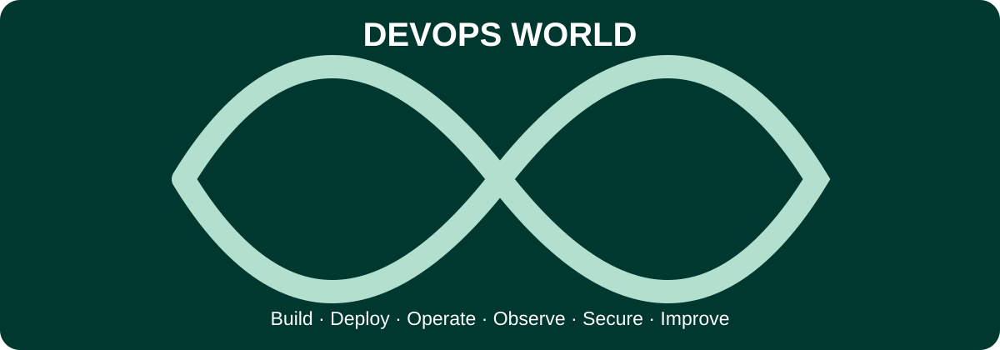

# DevOps World

**From Zero to Professional to Engineering Leadership.** A community-maintained guide to DevOps, SRE, platform engineering, cloud infrastructure, automation, security, and career development. Curated by VERIQTA.

> This is an independent community resource. Tool inclusion is not an endorsement. Verify documentation, pricing, certifications, and video availability before use.

## Table of Contents

- [Mission and principles](#mission-and-principles)
- [Learning outcomes and expectations](#learning-outcomes-and-expectations)
- [Learning paths](#learning-paths)
- [Tools and official documentation](#tools-and-official-documentation)
- [Projects and production labs](#projects-and-production-labs)
- [Incident scenarios](#incident-scenarios)
- [Senior interviews and system design](#senior-interviews-and-system-design)
- [Resume and portfolio resources](#resume-and-portfolio-resources)
- [Certifications](#certifications)
- [Video learning](#video-learning)
- [Books and reference material](#books-and-reference-material)
- [Contribution guide](CONTRIBUTING.md)
- [License](LICENSE)

## Mission and principles

DevOps is not a job title defined by a tool list. It is a set of practices that help teams deliver reliable, secure changes through collaboration, automation, feedback, and operational ownership. This repository includes software delivery, cloud architecture, observability, incident response, cost management, and technical leadership.

Principles: primary-source documentation first; safe reproducible labs; explicit prerequisites; trade-offs rather than hype; accessible beginner explanations; senior production realism; open contribution; no unverified salary or hiring guarantees.

## Learning outcomes and expectations

| Level | Must understand | Must demonstrate | Evidence |
|---|---|---|---|
| Beginner | Linux, networks, Git, scripting, HTTP, DNS | Diagnose a service and automate a simple task | README, commands, tests, screenshots |
| Junior | Containers, CI, cloud basics, IaC, monitoring | Deploy a small app and recover from a broken release | Pipeline, dashboard, rollback |
| Mid-level | Kubernetes, IAM, delivery patterns, reliability | Operate multi-service systems and debug cross-layer failures | Architecture, SLOs, runbooks |
| Senior | Distributed systems, risk, security, incident command | Design resilient platforms, lead incidents, explain trade-offs | ADRs, postmortems, threat model |
| Staff/Principal | Organizational architecture, standards, migration strategy | Influence multiple teams and manage systemic risk | RFCs, platform adoption and reliability metrics |
| Manager/Director | Strategy, people leadership, budgeting, governance | Build teams and accountable operating models | Roadmaps, staffing plans, service reviews |

## Learning paths

1. **Foundations:** Linux shell, processes, filesystems, TCP/IP, DNS, HTTP, SSH, Git, Python/Bash. Deliverable: diagnose a failing Linux web service.
2. **Delivery:** build, test, artifact storage, CI/CD, container images, rollback. Deliverable: signed container and tested deployment pipeline.
3. **Cloud and IaC:** IAM, VPC/VNet, compute, storage, Terraform/OpenTofu, state, policy, cost. Deliverable: reproducible cloud deployment with teardown.
4. **Kubernetes:** scheduling, services, ingress, storage, RBAC, upgrades, autoscaling, network policy. Deliverable: secure multi-service cluster with GitOps.
5. **SRE:** SLIs/SLOs, error budgets, RED/USE metrics, traces, alerting, on-call, postmortems. Deliverable: service dashboard and incident exercise.
6. **DevSecOps:** secrets, SBOM, supply chain, least privilege, policy as code, vulnerability remediation. Deliverable: threat model and gated release.
7. **Platform engineering:** golden paths, self-service, internal developer portals, tenancy, developer experience. Deliverable: platform product with adoption metrics.
8. **Leadership:** architecture reviews, technical strategy, cost ownership, mentoring, incident leadership. Deliverable: RFC, decision record, migration plan.

Each path should be assessed with a knowledge check, a working lab, a deliberate failure, a troubleshooting report, and a practical defense. See [labs](docs/LABS.md).

## Tools and official documentation

The following table contains **102 tools**. The icon is a clickable image that opens the same official documentation URL. Icons are loaded from Simple Icons when available; the text remains usable if a brand icon is missing. Icons are illustrative, not a guarantee of official logo availability. [Machine-readable CSV](docs/tools.csv).

| Category | Tool and clickable icon | Official documentation URL |
|---|---|---|
| Foundations | [ Linux](https://www.kernel.org/doc/html/latest/) | https://www.kernel.org/doc/html/latest/ |
| Foundations | [ GNU Bash](https://www.gnu.org/software/bash/manual/) | https://www.gnu.org/software/bash/manual/ |
| Foundations | [ Git](https://git-scm.com/doc) | https://git-scm.com/doc |
| Foundations | [ OpenSSH](https://www.openssh.com/manual.html) | https://www.openssh.com/manual.html |
| Foundations | [ Python](https://docs.python.org/3/) | https://docs.python.org/3/ |
| Foundations | [ Go](https://go.dev/doc/) | https://go.dev/doc/ |
| Foundations | [ PowerShell](https://learn.microsoft.com/en-us/powershell/) | https://learn.microsoft.com/en-us/powershell/ |
| Foundations | [ curl](https://curl.se/docs/) | https://curl.se/docs/ |
| Foundations | [ systemd](https://www.freedesktop.org/software/systemd/man/latest/) | https://www.freedesktop.org/software/systemd/man/latest/ |
| Foundations | [ Ansible](https://docs.ansible.com/) | https://docs.ansible.com/ |
| Cloud and Networking | [ AWS](https://docs.aws.amazon.com/) | https://docs.aws.amazon.com/ |
| Cloud and Networking | [ Microsoft Azure](https://learn.microsoft.com/en-us/azure/) | https://learn.microsoft.com/en-us/azure/ |
| Cloud and Networking | [ Google Cloud](https://cloud.google.com/docs) | https://cloud.google.com/docs |
| Cloud and Networking | [ Cloudflare](https://developers.cloudflare.com/) | https://developers.cloudflare.com/ |
| Cloud and Networking | [ Terraform](https://developer.hashicorp.com/terraform/docs) | https://developer.hashicorp.com/terraform/docs |
| Cloud and Networking | [ OpenTofu](https://opentofu.org/docs/) | https://opentofu.org/docs/ |
| Cloud and Networking | [ Pulumi](https://www.pulumi.com/docs/) | https://www.pulumi.com/docs/ |
| Cloud and Networking | [ Packer](https://developer.hashicorp.com/packer/docs) | https://developer.hashicorp.com/packer/docs |
| Cloud and Networking | [ Vault](https://developer.hashicorp.com/vault/docs) | https://developer.hashicorp.com/vault/docs |
| Cloud and Networking | [ Consul](https://developer.hashicorp.com/consul/docs) | https://developer.hashicorp.com/consul/docs |
| Containers and Kubernetes | [ Docker](https://docs.docker.com/) | https://docs.docker.com/ |
| Containers and Kubernetes | [ Podman](https://docs.podman.io/) | https://docs.podman.io/ |
| Containers and Kubernetes | [ containerd](https://containerd.io/docs/) | https://containerd.io/docs/ |
| Containers and Kubernetes | [ Kubernetes](https://kubernetes.io/docs/) | https://kubernetes.io/docs/ |
| Containers and Kubernetes | [ Helm](https://helm.sh/docs/) | https://helm.sh/docs/ |
| Containers and Kubernetes | [ Kustomize](https://kubectl.docs.kubernetes.io/references/kustomize/) | https://kubectl.docs.kubernetes.io/references/kustomize/ |
| Containers and Kubernetes | [ kind](https://kind.sigs.k8s.io/) | https://kind.sigs.k8s.io/ |
| Containers and Kubernetes | [ minikube](https://minikube.sigs.k8s.io/docs/) | https://minikube.sigs.k8s.io/docs/ |
| Containers and Kubernetes | [ K3s](https://docs.k3s.io/) | https://docs.k3s.io/ |
| Containers and Kubernetes | [ Cilium](https://docs.cilium.io/) | https://docs.cilium.io/ |
| Containers and Kubernetes | [ Istio](https://istio.io/latest/docs/) | https://istio.io/latest/docs/ |
| Containers and Kubernetes | [ Linkerd](https://linkerd.io/2/overview/) | https://linkerd.io/2/overview/ |
| Containers and Kubernetes | [ cert-manager](https://cert-manager.io/docs/) | https://cert-manager.io/docs/ |
| Containers and Kubernetes | [ External Secrets Operator](https://external-secrets.io/latest/) | https://external-secrets.io/latest/ |
| Containers and Kubernetes | [ Karpenter](https://karpenter.sh/docs/) | https://karpenter.sh/docs/ |
| Containers and Kubernetes | [ Crossplane](https://docs.crossplane.io/) | https://docs.crossplane.io/ |
| CI CD and GitOps | [ GitHub Actions](https://docs.github.com/en/actions) | https://docs.github.com/en/actions |
| CI CD and GitOps | [ GitLab CI/CD](https://docs.gitlab.com/ci/) | https://docs.gitlab.com/ci/ |
| CI CD and GitOps | [ Jenkins](https://www.jenkins.io/doc/) | https://www.jenkins.io/doc/ |
| CI CD and GitOps | [ CircleCI](https://circleci.com/docs/) | https://circleci.com/docs/ |
| CI CD and GitOps | [ Tekton](https://tekton.dev/docs/) | https://tekton.dev/docs/ |
| CI CD and GitOps | [ Argo CD](https://argo-cd.readthedocs.io/en/stable/) | https://argo-cd.readthedocs.io/en/stable/ |
| CI CD and GitOps | [ Argo Rollouts](https://argo-rollouts.readthedocs.io/) | https://argo-rollouts.readthedocs.io/ |
| CI CD and GitOps | [ Flux](https://fluxcd.io/flux/) | https://fluxcd.io/flux/ |
| CI CD and GitOps | [ Spinnaker](https://spinnaker.io/docs/) | https://spinnaker.io/docs/ |
| CI CD and GitOps | [ Dagger](https://docs.dagger.io/) | https://docs.dagger.io/ |
| CI CD and GitOps | [ Renovate](https://docs.renovatebot.com/) | https://docs.renovatebot.com/ |
| Observability and Incident Response | [ Prometheus](https://prometheus.io/docs/) | https://prometheus.io/docs/ |
| Observability and Incident Response | [ Grafana](https://grafana.com/docs/) | https://grafana.com/docs/ |
| Observability and Incident Response | [ Loki](https://grafana.com/docs/loki/latest/) | https://grafana.com/docs/loki/latest/ |
| Observability and Incident Response | [ Tempo](https://grafana.com/docs/tempo/latest/) | https://grafana.com/docs/tempo/latest/ |
| Observability and Incident Response | [ OpenTelemetry](https://opentelemetry.io/docs/) | https://opentelemetry.io/docs/ |
| Observability and Incident Response | [ Jaeger](https://www.jaegertracing.io/docs/) | https://www.jaegertracing.io/docs/ |
| Observability and Incident Response | [ Alertmanager](https://prometheus.io/docs/alerting/latest/alertmanager/) | https://prometheus.io/docs/alerting/latest/alertmanager/ |
| Observability and Incident Response | [ Elastic Stack](https://www.elastic.co/docs) | https://www.elastic.co/docs |
| Observability and Incident Response | [ Datadog](https://docs.datadoghq.com/) | https://docs.datadoghq.com/ |
| Observability and Incident Response | [ New Relic](https://docs.newrelic.com/) | https://docs.newrelic.com/ |
| Observability and Incident Response | [ Sentry](https://docs.sentry.io/) | https://docs.sentry.io/ |
| Observability and Incident Response | [ PagerDuty](https://support.pagerduty.com/) | https://support.pagerduty.com/ |
| Observability and Incident Response | [ Thanos](https://thanos.io/tip/thanos/getting-started.md) | https://thanos.io/tip/thanos/getting-started.md |
| Observability and Incident Response | [ VictoriaMetrics](https://docs.victoriametrics.com/) | https://docs.victoriametrics.com/ |
| Security and Supply Chain | [ Trivy](https://trivy.dev/latest/docs/) | https://trivy.dev/latest/docs/ |
| Security and Supply Chain | [ Grype](https://github.com/anchore/grype) | https://github.com/anchore/grype |
| Security and Supply Chain | [ Syft](https://github.com/anchore/syft) | https://github.com/anchore/syft |
| Security and Supply Chain | [ Cosign](https://docs.sigstore.dev/cosign/) | https://docs.sigstore.dev/cosign/ |
| Security and Supply Chain | [ Falco](https://falco.org/docs/) | https://falco.org/docs/ |
| Security and Supply Chain | [ OPA](https://www.openpolicyagent.org/docs/) | https://www.openpolicyagent.org/docs/ |
| Security and Supply Chain | [ Kyverno](https://kyverno.io/docs/) | https://kyverno.io/docs/ |
| Security and Supply Chain | [ Checkov](https://www.checkov.io/1.Welcome/What%20is%20Checkov.html) | https://www.checkov.io/1.Welcome/What%20is%20Checkov.html |
| Security and Supply Chain | [ Gitleaks](https://github.com/gitleaks/gitleaks) | https://github.com/gitleaks/gitleaks |
| Security and Supply Chain | [ SOPS](https://getsops.io/docs/) | https://getsops.io/docs/ |
| Security and Supply Chain | [ OWASP ZAP](https://www.zaproxy.org/docs/) | https://www.zaproxy.org/docs/ |
| Security and Supply Chain | [ SonarQube](https://docs.sonarsource.com/sonarqube-server/) | https://docs.sonarsource.com/sonarqube-server/ |
| Security and Supply Chain | [ Dependency-Track](https://docs.dependencytrack.org/) | https://docs.dependencytrack.org/ |
| Databases and Messaging | [ PostgreSQL](https://www.postgresql.org/docs/) | https://www.postgresql.org/docs/ |
| Databases and Messaging | [ MySQL](https://dev.mysql.com/doc/) | https://dev.mysql.com/doc/ |
| Databases and Messaging | [ Redis](https://redis.io/docs/latest/) | https://redis.io/docs/latest/ |
| Databases and Messaging | [ MongoDB](https://www.mongodb.com/docs/) | https://www.mongodb.com/docs/ |
| Databases and Messaging | [ Apache Kafka](https://kafka.apache.org/documentation/) | https://kafka.apache.org/documentation/ |
| Databases and Messaging | [ RabbitMQ](https://www.rabbitmq.com/docs) | https://www.rabbitmq.com/docs |
| Databases and Messaging | [ etcd](https://etcd.io/docs/) | https://etcd.io/docs/ |
| Databases and Messaging | [ Elasticsearch](https://www.elastic.co/docs/reference/elasticsearch) | https://www.elastic.co/docs/reference/elasticsearch |
| Databases and Messaging | [ NATS](https://docs.nats.io/) | https://docs.nats.io/ |
| Testing and Performance | [ k6](https://grafana.com/docs/k6/latest/) | https://grafana.com/docs/k6/latest/ |
| Testing and Performance | [ Locust](https://docs.locust.io/) | https://docs.locust.io/ |
| Testing and Performance | [ Apache JMeter](https://jmeter.apache.org/usermanual/) | https://jmeter.apache.org/usermanual/ |
| Testing and Performance | [ Terratest](https://terratest.gruntwork.io/) | https://terratest.gruntwork.io/ |
| Testing and Performance | [ Testcontainers](https://testcontainers.com/) | https://testcontainers.com/ |
| Testing and Performance | [ Chaos Mesh](https://chaos-mesh.org/docs/) | https://chaos-mesh.org/docs/ |
| Testing and Performance | [ Litmus](https://docs.litmuschaos.io/) | https://docs.litmuschaos.io/ |
| Testing and Performance | [ Pact](https://docs.pact.io/) | https://docs.pact.io/ |
| Platform and Developer Experience | [ Backstage](https://backstage.io/docs/) | https://backstage.io/docs/ |
| Platform and Developer Experience | [ Harbor](https://goharbor.io/docs/) | https://goharbor.io/docs/ |
| Platform and Developer Experience | [ Nexus Repository](https://help.sonatype.com/) | https://help.sonatype.com/ |
| Platform and Developer Experience | [ JFrog Artifactory](https://jfrog.com/help/) | https://jfrog.com/help/ |
| Platform and Developer Experience | [ Envoy](https://www.envoyproxy.io/docs/envoy/latest/) | https://www.envoyproxy.io/docs/envoy/latest/ |
| Platform and Developer Experience | [ NGINX](https://nginx.org/en/docs/) | https://nginx.org/en/docs/ |
| Platform and Developer Experience | [ Traefik](https://doc.traefik.io/traefik/) | https://doc.traefik.io/traefik/ |
| Platform and Developer Experience | [ OpenCost](https://opencost.io/docs/) | https://opencost.io/docs/ |
| Platform and Developer Experience | [ Kubecost](https://www.ibm.com/docs/en/kubecost) | https://www.ibm.com/docs/en/kubecost |
| Platform and Developer Experience | [ Apache Airflow](https://airflow.apache.org/docs/) | https://airflow.apache.org/docs/ |
| Platform and Developer Experience | [ Temporal](https://docs.temporal.io/) | https://docs.temporal.io/ |

## Projects and production labs

| Project | Difficulty | Expected deliverable |
|---|---|---|
| Linux service recovery | Beginner | systemd unit, logs, root-cause notes |
| GitHub Actions CI | Beginner | tests, lint, artifact, failing test proof |
| Docker Compose three-tier app | Junior | app, DB, proxy, health checks, backup |
| Cloud VPC and web service | Junior | IaC, private networking, IAM, teardown |
| Terraform remote state | Mid | locking, drift demonstration, recovery |
| Kubernetes production baseline | Mid | RBAC, quotas, probes, PDB, network policy |
| GitOps progressive delivery | Mid | Argo CD/Flux, canary, rollback evidence |
| Observability stack | Mid | metrics, logs, traces, SLO dashboard |
| Secrets and supply chain | Senior | signed artifacts, SBOM, rotation drill |
| Multi-region architecture | Senior | RTO/RPO, failure injection, cost analysis |
| Internal developer platform | Staff | golden path, templates, guardrails, metrics |
| Platform migration program | Leadership | RFC, milestones, staffing, risk register |

## Incident scenarios

- Pods remain Pending despite spare cluster CPU. Check requests, taints, affinity, quotas, storage and scheduler events.
- Deployment is healthy but users see 502. Trace ingress, readiness, endpoints, TLS, upstream timeout and application errors.
- Terraform proposes unexpected replacement. Inspect state, provider changes, drift, immutable attributes and blast radius before apply.
- CI credentials leak. Revoke and rotate, audit usage, contain access, then redesign short-lived identity.
- Prometheus alerts flood on-call. Evaluate symptom vs cause alerts, grouping, inhibition, routing and SLO burn rates.
- Redis memory rises after key expiration. Investigate lazy/active expiry, allocator fragmentation, eviction policy and metrics.
- Database latency spikes after release. Correlate traces, query plans, connection pool saturation and rollback criteria.
- Kubernetes node drains stall. Investigate PDBs, termination grace periods, finalizers and stateful workloads.

For every incident: define impact, collect timestamps, establish hypotheses, perform safe mitigation, verify recovery, document root causes and prevention. Never run destructive commands on systems you do not own or have permission to operate.

## Senior interviews and system design

Senior interview rubric: **problem framing (15%), architecture and trade-offs (25%), troubleshooting and evidence (25%), security and reliability (15%), communication and incident leadership (10%), cost and operational sustainability (10%)**.

Questions to rehearse:

1. Design a multi-region service with clear RTO/RPO and explain consistency, failover, and data replication.
2. A Kubernetes upgrade breaks networking. What evidence do you gather and what is your rollback plan?
3. A release increases p99 latency but average latency is unchanged. How do you investigate?
4. Design a deployment system with approvals, progressive delivery, policy enforcement and audit trails.
5. Your team has alert fatigue and missed a real incident. Redesign the alerting and on-call model.
6. Compare managed Kubernetes, serverless, and VMs for a regulated workload with a small operations team.
7. Explain how to migrate hundreds of Terraform workspaces safely across teams.
8. Design an internal platform without making it a bottleneck. How do you measure adoption and success?
9. Your organization needs a 30% cloud spend reduction without compromising reliability. What do you do?
10. Lead a postmortem after a severe outage involving a human configuration error.

Use the STAR structure for leadership examples and architecture diagrams plus explicit assumptions for technical questions. Good answers acknowledge uncertainty, discuss failure modes, and identify verification signals.

## Resume and portfolio resources

| Resource | Purpose | Full URL |
|---|---|---|
| Reactive Resume | Open-source resume builder | https://rxresu.me/ |
|---|---|---|
| JSON Resume | Structured resume schema and ecosystem | https://jsonresume.org/ |
| Overleaf | LaTeX resume templates and editor | https://www.overleaf.com/ |
| Europass | European CV builder | https://europass.europa.eu/en/create-europass-cv |
| GitHub Profile README | Public portfolio profile | https://docs.github.com/en/account-and-profile/how-tos/profile-customization/managing-your-profile-readme |
| GitHub Pages | Publish a portfolio site | https://docs.github.com/en/pages |
| LinkedIn Help | Profile and professional networking help | https://www.linkedin.com/help/linkedin |

Resume checklist: role-specific headline, 3-5 evidence-backed achievements, measurable reliability/delivery improvements, cloud and IaC scope, security responsibilities, leadership impact, and direct portfolio links. Never invent percentages or claim certifications not earned. A senior resume should emphasize architecture decisions, incident leadership, mentorship and business outcomes, not just a list of tools.

## Certifications

| Track | Credential or program | Official URL |
|---|---|---|
| AWS | AWS Certified Cloud Practitioner | https://aws.amazon.com/certification/certified-cloud-practitioner/ |
| AWS | AWS Certified Solutions Architect Associate | https://aws.amazon.com/certification/certified-solutions-architect-associate/ |
| AWS | AWS Certified DevOps Engineer Professional | https://aws.amazon.com/certification/certified-devops-engineer-professional/ |
| Azure | Microsoft credentials and certifications | https://learn.microsoft.com/en-us/credentials/ |
| Google Cloud | Professional Cloud DevOps Engineer | https://cloud.google.com/learn/certification/cloud-devops-engineer |
| Linux Foundation | Certified Kubernetes Administrator (CKA) | https://training.linuxfoundation.org/certification/certified-kubernetes-administrator-cka/ |
| Linux Foundation | Certified Kubernetes Application Developer (CKAD) | https://training.linuxfoundation.org/certification/certified-kubernetes-application-developer-ckad/ |
| Linux Foundation | Certified Kubernetes Security Specialist (CKS) | https://training.linuxfoundation.org/certification/certified-kubernetes-security-specialist/ |
| HashiCorp | Certification program | https://www.hashicorp.com/certification |
| Red Hat | Certification program | https://www.redhat.com/en/services/certification |
| CNCF | Training and certification | https://www.cncf.io/training/ |
| ISC2 | Cybersecurity certifications | https://www.isc2.org/certifications |

Select credentials based on the role you want, then build public labs to prove practical competence. Certification titles, prerequisites and retirement dates can change; check official pages.

## Video learning

The links below point to established learning channels or course catalogs, not unverified individual video IDs. Contributors should add vetted direct video links with duration, level, publication date and a short learning outcome.

| Provider | Focus | Full URL |
|---|---|---|
| TechWorld with Nana | Docker, Kubernetes, DevOps | https://www.youtube.com/@TechWorldwithNana |
| freeCodeCamp.org | Long-form programming and DevOps courses | https://www.youtube.com/@freecodecamp |
| KodeKloud | Hands-on DevOps and cloud | https://www.youtube.com/@KodeKloud |
| Bret Fisher | Containers and cloud-native | https://www.youtube.com/@BretFisherDockerandDevOps |
| CNCF | Kubernetes, observability, cloud native | https://www.youtube.com/@cncf |
| Google Cloud Tech | Google Cloud architecture | https://www.youtube.com/@googlecloudtech |
| AWS Events | AWS technical talks | https://www.youtube.com/@AWSEventsChannel |
| Microsoft Azure | Azure engineering | https://www.youtube.com/@MicrosoftAzure |
| DevOps Toolkit | Kubernetes, GitOps and platforms | https://www.youtube.com/@DevOpsToolkit |
| Hussein Nasser | Backend engineering and networking | https://www.youtube.com/@hnasr |

## Books and reference material

- Google SRE books, free online: https://sre.google/books/
- The Linux Documentation Project: https://tldp.org/
- Kubernetes Concepts: https://kubernetes.io/docs/concepts/
- AWS Well-Architected Framework: https://docs.aws.amazon.com/wellarchitected/latest/framework/welcome.html
- Azure Well-Architected Framework: https://learn.microsoft.com/en-us/azure/well-architected/
- Google Cloud Architecture Framework: https://cloud.google.com/architecture/framework
- OWASP Cheat Sheet Series: https://cheatsheetseries.owasp.org/
- CNCF Landscape: https://landscape.cncf.io/
- Roadmap.sh DevOps roadmap: https://roadmap.sh/devops
- DORA research: https://dora.dev/

## Community and maintenance

Use pull requests to propose additions. Prefer maintained primary sources, accurate descriptions, and stable HTTPS URLs. Separate deprecated tools into an archive rather than silently deleting history. Review links and certification names periodically. See [CONTRIBUTING.md](CONTRIBUTING.md), [CODE_OF_CONDUCT.md](CODE_OF_CONDUCT.md) and [SECURITY.md](SECURITY.md).

**Disclaimer:** The collection is educational. Cloud labs can incur charges. Follow provider terms and use authorized environments.
