

# DevOps World

**Your DevOps resource hub: tools, learning, projects, certifications, and careers.**

[Roadmap](#roadmap) · [Tools](#tool-directory) · [Learning](#learning) · [YouTube](#videos) · [Certifications](#certifications) · [Interviews](#interviews) · [Resumes](#careers) · [Projects](#projects) · [Books & communities](#community)

## DevOps roadmap

Follow the central path. Use the side branches to choose tools and build the supporting skills.

```mermaid
%%{init: {'theme':'base','themeVariables':{'fontFamily':'Arial','fontSize':'16px'}}}%%
block-beta
    columns 3
    space START["VERIQTA DEVOPS WORLD<br/>Learn · build · operate · improve"] space
    space:3
    L1["Linux · users · permissions<br/>Processes · services · storage"] M1["01 · Linux and systems"] T1["Bash · PowerShell<br/>Logs · packages · SSH"]
    space:3
    L2["TCP/IP · routing · DNS<br/>HTTP · TLS · certificates"] M2["02 · Networking"] T2["Proxies · load balancing<br/>Firewalls · private networks"]
    space:3
    L3["Choose: Python or Go<br/>Functions · data · errors"] M3["03 · Programming"] T3["APIs · JSON · tests<br/>Timeouts · idempotency"]
    space:3
    L4["Commits · branches · reviews<br/>Merges · tags · reverting"] M4["04 · Git and collaboration"] T4["GitHub · GitLab · Bitbucket<br/>Issues · releases · ownership"]
    space:3
    L5["Docker or Podman<br/>Images · layers · registries"] M5["05 · Containers"] T5["Compose · volumes · networking<br/>Non-root users · shutdown"]
    space:3
    L6["Choose: AWS, Azure, or GCP<br/>IAM · compute · networking"] M6["06 · Cloud foundations"] T6["Storage · managed services<br/>Budgets · quotas · audit logs"]
    space:3
    L7["OpenTofu · Terraform · Pulumi<br/>Plans · modules · providers"] M7["07 · Infrastructure as code"] T7["State · locking · imports<br/>Drift · review · recovery"]
    space:3
    L8["Ansible · cloud-init<br/>Inventory · roles · templates"] M8["08 · Configuration automation"] T8["Idempotency · tests · secrets<br/>Versioning · safe changes"]
    space:3
    L9["Actions · GitLab CI · Jenkins<br/>Tests · immutable artifacts"] M9["09 · CI/CD and releases"] T9["Promotion · canaries · rollback<br/>Short-lived workload identity"]
    space:3
    L10["Pods · workloads · services<br/>Scheduling · probes · storage"] M10["10 · Kubernetes operations"] T10["RBAC · policy · upgrades<br/>kind · minikube · K9s"]
    space:3
    L11["Argo CD or Flux<br/>Desired state · reconciliation"] M11["11 · GitOps delivery"] T11["Helm or Kustomize<br/>Promotion · drift · recovery"]
    space:3
    L12["Prometheus · Grafana<br/>OpenTelemetry · logs · traces"] M12["12 · Observability"] T12["Instrumentation · dashboards<br/>Cardinality · sampling · retention"]
    space:3
    L13["SLIs · SLOs · error budgets<br/>Alerts · runbooks · capacity"] M13["13 · Site reliability"] T13["Incidents · reviews · toil<br/>Ownership · operational readiness"]
    space:3
    L14["Identity · cloud secrets · Vault<br/>Rotation · access · auditability"] M14["14 · Security and supply chain"] T14["Syft · Grype · Trivy · Cosign<br/>SBOMs · signing · policy"]
    space:3
    L15["SQL · caches · queues · streams<br/>Schemas · retries · consistency"] M15["15 · Data and recovery"] T15["Velero · Restic · pgBackRest<br/>Restore tests · RTO · RPO"]
    space:3
    L16["k6 · Locust · JMeter<br/>Load models · latency · limits"] M16["16 · Performance and resilience"] T16["Chaos Mesh · fault injection<br/>Isolation · graceful degradation"]
    space:3
    L17["Golden paths · developer portals<br/>Self-service · support · feedback"] M17["17 · Platform and cost"] T17["OpenCost · Infracost<br/>Allocation · unit cost · rightsizing"]
    space:3
    L18["Architecture · migrations<br/>Tradeoffs · failure domains"] M18["18 · Senior engineering"] T18["Decision records · mentoring<br/>Incident leadership · communication"]
    space:3
    space FINISH["Keep building real projects<br/>Choose your specialization"] space
    START --> M1
    M1 --> M2
    M2 --> M3
    M3 --> M4
    M4 --> M5
    M5 --> M6
    M6 --> M7
    M7 --> M8
    M8 --> M9
    M9 --> M10
    M10 --> M11
    M11 --> M12
    M12 --> M13
    M13 --> M14
    M14 --> M15
    M15 --> M16
    M16 --> M17
    M17 --> M18
    M18 --> FINISH
    L1 --- M1
    M1 --- T1
    L2 --- M2
    M2 --- T2
    L3 --- M3
    M3 --- T3
    L4 --- M4
    M4 --- T4
    L5 --- M5
    M5 --- T5
    L6 --- M6
    M6 --- T6
    L7 --- M7
    M7 --- T7
    L8 --- M8
    M8 --- T8
    L9 --- M9
    M9 --- T9
    L10 --- M10
    M10 --- T10
    L11 --- M11
    M11 --- T11
    L12 --- M12
    M12 --- T12
    L13 --- M13
    M13 --- T13
    L14 --- M14
    M14 --- T14
    L15 --- M15
    M15 --- T15
    L16 --- M16
    M16 --- T16
    L17 --- M17
    M17 --- T17
    L18 --- M18
    M18 --- T18
    classDef stage fill:#ffe39b,stroke:#a67619,color:#1c2530,stroke-width:2px;
    classDef skills fill:#f5faff,stroke:#6b8ba5,color:#172c3c;
    classDef choices fill:#eee7ff,stroke:#8d70bc,color:#352449;
    classDef milestone fill:#10324a,stroke:#32b8c6,color:#ffffff,stroke-width:2px;
    class M1,M2,M3,M4,M5,M6,M7,M8,M9,M10,M11,M12,M13,M14,M15,M16,M17,M18 stage;
    class L1,L2,L3,L4,L5,L6,L7,L8,L9,L10,L11,L12,L13,L14,L15,L16,L17,L18 skills;
    class T1,T2,T3,T4,T5,T6,T7,T8,T9,T10,T11,T12,T13,T14,T15,T16,T17,T18 choices;
    class START,FINISH milestone;
    style M1 fill:#ffe39b,stroke:#a67619,color:#1c2530,stroke-width:2px;
    style L1 fill:#f5faff,stroke:#6b8ba5,color:#172c3c;
    style T1 fill:#eee7ff,stroke:#8d70bc,color:#352449;
    style M2 fill:#ffe39b,stroke:#a67619,color:#1c2530,stroke-width:2px;
    style L2 fill:#f5faff,stroke:#6b8ba5,color:#172c3c;
    style T2 fill:#eee7ff,stroke:#8d70bc,color:#352449;
    style M3 fill:#ffe39b,stroke:#a67619,color:#1c2530,stroke-width:2px;
    style L3 fill:#f5faff,stroke:#6b8ba5,color:#172c3c;
    style T3 fill:#eee7ff,stroke:#8d70bc,color:#352449;
    style M4 fill:#ffe39b,stroke:#a67619,color:#1c2530,stroke-width:2px;
    style L4 fill:#f5faff,stroke:#6b8ba5,color:#172c3c;
    style T4 fill:#eee7ff,stroke:#8d70bc,color:#352449;
    style M5 fill:#ffe39b,stroke:#a67619,color:#1c2530,stroke-width:2px;
    style L5 fill:#f5faff,stroke:#6b8ba5,color:#172c3c;
    style T5 fill:#eee7ff,stroke:#8d70bc,color:#352449;
    style M6 fill:#ffe39b,stroke:#a67619,color:#1c2530,stroke-width:2px;
    style L6 fill:#f5faff,stroke:#6b8ba5,color:#172c3c;
    style T6 fill:#eee7ff,stroke:#8d70bc,color:#352449;
    style M7 fill:#ffe39b,stroke:#a67619,color:#1c2530,stroke-width:2px;
    style L7 fill:#f5faff,stroke:#6b8ba5,color:#172c3c;
    style T7 fill:#eee7ff,stroke:#8d70bc,color:#352449;
    style M8 fill:#ffe39b,stroke:#a67619,color:#1c2530,stroke-width:2px;
    style L8 fill:#f5faff,stroke:#6b8ba5,color:#172c3c;
    style T8 fill:#eee7ff,stroke:#8d70bc,color:#352449;
    style M9 fill:#ffe39b,stroke:#a67619,color:#1c2530,stroke-width:2px;
    style L9 fill:#f5faff,stroke:#6b8ba5,color:#172c3c;
    style T9 fill:#eee7ff,stroke:#8d70bc,color:#352449;
    style M10 fill:#ffe39b,stroke:#a67619,color:#1c2530,stroke-width:2px;
    style L10 fill:#f5faff,stroke:#6b8ba5,color:#172c3c;
    style T10 fill:#eee7ff,stroke:#8d70bc,color:#352449;
    style M11 fill:#ffe39b,stroke:#a67619,color:#1c2530,stroke-width:2px;
    style L11 fill:#f5faff,stroke:#6b8ba5,color:#172c3c;
    style T11 fill:#eee7ff,stroke:#8d70bc,color:#352449;
    style M12 fill:#ffe39b,stroke:#a67619,color:#1c2530,stroke-width:2px;
    style L12 fill:#f5faff,stroke:#6b8ba5,color:#172c3c;
    style T12 fill:#eee7ff,stroke:#8d70bc,color:#352449;
    style M13 fill:#ffe39b,stroke:#a67619,color:#1c2530,stroke-width:2px;
    style L13 fill:#f5faff,stroke:#6b8ba5,color:#172c3c;
    style T13 fill:#eee7ff,stroke:#8d70bc,color:#352449;
    style M14 fill:#ffe39b,stroke:#a67619,color:#1c2530,stroke-width:2px;
    style L14 fill:#f5faff,stroke:#6b8ba5,color:#172c3c;
    style T14 fill:#eee7ff,stroke:#8d70bc,color:#352449;
    style M15 fill:#ffe39b,stroke:#a67619,color:#1c2530,stroke-width:2px;
    style L15 fill:#f5faff,stroke:#6b8ba5,color:#172c3c;
    style T15 fill:#eee7ff,stroke:#8d70bc,color:#352449;
    style M16 fill:#ffe39b,stroke:#a67619,color:#1c2530,stroke-width:2px;
    style L16 fill:#f5faff,stroke:#6b8ba5,color:#172c3c;
    style T16 fill:#eee7ff,stroke:#8d70bc,color:#352449;
    style M17 fill:#ffe39b,stroke:#a67619,color:#1c2530,stroke-width:2px;
    style L17 fill:#f5faff,stroke:#6b8ba5,color:#172c3c;
    style T17 fill:#eee7ff,stroke:#8d70bc,color:#352449;
    style M18 fill:#ffe39b,stroke:#a67619,color:#1c2530,stroke-width:2px;
    style L18 fill:#f5faff,stroke:#6b8ba5,color:#172c3c;
    style T18 fill:#eee7ff,stroke:#8d70bc,color:#352449;
    style START fill:#10324a,stroke:#32b8c6,color:#ffffff,stroke-width:2px;
    style FINISH fill:#10324a,stroke:#32b8c6,color:#ffffff,stroke-width:2px;
```

## Tool directory

Click a logo or **Docs ↗** to open the official documentation.

<table width="100%">
<tr>
<td align="center" valign="top" width="33%"> 
<a href="https://git-scm.com/doc">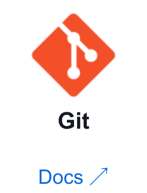</a>
<a href="https://docs.github.com/">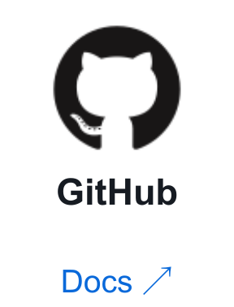</a>
<a href="https://docs.gitlab.com/">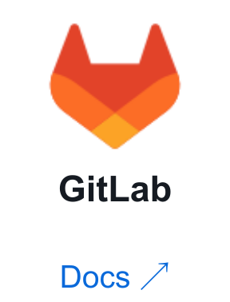</a>
<a href="https://support.atlassian.com/bitbucket-cloud/">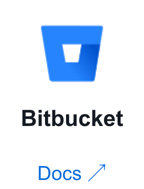</a> 
<a href="https://docs.gitea.com/">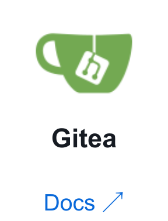</a>
<a href="https://forgejo.org/docs/latest/">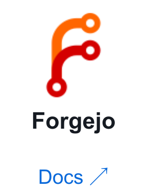</a>
<a href="https://www.mercurial-scm.org/help/commands">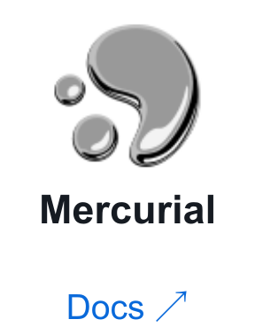</a>
<a href="https://subversion.apache.org/docs/">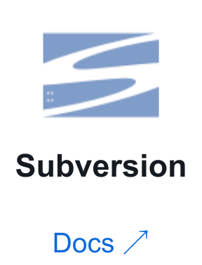</a> 
</td>
<td align="center" valign="top" width="33%"> 
<a href="https://www.jenkins.io/doc/">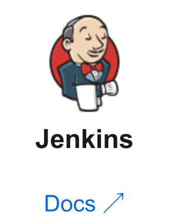</a>
<a href="https://docs.github.com/en/actions">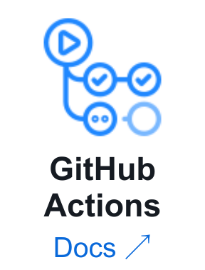</a>
<a href="https://docs.gitlab.com/ci/">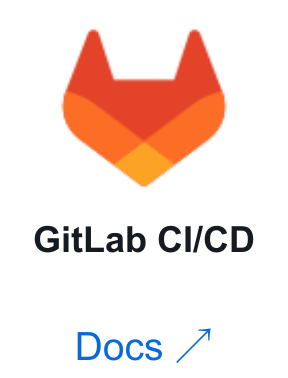</a>
<a href="https://circleci.com/docs/">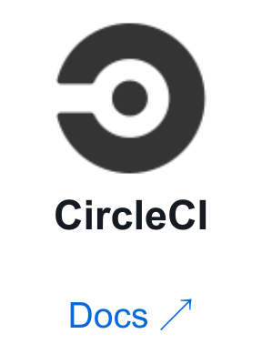</a> 
<a href="https://learn.microsoft.com/en-us/azure/devops/pipelines/">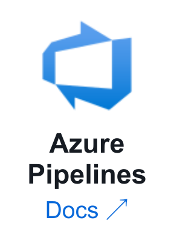</a>
<a href="https://www.jetbrains.com/help/teamcity/">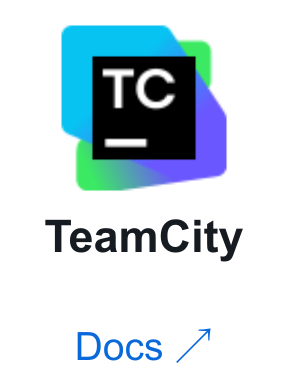</a>
<a href="https://buildkite.com/docs">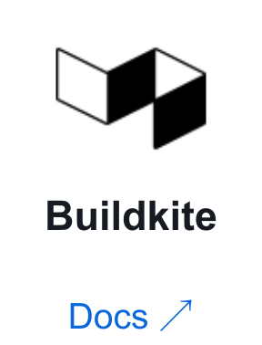</a>
<a href="https://docs.travis-ci.com/">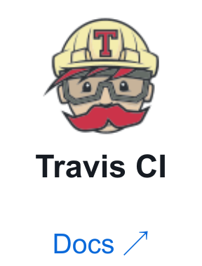</a> 
</td>
<td align="center" valign="top" width="33%"> 
<a href="https://docs.docker.com/">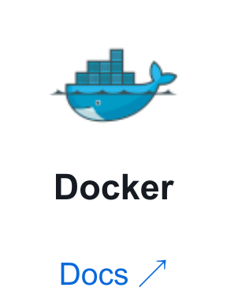</a>
<a href="https://containerd.io/docs/">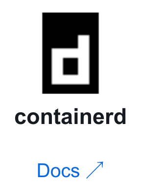</a>
<a href="https://docs.podman.io/">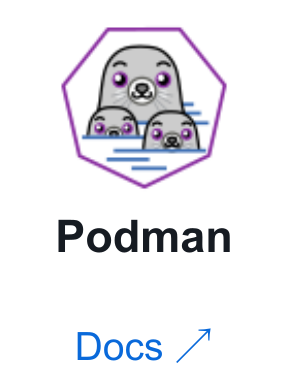</a>
<a href="https://buildah.io/">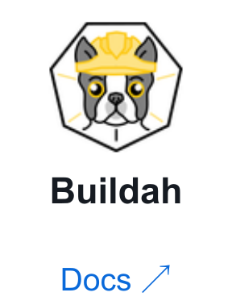</a> 
<a href="https://docs.docker.com/build/buildkit/">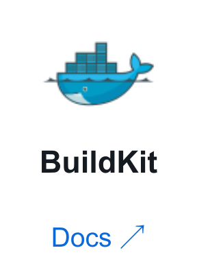</a>
<a href="https://github.com/containers/skopeo/tree/main/docs">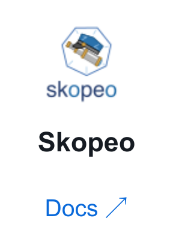</a>
<a href="https://docs.portainer.io/">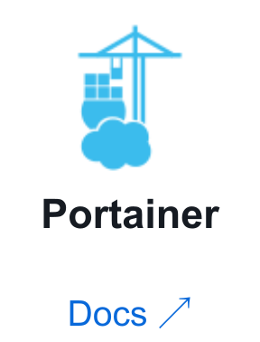</a>
</td>
</tr>
<tr>
<td align="center" valign="top" width="33%"> 
<a href="https://kubernetes.io/docs/">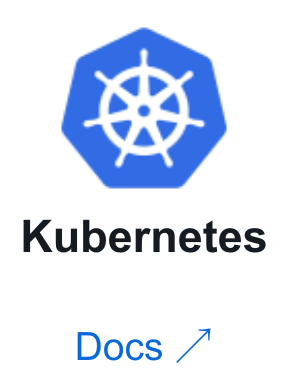</a>
<a href="https://docs.redhat.com/en/documentation/openshift_container_platform">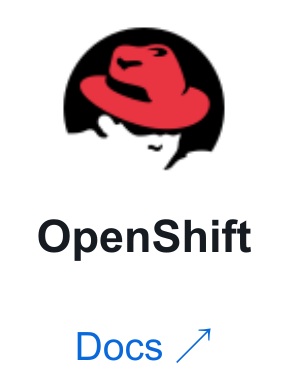</a>
<a href="https://ranchermanager.docs.rancher.com/">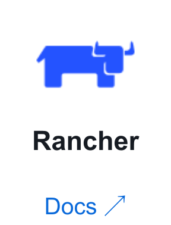</a>
<a href="https://developer.hashicorp.com/nomad/docs">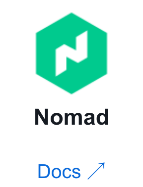</a> 
<a href="https://docs.k3s.io/">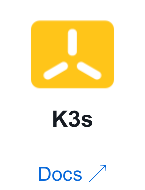</a>
<a href="https://helm.sh/docs/">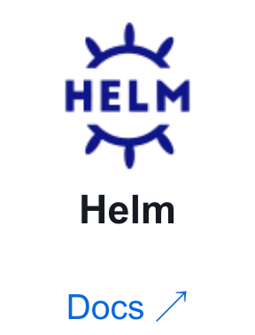</a>
<a href="https://docs.docker.com/engine/swarm/">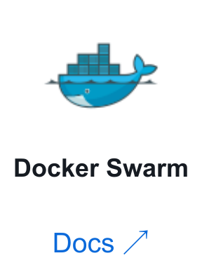</a>
<a href="https://www.talos.dev/">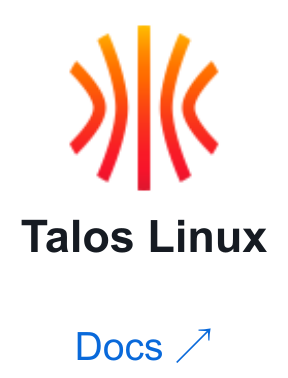</a> 
</td>
<td align="center" valign="top" width="33%"> 
<a href="https://developer.hashicorp.com/terraform/docs">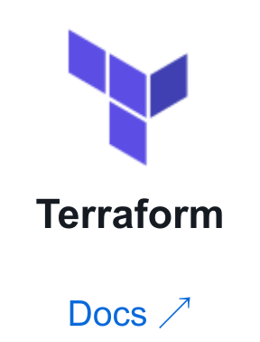</a>
<a href="https://opentofu.org/docs/">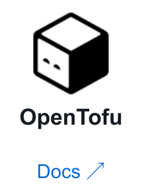</a>
<a href="https://www.pulumi.com/docs/">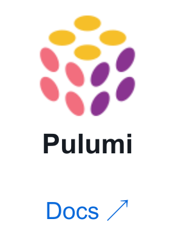</a>
<a href="https://docs.aws.amazon.com/cloudformation/">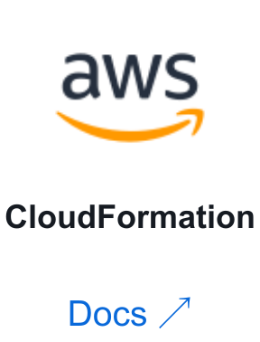</a> 
<a href="https://developer.hashicorp.com/packer/docs">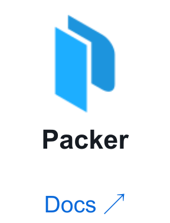</a>
<a href="https://developer.hashicorp.com/vagrant/docs">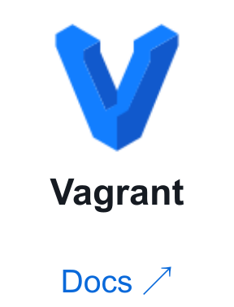</a>
<a href="https://docs.crossplane.io/">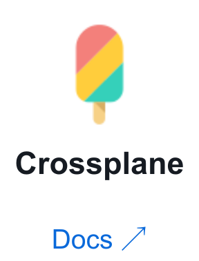</a>
<a href="https://terramate.io/docs/">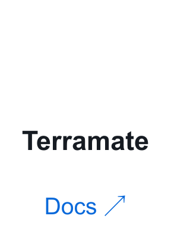</a> 
</td>
<td align="center" valign="top" width="33%"> 
<a href="https://docs.ansible.com/">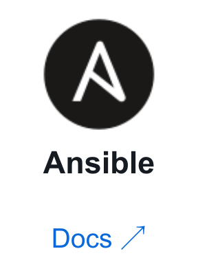</a>
<a href="https://docs.chef.io/">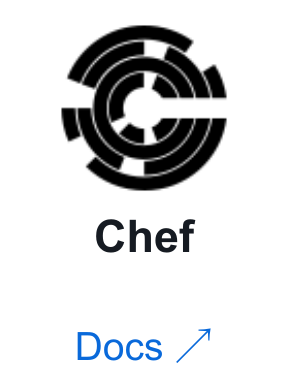</a>
<a href="https://www.puppet.com/docs">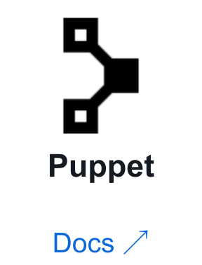</a>
<a href="https://docs.saltproject.io/">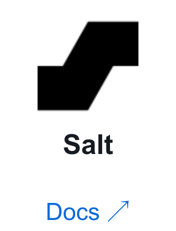</a> 
<a href="https://ansible.readthedocs.io/projects/awx/en/latest/">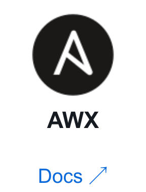</a>
<a href="https://docs.cfengine.com/">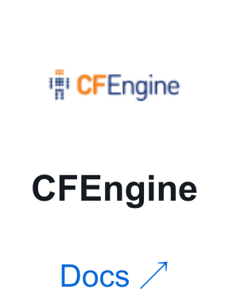</a>
<a href="https://nixos.org/manual/nixos/stable/">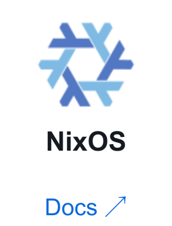</a>
<a href="https://learn.microsoft.com/en-us/powershell/dsc/overview">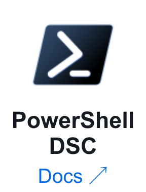</a> 
</td>
</tr>
<tr>
<td align="center" valign="top" width="33%"> 
<a href="https://docs.aws.amazon.com/">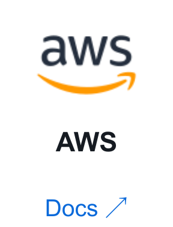</a>
<a href="https://learn.microsoft.com/en-us/azure/">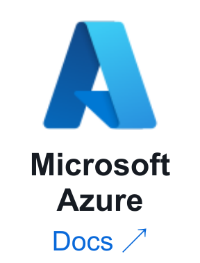</a>

 

 
</td>
<td align="center" valign="top" width="33%"> 

 

 
</td>
<td align="center" valign="top" width="33%"> 

 

 
</td>
</tr>
<tr>
<td align="center" valign="top" width="33%"> 

 

 
</td>
<td align="center" valign="top" width="33%"> 

 

 
</td>
<td align="center" valign="top" width="33%"> 

 

 
</td>
</tr>
<tr>
<td align="center" valign="top" width="33%"> 

 

 
</td>
<td align="center" valign="top" width="33%"> 

 

 
</td>
<td align="center" valign="top" width="33%"> 

 

 
</td>
</tr>
<tr>
<td align="center" valign="top" width="33%"> 

 

 
</td>
<td align="center" valign="top" width="33%"> 

 

 
</td>
<td align="center" valign="top" width="33%"> 

 

</td>
</tr>
<tr>
<td align="center" valign="top" width="33%"> 

 

</td>
<td align="center" valign="top" width="33%"> 

</td>
<td align="center" valign="top" width="33%"> 

 
</td>
</tr>
<tr>
<td align="center" valign="top" width="33%"> 

 
</td>
<td align="center" valign="top" width="33%"> 

 
</td>
<td align="center" valign="top" width="33%"> 

</td>
</tr>
<tr>
<td align="center" valign="top" width="33%"> 

</td>
</tr>
</table>

[Back to contents](#contents)

## Learning websites and labs

<strong>Browse learning topics</strong>

- [Linux and system administration](#learning-topic-01)
- [Networking, DNS, HTTP, and TLS](#learning-topic-02)
- [Git, collaboration, and code review](#learning-topic-03)
- [Bash, Python, Go, and automation practice](#learning-topic-04)
- [AWS architecture and hands-on workshops](#learning-topic-05)
- [Azure and Microsoft engineering](#learning-topic-06)
- [Google Cloud engineering](#learning-topic-07)
- [Containers, images, and build engineering](#learning-topic-08)
- [Kubernetes learning and administration](#learning-topic-09)
- [Infrastructure as code and configuration practice](#learning-topic-10)
- [Continuous integration, delivery, and release practice](#learning-topic-11)
- [GitOps and platform delivery](#learning-topic-12)
- [Observability and production debugging](#learning-topic-13)
- [Reliability, incidents, and distributed systems](#learning-topic-14)
- [Security engineering and software supply chains](#learning-topic-15)
- [Backup, storage, and data operations](#learning-topic-16)
- [Performance testing and resilience experiments](#learning-topic-17)
- [Platform engineering, cost, and sustainability](#learning-topic-18)
- [AI infrastructure and MLOps learning](#learning-topic-19)
- [Senior engineering, architecture, and design communication](#learning-topic-20)
- [Additional project collections and engineering references](#learning-topic-21)

### Foundations

- **Missing Semester** — shell, Git, debugging: https://missing.csail.mit.edu/
- **Linux Journey** — Linux fundamentals: https://linuxjourney.com/
- **Linux Upskill Challenge** — practical Linux learning: https://linuxupskillchallenge.org/
- **OverTheWire Bandit** — Linux and SSH practice: https://overthewire.org/wargames/bandit/
- **Practical Networking** — networking explanations: https://www.practicalnetworking.net/
- **Exercism** — programming practice: https://exercism.org/

### DevOps and cloud training

- **KodeKloud** — DevOps courses and labs: https://kodekloud.com/
- **Killercoda** — browser-based scenarios: https://killercoda.com/
- **Kubernetes playground** — interactive cluster practice: https://labs.play-with-k8s.com/
- **Docker playground** — interactive container practice: https://labs.play-with-docker.com/
- **Microsoft Learn** — guided technical learning: https://learn.microsoft.com/training/
- **AWS Skill Builder** — AWS learning: https://skillbuilder.aws/
- **Google Cloud Skills Boost** — cloud labs: https://www.cloudskillsboost.google/
- **HashiCorp tutorials** — infrastructure workflows: https://developer.hashicorp.com/tutorials
- **GitHub Skills** — repository-based exercises: https://skills.github.com/
- **freeCodeCamp** — free technical courses: https://www.freecodecamp.org/

### Engineering beyond the tools

- **DORA** — software delivery capabilities: https://dora.dev/
- **AWS Builders' Library** — distributed systems: https://aws.amazon.com/builders-library/
- **Twelve-Factor App** — application design: https://12factor.net/
- **OpenGitOps** — GitOps principles: https://opengitops.dev/
- **OWASP Cheat Sheets** — practical security: https://cheatsheetseries.owasp.org/
- **SLSA** — software supply-chain integrity: https://slsa.dev/
- **FinOps Framework** — cloud financial management: https://www.finops.org/framework/
- **CNCF Landscape** — ecosystem discovery: https://landscape.cncf.io/

*Some platforms include paid courses or labs; cloud resources can incur charges.*

### More learning paths, workshops, and technical reading

### Linux and system administration

- **Linux From Scratch** — Understand how Linux systems are assembled by building a distribution from source.  
  https://www.linuxfromscratch.org/
- **Debian Administrator's Handbook** — Study package management, services, networking, security, and practical Linux administration workflows.  
  https://debian-handbook.info/
- **ArchWiki** — Investigate detailed configuration explanations and troubleshooting notes across Linux system components.  
  https://wiki.archlinux.org/
- **Ubuntu Server tutorials** — Follow guided exercises for servers, containers, security, storage, and cloud environments.  
  https://ubuntu.com/tutorials
- **Red Hat Developer learning** — Explore enterprise Linux, containers, automation, and application delivery through guided learning.  
  https://developers.redhat.com/learn
- **SUSE documentation portal** — Find enterprise Linux operational references for storage, networking, security, and services.  
  https://documentation.suse.com/
- **Linux man-pages project** — Look up system calls and utilities while diagnosing concrete operating-system behavior.  
  https://man7.org/linux/man-pages/
- **Brendan Gregg Linux performance** — Learn a systematic approach to identifying bottlenecks across Linux operating-system resources.  
  https://www.brendangregg.com/linuxperf.html
- **Brendan Gregg USE method** — Investigate utilization, saturation, and errors before guessing which resource causes slowness.  
  https://www.brendangregg.com/usemethod.html
- **Linux Performance Analysis in 60 Seconds** — See how operational engineers combine quick observations into a useful investigation.  
  https://netflixtechblog.com/linux-performance-analysis-in-60-000-milliseconds-accc10403c55
- **The Linux Command Line** — Read a free shell book covering everyday commands and maintainable scripting.  
  https://linuxcommand.org/tlcl.php
- **Command Line Interface Guidelines** — Design automation interfaces with predictable behavior, helpful errors, and clear output.  
  https://clig.dev/
- **ExplainShell** — Break down shell commands into their documented options before running unfamiliar examples.  
  https://explainshell.com/
- **ShellCheck gallery** — Review common shell mistakes and improve the reliability of your automation scripts.  
  https://www.shellcheck.net/

### Networking, DNS, HTTP, and TLS

- **Beej's Guide to Network Programming** — Learn sockets and networking fundamentals through practical, low-level client and server examples.  
  https://beej.us/guide/bgnet/
- **Computer Networking: Principles, Protocols and Practice** — Study an open networking textbook connecting protocols, architecture, and system behavior.  
  https://www.computer-networking.info/
- **Cloudflare Learning Center** — Build clear mental models for DNS, encryption, caching, and network security.  
  https://www.cloudflare.com/learning/
- **MDN HTTP overview** — Understand the request-response model before debugging proxies, clients, and application servers.  
  https://developer.mozilla.org/en-US/docs/Web/HTTP/Overview
- **MDN HTTP status codes** — Distinguish response categories when diagnosing application errors and failed integration requests.  
  https://developer.mozilla.org/en-US/docs/Web/HTTP/Status
- **MDN HTTP caching** — Learn cache behavior, validators, and freshness rules that affect production traffic.  
  https://developer.mozilla.org/en-US/docs/Web/HTTP/Caching
- **MDN TLS guide** — Understand transport encryption and the trust assumptions behind secure web connections.  
  https://developer.mozilla.org/en-US/docs/Web/Security/Transport_Layer_Security
- **Everything curl** — Explore HTTP clients, authentication, proxies, and transfer troubleshooting through detailed examples.  
  https://everything.curl.dev/
- **Wireshark User's Guide** — Learn packet inspection techniques for investigating protocol behavior and connection failures.  
  https://www.wireshark.org/docs/wsug_html_chunked/
- **Julia Evans networking articles** — Explore approachable explanations of networking behavior, debugging techniques, and common misconceptions.  
  https://jvns.ca/categories/networking/
- **How DNS Works** — Follow an illustrated explanation of DNS resolution before troubleshooting real resolver behavior.  
  https://howdns.works/
- **Let's Encrypt getting started** — Understand certificate issuance workflows and the practical requirements of HTTPS deployment.  
  https://letsencrypt.org/getting-started/
- **OpenSSL cookbook** — Practice certificate inspection and TLS troubleshooting with a dedicated technical reference.  
  https://www.feistyduck.com/library/openssl-cookbook/
- **BGP explained** — Understand routing between networks and why connectivity can fail beyond your application.  
  https://www.cloudflare.com/learning/security/glossary/what-is-bgp/
- **TCP/IP guide** — Explore protocol relationships and networking concepts through a broad technical reference.  
  http://www.tcpipguide.com/

### Git, collaboration, and code review

- **GitHub pull request guidance** — Learn review workflows, collaboration tools, and the mechanics of proposing source changes.  
  https://docs.github.com/en/pull-requests
- **GitHub Skills introduction** — Practice repository collaboration through a guided exercise that runs inside GitHub.  
  https://github.com/skills/introduction-to-github
- **Learn Git Branching** — Experiment visually with commits, branches, merges, and history before modifying shared repositories.  
  https://learngitbranching.js.org/
- **Git Immersion** — Work through small Git exercises that build confidence in everyday version-control operations.  
  https://gitimmersion.com/
- **Oh Shit, Git!?!** — Find understandable recovery examples for common mistakes in local Git workflows.  
  https://ohshitgit.com/
- **Atlassian Git tutorials** — Compare branching, merging, rebasing, and collaboration approaches with practical workflow explanations.  
  https://www.atlassian.com/git/tutorials
- **Google code review guidelines** — Study how reviewers evaluate changes and communicate actionable, constructive engineering feedback.  
  https://google.github.io/eng-practices/review/
- **Conventional Commits** — Use a documented commit-message convention when consistent change classification benefits your project.  
  https://www.conventionalcommits.org/
- **Semantic Versioning** — Understand compatibility promises and communicate the intended meaning of software version changes.  
  https://semver.org/
- **Keep a Changelog** — Create useful release notes that explain changes to people using your software.  
  https://keepachangelog.com/
- **GitHub release management** — Connect versions, tags, release notes, and downloadable artifacts in a public project.  
  https://docs.github.com/en/repositories/releasing-projects-on-github
- **Open Source Guides** — Learn contribution, maintenance, community-building, and governance practices for collaborative public projects.  
  https://opensource.guide/

### Bash, Python, Go, and automation practice

- **BashGuide** — Learn shell quoting, expansions, control flow, and the foundations of reliable scripts.  
  https://mywiki.wooledge.org/BashGuide
- **BashFAQ** — Investigate recurring shell problems before adopting fragile command-line workarounds in automation.  
  https://mywiki.wooledge.org/BashFAQ
- **Bash Pitfalls** — Recognize shell patterns that behave unexpectedly with filenames, quoting, and process output.  
  https://mywiki.wooledge.org/BashPitfalls
- **Bash Hackers Wiki** — Explore shell behavior and scripting details when a simple example stops working.  
  https://bash-hackers.gabe565.com/
- **Python packaging tutorial** — Package an automation tool so another engineer can install and run it reliably.  
  https://packaging.python.org/en/latest/tutorials/packaging-projects/
- **Python virtual environments** — Separate project dependencies and reproduce an automation environment without changing system packages.  
  https://docs.python.org/3/tutorial/venv.html
- **Python argparse tutorial** — Build command-line tools with documented arguments, validation, help output, and predictable behavior.  
  https://docs.python.org/3/howto/argparse.html
- **Python logging cookbook** — Improve automation diagnostics using structured logging patterns and practical configuration examples.  
  https://docs.python.org/3/howto/logging-cookbook.html
- **Automate the Boring Stuff** — Practice useful Python automation through concrete examples involving files, data, and workflows.  
  https://automatetheboringstuff.com/
- **A Tour of Go** — Learn Go fundamentals through interactive exercises before building distributable infrastructure tools.  
  https://go.dev/tour/
- **Go by Example** — Explore small examples covering concurrency, files, errors, HTTP, and practical programming patterns.  
  https://gobyexample.com/
- **Effective Go** — Learn established Go conventions that improve readability and maintenance of operational software.  
  https://go.dev/doc/effective_go
- **Regular Expressions 101** — Test parsing expressions against sample input before embedding them in operational scripts.  
  https://regex101.com/
- **JSON Schema learning** — Define and validate configuration structures before malformed data reaches downstream automation.  
  https://json-schema.org/learn

### AWS architecture and hands-on workshops

- **AWS Workshops** — Discover practical workshops across cloud architecture, containers, security, observability, and operations.  
  https://workshops.aws/
- **AWS Well-Architected Labs** — Apply architecture principles through exercises covering reliability, security, cost, and operations.  
  https://www.wellarchitectedlabs.com/
- **AWS Samples** — Explore reference implementations and workshop repositories maintained within the AWS developer ecosystem.  
  https://github.com/aws-samples
- **AWS Architecture Center** — Find architecture examples and technical guidance for evaluating cloud workload design choices.  
  https://aws.amazon.com/architecture/
- **AWS Prescriptive Guidance** — Study implementation patterns and migration guidance for specific organizational and technical challenges.  
  https://aws.amazon.com/prescriptive-guidance/
- **AWS IAM best practices** — Review identity controls before granting workloads or engineers access to cloud resources.  
  https://docs.aws.amazon.com/IAM/latest/UserGuide/best-practices.html
- **AWS VPC user guide** — Understand private cloud networking boundaries before designing application connectivity and access paths.  
  https://docs.aws.amazon.com/vpc/latest/userguide/what-is-amazon-vpc.html
- **AWS EKS best practices** — Review operational considerations for Kubernetes workloads running on Amazon's managed control plane.  
  https://docs.aws.amazon.com/eks/latest/best-practices/
- **AWS Containers blog** — Explore technical walkthroughs and service explanations for container delivery and cloud operations.  
  https://aws.amazon.com/blogs/containers/
- **AWS Security blog** — Follow implementation guidance covering identities, protection mechanisms, investigations, and cloud security practices.  
  https://aws.amazon.com/blogs/security/
- **AWS Compute blog** — Study practical compute and serverless design patterns alongside implementation examples and tradeoffs.  
  https://aws.amazon.com/blogs/compute/
- **AWS Open Source blog** — Explore cloud-related open-source projects, integrations, community developments, and technical implementation stories.  
  https://aws.amazon.com/blogs/opensource/

### Azure and Microsoft engineering

- **Azure architecture examples** — Compare reference designs and solution patterns against your workload's actual operational requirements.  
  https://learn.microsoft.com/en-us/azure/architecture/browse/
- **Azure Well-Architected Framework** — Review workloads across reliability, security, cost, performance, and operational excellence concerns.  
  https://learn.microsoft.com/en-us/azure/well-architected/
- **Azure Cloud Adoption Framework** — Explore cloud adoption, governance, organizational readiness, and platform planning for larger environments.  
  https://learn.microsoft.com/en-us/azure/cloud-adoption-framework/
- **Azure landing zones** — Understand platform boundaries, subscriptions, governance, and identity before scaling team cloud adoption.  
  https://learn.microsoft.com/en-us/azure/cloud-adoption-framework/ready/landing-zone/
- **Azure samples** — Discover sample applications and technical examples for experimenting with Microsoft cloud services.  
  https://github.com/Azure-Samples
- **Azure architecture icons** — Create clearer architecture diagrams using the provider's published service artwork and guidelines.  
  https://learn.microsoft.com/en-us/azure/architecture/icons/
- **John Savill's Azure Master Class** — Use course materials and whiteboards alongside the corresponding cloud architecture video lessons.  
  https://github.com/johnthebrit/AzureMasterClass
- **Microsoft Engineering Fundamentals** — Explore engineering practices covering collaboration, testing, delivery, reliability, and maintainable project execution.  
  https://microsoft.github.io/code-with-engineering-playbook/
- **Azure reliability guidance** — Investigate service reliability capabilities and regional considerations when designing recoverable cloud workloads.  
  https://learn.microsoft.com/en-us/azure/reliability/
- **Azure Architecture blog** — Read architecture discussions and implementation guidance from Microsoft's technical community publishing channels.  
  https://techcommunity.microsoft.com/category/azure/blog/azurearchitectureblog
- **Microsoft Learn sandbox training** — Search official learning modules by technology, experience level, and target engineering role.  
  https://learn.microsoft.com/en-us/training/browse/
- **Azure developer CLI learning** — Explore repeatable developer workflows for provisioning and deploying applications into Azure environments.  
  https://learn.microsoft.com/en-us/azure/developer/azure-developer-cli/

### Google Cloud engineering

- **Google Cloud architecture center** — Browse reference architectures and engineering guidance for operating workloads on Google Cloud.  
  https://cloud.google.com/architecture
- **Google Cloud training** — Find official learning paths aligned with cloud administration, architecture, data, and operations.  
  https://cloud.google.com/learn/training
- **Google Cloud samples** — Explore sample implementations and infrastructure projects published through Google's cloud engineering organization.  
  https://github.com/GoogleCloudPlatform
- **Google Cloud reliability guidance** — Study design and operational practices for building services with explicit reliability requirements.  
  https://cloud.google.com/architecture/framework/reliability
- **Google Cloud security guidance** — Review identity, data protection, and organizational security considerations within a cloud architecture.  
  https://cloud.google.com/architecture/framework/security
- **Google Cloud cost guidance** — Connect cloud spending decisions to workload requirements, operating practices, and measurable business value.  
  https://cloud.google.com/architecture/framework/cost-optimization
- **Google Cloud developer blog** — Explore application delivery patterns, technical examples, and engineering discussions from Google Cloud.  
  https://cloud.google.com/blog/products/application-development
- **Google Cloud containers blog** — Follow managed Kubernetes explanations, container architecture guidance, and cloud-native engineering case studies.  
  https://cloud.google.com/blog/products/containers-kubernetes
- **Google Cloud DevOps blog** — Read delivery and reliability discussions grounded in cloud engineering practices and examples.  
  https://cloud.google.com/blog/products/devops-sre
- **Google Cloud Terraform samples** — Explore reusable infrastructure modules and examples maintained within Google's Terraform module organization.  
  https://github.com/terraform-google-modules
- **Cloud Foundation Toolkit** — Discover reference infrastructure components for establishing consistent Google Cloud platform foundations.  
  https://cloud.google.com/foundation-toolkit
- **Google Cloud Architecture Framework resources** — Review operational responsibilities, processes, and feedback loops when maintaining cloud-based production services.  
  https://cloud.google.com/architecture/framework/operational-excellence

### Containers, images, and build engineering

- **Docker getting started workshop** — Build and run a small application while learning the container development lifecycle.  
  https://docs.docker.com/get-started/workshop/
- **Docker build best practices** — Improve image construction through deliberate choices about layers, dependencies, context, and caching.  
  https://docs.docker.com/build/building/best-practices/
- **Docker multi-stage builds** — Separate build tooling from runtime contents while keeping the build understandable and maintainable.  
  https://docs.docker.com/build/building/multi-stage/
- **Docker build secrets** — Provide sensitive build inputs without placing credentials in permanent application image layers.  
  https://docs.docker.com/build/building/secrets/
- **Docker samples organization** — Explore sample applications and teaching repositories that demonstrate common container development workflows.  
  https://github.com/dockersamples
- **Awesome Compose** — Find small multi-container examples and adapt their structure to your own learning projects.  
  https://github.com/docker/awesome-compose
- **OCI image specification** — Understand the common image format underlying portable container packaging and registry interoperability.  
  https://github.com/opencontainers/image-spec
- **OCI runtime specification** — Explore the runtime configuration model behind container execution and operating-system isolation boundaries.  
  https://github.com/opencontainers/runtime-spec
- **BuildKit examples** — Study build-engine examples when investigating caching, build behavior, and advanced image construction.  
  https://github.com/moby/buildkit/tree/master/examples
- **Distroless images** — Compare minimal runtime images with the debugging and maintenance requirements of your application.  
  https://github.com/GoogleContainerTools/distroless
- **Chainguard Academy** — Study container security, software supply chains, and artifact integrity through educational technical material.  
  https://edu.chainguard.dev/

### Kubernetes learning and administration

- **Kubernetes Basics** — Follow an introductory learning sequence covering deployment, discovery, scaling, and application updates.  
  https://kubernetes.io/docs/tutorials/kubernetes-basics/
- **Kubernetes tasks** — Find task-oriented procedures when implementing a specific cluster or workload administration capability.  
  https://kubernetes.io/docs/tasks/
- **Kubernetes troubleshooting** — Investigate workload and cluster problems using documented diagnostic approaches and observable evidence.  
  https://kubernetes.io/docs/tasks/debug/
- **Debug running Pods** — Practice collecting useful evidence from workloads before changing configuration or restarting containers.  
  https://kubernetes.io/docs/tasks/debug/debug-application/debug-running-pod/
- **Kubernetes resource management** — Understand how resource requests and limits affect workload scheduling and runtime behavior.  
  https://kubernetes.io/docs/concepts/configuration/manage-resources-containers/
- **Kubernetes probes** — Choose health checks that distinguish startup, readiness, and genuine reasons to restart.  
  https://kubernetes.io/docs/tasks/configure-pod-container/configure-liveness-readiness-startup-probes/
- **Kubernetes network policies** — Define intended workload connectivity and verify that the network implementation enforces it.  
  https://kubernetes.io/docs/concepts/services-networking/network-policies/
- **Kubernetes RBAC** — Design scoped permissions for engineers, controllers, and application identities within cluster environments.  
  https://kubernetes.io/docs/reference/access-authn-authz/rbac/
- **Kubernetes security concepts** — Explore trust boundaries and controls before treating a cluster as a secure platform.  
  https://kubernetes.io/docs/concepts/security/
- **Kubernetes storage concepts** — Understand persistence, provisioning, volumes, and the operational boundaries of stateful application storage.  
  https://kubernetes.io/docs/concepts/storage/
- **Kubernetes disruption guidance** — Distinguish planned maintenance from unexpected failures when evaluating workload availability and disruption controls.  
  https://kubernetes.io/docs/concepts/workloads/pods/disruptions/
- **Kubernetes upgrade planning** — Review cluster upgrade responsibilities and supported procedures before changing a running environment.  
  https://kubernetes.io/docs/tasks/administer-cluster/cluster-upgrade/
- **Kubernetes The Hard Way** — Explore the components behind Kubernetes by assembling an educational cluster step by step.  
  https://github.com/kelseyhightower/kubernetes-the-hard-way
- **Kubernetes community learning** — Discover community resources for learning, participation, and understanding the Kubernetes contributor ecosystem.  
  https://www.kubernetes.dev/resources/

### Infrastructure as code and configuration practice

- **Terraform testing tutorial** — Practice validating infrastructure modules instead of relying entirely on manual plan inspection.  
  https://developer.hashicorp.com/terraform/tutorials/configuration-language/test
- **Terraform module tutorials** — Learn module structure and reuse while considering readability, maintenance, and interface boundaries.  
  https://developer.hashicorp.com/terraform/tutorials/modules
- **Terraform state tutorials** — Investigate state behavior and management procedures before recovering or importing infrastructure resources.  
  https://developer.hashicorp.com/terraform/tutorials/state
- **Terraform AWS modules** — Compare community modules and examples while evaluating their interfaces and maintenance implications.  
  https://github.com/terraform-aws-modules
- **Terraform Azure modules** — Inspect a focused infrastructure module and its approach to exposing network configuration choices.  
  https://github.com/Azure/terraform-azurerm-avm-res-network-virtualnetwork
- **OpenTofu examples and discussions** — Follow the provisioning engine's source, issues, and community discussions when investigating tool behavior.  
  https://github.com/opentofu/opentofu
- **Ansible examples** — Study playbook examples and adapt them to a small, controlled automation environment.  
  https://github.com/ansible/ansible-examples
- **Ansible workshops** — Find guided workshop materials for practicing configuration automation and repeatable operational workflows.  
  https://github.com/ansible/workshops
- **Ansible lint** — Review automation content for maintainability problems and common configuration mistakes before deployment.  
  https://ansible.readthedocs.io/projects/lint/
- **Molecule learning** — Explore repeatable testing workflows for configuration automation and infrastructure-related role development.  
  https://ansible.readthedocs.io/projects/molecule/
- **Pulumi examples** — Compare infrastructure examples across languages and providers while understanding the underlying cloud resources.  
  https://github.com/pulumi/examples

### Continuous integration, delivery, and release practice

- **GitHub Actions starter workflows** — Study example workflows and adapt their permissions and behavior to your own repository.  
  https://github.com/actions/starter-workflows
- **GitHub Actions security guidance** — Review trust boundaries, untrusted inputs, and identity before granting workflows deployment authority.  
  https://docs.github.com/en/actions/security-for-github-actions/security-guides/security-hardening-for-github-actions
- **GitHub Actions OIDC** — Understand short-lived cloud authentication as an alternative to distributing permanent deployment credentials.  
  https://docs.github.com/en/actions/security-for-github-actions/security-hardening-your-deployments/about-security-hardening-with-openid-connect
- **GitHub Actions reusable workflows** — Reduce repeated pipeline definitions while keeping interfaces, permissions, and change ownership clear.  
  https://docs.github.com/en/actions/sharing-automations/reusing-workflows
- **GitHub Actions caching** — Improve feedback speed while understanding cache keys, invalidation behavior, and trust boundaries.  
  https://docs.github.com/en/actions/using-workflows/caching-dependencies-to-speed-up-workflows
- **Jenkins Pipeline tour** — Start with a minimal pipeline before introducing shared libraries and complex release processes.  
  https://www.jenkins.io/doc/pipeline/tour/hello-world/
- **Jenkins pipeline examples** — Explore pipeline patterns and evaluate how they handle credentials, failures, and maintenance.  
  https://github.com/jenkinsci/pipeline-examples
- **Jenkins shared libraries** — Understand the tradeoffs of shared pipeline code across multiple teams and repositories.  
  https://www.jenkins.io/doc/book/pipeline/shared-libraries/
- **GitLab pipeline examples** — Find delivery examples for different applications, then review their security and release assumptions.  
  https://docs.gitlab.com/ci/examples/
- **GitLab pipeline efficiency** — Investigate pipeline structure and feedback time before simply increasing runner resource consumption.  
  https://docs.gitlab.com/ci/pipelines/pipeline_efficiency/
- **OpenFeature learning** — Explore vendor-neutral feature-flag concepts for separating software deployment from controlled user exposure.  
  https://openfeature.dev/
- **Argo Rollouts examples** — Practice progressive delivery using a small application designed for rollout demonstrations and experiments.  
  https://github.com/argoproj/rollouts-demo

### GitOps and platform delivery

- **OpenGitOps project** — Read the principles and definitions behind GitOps before selecting a reconciliation controller.  
  https://github.com/open-gitops/documents
- **Argo Rollouts learning** — Study progressive delivery concepts, traffic management integration, and automated rollout verification mechanisms.  
  https://argoproj.github.io/argo-rollouts/
- **Flux multi-tenancy examples** — Investigate repository boundaries, identities, and ownership within a shared GitOps delivery model.  
  https://github.com/fluxcd/flux2-multi-tenancy
- **Flux bootstrap examples** — Explore controller behavior, installation approaches, and real issues encountered by GitOps users.  
  https://github.com/fluxcd/flux2
- **Backstage software templates** — Understand how a developer portal can scaffold services through a supported golden path.  
  https://backstage.io/docs/features/software-templates/
- **Backstage software catalog** — Explore service ownership and metadata as foundations for useful internal developer experiences.  
  https://backstage.io/docs/features/software-catalog/
- **CNCF platform engineering guidance** — Study platform capabilities and organizational considerations before implementing a developer portal product.  
  https://tag-app-delivery.cncf.io/whitepapers/platforms/
- **Platform Engineering community** — Discover community discussions, learning material, and events focused on internal developer platforms.  
  https://platformengineering.org/
- **Team Topologies resources** — Explore organizational interaction patterns that influence platform ownership, delivery flow, and cognitive load.  
  https://teamtopologies.com/

### Observability and production debugging

- **OpenTelemetry demo architecture** — Trace a demonstration system's request paths and understand how its telemetry is produced.  
  https://opentelemetry.io/docs/demo/architecture/
- **OpenTelemetry concepts** — Learn instrumentation and telemetry concepts before assembling an observability collection and export pipeline.  
  https://opentelemetry.io/docs/concepts/
- **OpenTelemetry Collector tutorials** — Explore how telemetry is received, transformed, filtered, and exported across observability backends.  
  https://opentelemetry.io/docs/collector/
- **Prometheus getting started** — Collect your first metrics and connect a concrete target to the monitoring system.  
  https://prometheus.io/docs/prometheus/latest/getting_started/
- **Prometheus query basics** — Learn the query model before building dashboards or interpreting alert expressions under pressure.  
  https://prometheus.io/docs/prometheus/latest/querying/basics/
- **Prometheus alerting rules** — Understand how alert conditions are expressed and evaluated against collected time-series data.  
  https://prometheus.io/docs/prometheus/latest/configuration/alerting_rules/
- **Prometheus instrumentation guidance** — Choose useful signals while considering labels, metric types, and application-specific monitoring needs.  
  https://prometheus.io/docs/practices/instrumentation/
- **Grafana tutorials** — Follow practical observability exercises connecting data collection, visualization, dashboards, and operational investigations.  
  https://grafana.com/tutorials/
- **Grafana Play** — Explore interactive dashboard examples before designing your own views of application behavior.  
  https://play.grafana.org/
- **Grafana dashboards library** — Discover dashboard examples and assess whether their signals answer your own operational questions.  
  https://grafana.com/grafana/dashboards/
- **Grafana Loki tutorials** — Investigate log collection and querying while considering operational ownership and retention costs.  
  https://grafana.com/docs/loki/latest/get-started/
- **OpenTelemetry Python examples** — Study concrete instrumentation examples before applying telemetry patterns to your own Python application.  
  https://github.com/open-telemetry/opentelemetry-python/tree/main/docs/examples

### Reliability, incidents, and distributed systems

- **Google SRE workbook** — Apply reliability principles through practical discussions of monitoring, incident response, and service objectives.  
  https://sre.google/workbook/table-of-contents/
- **SRE error budgets** — Connect reliability targets to engineering priorities instead of treating every failure identically.  
  https://sre.google/sre-book/embracing-risk/
- **SRE monitoring distributed systems** — Study monitoring principles that connect useful signals to user-visible symptoms and operational action.  
  https://sre.google/sre-book/monitoring-distributed-systems/
- **SRE effective troubleshooting** — Practice hypothesis-driven investigation instead of changing several system components without clear evidence.  
  https://sre.google/sre-book/effective-troubleshooting/
- **SRE incident management** — Understand roles and coordination practices that help teams respond coherently during service incidents.  
  https://sre.google/sre-book/managing-incidents/
- **SRE postmortem culture** — Learn how incident reviews can improve systems without reducing complex failures to individual blame.  
  https://sre.google/sre-book/postmortem-culture/
- **SRE eliminating toil** — Identify repetitive operational work and evaluate opportunities for lasting engineering improvements across services.  
  https://sre.google/sre-book/eliminating-toil/
- **SRE workbook SLO implementation** — Move from reliability terminology toward objectives and measurement choices grounded in user needs.  
  https://sre.google/workbook/implementing-slos/
- **Amazon timeouts and retries** — Understand how timeout choices and retry behavior interact with overload and dependency failures.  
  https://aws.amazon.com/builders-library/timeouts-retries-and-backoff-with-jitter/
- **Amazon idempotent APIs** — Study the design choices that make repeated requests safer after ambiguous network failures.  
  https://aws.amazon.com/builders-library/making-retries-safe-with-idempotent-APIs/
- **Amazon shuffle sharding** — Explore workload isolation strategies that limit the impact of failures and noisy neighbors.  
  https://aws.amazon.com/builders-library/workload-isolation-using-shuffle-sharding/
- **Amazon avoiding overload** — Investigate deliberate rejection of work as a way to protect essential service behavior.  
  https://aws.amazon.com/builders-library/using-load-shedding-to-avoid-overload/

### Security engineering and software supply chains

- **OWASP DevSecOps Guideline** — Explore security activities across development and delivery rather than adding only a final scan.  
  https://owasp.org/www-project-devsecops-guideline/
- **OWASP threat modeling** — Identify assets, trust boundaries, and plausible failure or abuse paths before choosing controls.  
  https://owasp.org/www-community/Threat_Modeling
- **OWASP secrets management guidance** — Review secret issuance, storage, rotation, access, and incident handling across application lifecycles.  
  https://cheatsheetseries.owasp.org/cheatsheets/Secrets_Management_Cheat_Sheet.html
- **OWASP Docker security guidance** — Assess container build and runtime controls against practical security concerns in deployment environments.  
  https://cheatsheetseries.owasp.org/cheatsheets/Docker_Security_Cheat_Sheet.html
- **OWASP Kubernetes security guidance** — Review cluster and workload controls while keeping operational responsibilities and trust boundaries explicit.  
  https://cheatsheetseries.owasp.org/cheatsheets/Kubernetes_Security_Cheat_Sheet.html
- **OpenSSF Scorecard** — Explore automated signals that help evaluate security practices in open-source software repositories.  
  https://github.com/ossf/scorecard
- **OpenSSF best practices badge** — Use a structured checklist to evaluate and improve an open-source project's engineering practices.  
  https://www.bestpractices.dev/
- **OpenSSF training** — Find educational material about secure development and the broader open-source software supply chain.  
  https://openssf.org/training/
- **SLSA specification** — Understand provenance and build integrity requirements before claiming a supply-chain assurance level.  
  https://slsa.dev/spec/
- **SPDX resources** — Learn a standardized approach to describing software components and associated licensing information.  
  https://spdx.dev/
- **CycloneDX resources** — Explore bill-of-materials formats and concepts used across software supply-chain transparency workflows.  
  https://cyclonedx.org/
- **Anchore SBOM generation guide** — Generate a software inventory and understand which artifacts and package types are represented.  
  https://oss.anchore.com/docs/guides/sbom/
- **Anchore vulnerability scanning guide** — Interpret software vulnerability findings alongside exposure, available fixes, and application operating context.  
  https://oss.anchore.com/docs/guides/vulnerability/
- **Sigstore quickstart** — Practice signing and verification while understanding the identity and trust policy involved.  
  https://docs.sigstore.dev/quickstart/quickstart-cosign/
- **Kyverno policies library** — Study policy examples and test their behavior against valid workloads and intended exceptions.  
  https://kyverno.io/policies/

### Backup, storage, and data operations

- **PostgreSQL tutorial** — Build relational database fundamentals before operating application data and designing recovery procedures.  
  https://www.postgresql.org/docs/current/tutorial.html
- **PostgreSQL backup guidance** — Compare backup approaches and understand their recovery capabilities and operational requirements.  
  https://www.postgresql.org/docs/current/backup.html
- **PostgreSQL continuous archiving** — Understand how archived write-ahead logs support recovery beyond a single base backup.  
  https://www.postgresql.org/docs/current/continuous-archiving.html
- **PostgreSQL monitoring** — Investigate database activity and resource behavior before assuming an application problem is CPU-related.  
  https://www.postgresql.org/docs/current/monitoring.html
- **PostgreSQL high availability** — Compare replication and availability mechanisms while keeping data recovery requirements separate from redundancy.  
  https://www.postgresql.org/docs/current/high-availability.html
- **Restic examples** — Practice creating backups with explicit inclusion, exclusion, retention, and recovery expectations for data.  
  https://restic.readthedocs.io/en/stable/040_backup.html
- **Velero project** — Explore backup capabilities and project discussions while planning an actual Kubernetes restore test.  
  https://github.com/vmware-tanzu/velero
- **pgBackRest FAQ** — Investigate common backup and restoration questions before designing a PostgreSQL operational recovery process.  
  https://pgbackrest.org/faq.html
- **Redis persistence concepts** — Understand persistence mechanisms and recovery tradeoffs before using an in-memory data service.  
  https://redis.io/docs/latest/operate/oss_and_stack/management/persistence/
- **Kafka design discussion** — Study event-log design concepts before selecting delivery, replay, retention, and consumer behavior.  
  https://kafka.apache.org/documentation/#design
- **RabbitMQ tutorials** — Practice messaging workflows while learning acknowledgments, routing, delivery behavior, and application responsibilities.  
  https://www.rabbitmq.com/tutorials
- **NATS by Example** — Explore concise messaging examples covering practical communication patterns and application integration scenarios.  
  https://natsbyexample.com/

### Performance testing and resilience experiments

- **k6 examples** — Build representative load scenarios and connect workload behavior to measurable application response signals.  
  https://grafana.com/docs/k6/latest/examples/
- **k6 test types** — Distinguish different performance questions before selecting a load pattern and success criteria.  
  https://grafana.com/docs/k6/latest/testing-guides/test-types/
- **Locust quickstart** — Create a small load test and inspect its traffic generation and response measurements.  
  https://docs.locust.io/en/stable/quickstart.html
- **Locust writing tests** — Model user behavior explicitly instead of sending unrealistic traffic to an application endpoint.  
  https://docs.locust.io/en/stable/writing-a-locustfile.html
- **JMeter best practices** — Review practical load-testing considerations before trusting results from a large test run.  
  https://jmeter.apache.org/usermanual/best-practices.html
- **Chaos Mesh experiments** — Plan a bounded failure experiment with clear observations, ownership, and recovery conditions.  
  https://chaos-mesh.org/docs/run-a-chaos-experiment/
- **Principles of Chaos Engineering** — Understand hypothesis-driven resilience experiments before deliberately disrupting a system or dependency.  
  https://principlesofchaos.org/
- **LitmusChaos learning** — Explore another resilience experimentation ecosystem and compare its workflow with your operational needs.  
  https://litmuschaos.io/
- **Toxiproxy** — Simulate dependency and network problems while observing how a test application degrades.  
  https://github.com/Shopify/toxiproxy
- **Vegeta** — Explore a focused HTTP load-generation tool when investigating service behavior under traffic.  
  https://github.com/tsenart/vegeta

### Platform engineering, cost, and sustainability

- **CNCF platform maturity model** — Evaluate platform practices against organizational needs instead of measuring progress by tool count.  
  https://tag-app-delivery.cncf.io/whitepapers/platform-eng-maturity-model/
- **DORA capabilities** — Explore delivery practices associated with organizational performance and consider their local implementation context.  
  https://dora.dev/capabilities/
- **DORA metrics** — Understand delivery measurements before turning them into dashboards or organizational improvement targets.  
  https://dora.dev/guides/dora-metrics-four-keys/
- **FinOps principles** — Connect financial ownership, collaboration, and engineering decisions when managing cloud resource consumption.  
  https://www.finops.org/framework/principles/
- **FinOps capabilities** — Explore operational capabilities for allocating, understanding, and improving the economics of cloud usage.  
  https://www.finops.org/framework/capabilities/
- **OpenCost specification** — Understand cost allocation concepts before comparing workload costs across teams and environments.  
  https://opencost.io/docs/specification/
- **Infracost CI integration** — Explore cost feedback during infrastructure review while distinguishing estimates from realized cloud spending.  
  https://www.infracost.io/docs/integrations/cicd/
- **Green Software Foundation learning** — Study software sustainability concepts and connect resource consumption to engineering design choices.  
  https://learn.greensoftware.foundation/
- **Software Carbon Intensity specification** — Explore a framework for discussing software carbon intensity with explicit measurement boundaries.  
  https://sci.greensoftware.foundation/

### AI infrastructure and MLOps learning

- **Made With ML** — Study end-to-end machine-learning engineering with attention to testing, deployment, and operational ownership.  
  https://madewithml.com/
- **Full Stack Deep Learning** — Explore the engineering concerns involved in building and operating machine-learning-based applications.  
  https://fullstackdeeplearning.com/
- **MLOps Zoomcamp** — Follow a project-oriented learning path connecting model development, deployment, and operational practices.  
  https://github.com/DataTalksClub/mlops-zoomcamp
- **MLOps community** — Discover practitioner discussions, learning resources, and examples from machine-learning platform engineering teams.  
  https://mlops.community/
- **MLflow tutorials** — Explore examples connecting experiments, model artifacts, tracking, evaluation, and deployment workflows.  
  https://mlflow.org/docs/latest/ml/tutorials-and-examples/
- **DVC tutorials** — Practice versioning data-related project inputs while understanding reproducibility and collaboration requirements.  
  https://dvc.org/doc/start
- **Ray learning examples** — Explore distributed computing examples and assess their infrastructure and workload management implications.  
  https://docs.ray.io/en/latest/ray-overview/examples.html
- **KServe examples** — Study model-serving examples while considering deployment behavior, observability, and operational reliability concerns.  
  https://github.com/kserve/kserve/tree/master/docs/samples
- **Hugging Face courses** — Build familiarity with modern machine-learning tools before maintaining the platforms that support them.  
  https://huggingface.co/learn
- **NVIDIA DLI** — Find structured learning about accelerated computing and the infrastructure behind GPU-based workloads.  
  https://www.nvidia.com/en-us/training/

### Senior engineering, architecture, and design communication

- **Architecture Decision Records** — Learn a lightweight way to preserve context, alternatives, and consequences behind engineering decisions.  
  https://adr.github.io/
- **ADR examples and templates** — Compare decision-record formats and choose one that helps your reviewers understand real tradeoffs.  
  https://github.com/joelparkerhenderson/architecture-decision-record
- **C4 model** — Create architecture diagrams that communicate system context and component relationships to different audiences.  
  https://c4model.com/
- **Architecture of Open Source Applications** — Study how real software systems are structured and why their designers made particular choices.  
  https://aosabook.org/
- **Distributed Systems Reading Group** — Explore distributed-system learning material and deepen your understanding beyond tool-specific operational knowledge.  
  https://www.distributed-systems.net/
- **Martin Fowler architecture articles** — Read architectural explanations and compare their assumptions with the constraints of your system.  
  https://martinfowler.com/architecture/
- **Google engineering practices** — Explore review and development practices that help teams maintain understandable, reliable software changes.  
  https://google.github.io/eng-practices/
- **Staff Engineer stories** — Learn how experienced engineers influence organizations, handle ambiguity, and lead technical work.  
  https://staffeng.com/
- **The Staff Engineer's Path** — Explore a commercial book about technical leadership beyond an individual implementation role.  
  https://www.oreilly.com/library/view/the-staff-engineers/9781098118723/
- **System Design Fight Club** — Discover system-design learning discussions and compare approaches to architectural interview preparation.  
  https://github.com/systemdesignfightclub/SDFC

### Additional project collections and engineering references

- **RealWorld example applications** — Use a realistic application specification as a starting point for delivery and operations projects.  
  https://github.com/gothinkster/realworld
- **Sock Shop project** — Inspect an educational microservices application and assess compatibility before reusing older manifests.  
  https://github.com/microservices-demo/microservices-demo
- **Awesome Scalability** — Discover engineering articles and case studies about scaling distributed systems and infrastructure.  
  https://github.com/binhnguyennus/awesome-scalability
- **Awesome Chaos Engineering** — Find resilience experimentation resources and compare practical approaches to controlled system failure.  
  https://github.com/dastergon/awesome-chaos-engineering
- **Awesome Incident Response** — Explore incident-handling resources and adapt suitable practices to your organization's operational context.  
  https://github.com/meirwah/awesome-incident-response
- **The Twelve Networking Truths** — Read a memorable networking perspective and discuss where its observations apply operationally.  
  https://www.rfc-editor.org/rfc/rfc1925

[Back to contents](#contents)

## YouTube watchlist

Specific courses and tutorials, grouped by topic.

### Linux and networking

- **Linux Operating System — Crash Course for Beginners** — freeCodeCamp  
  https://www.youtube.com/watch?v=ROjZy1WbCIA

- **Computer Networking Fundamentals** — freeCodeCamp  
  https://www.youtube.com/watch?v=fQbBPa0ADvs

### Git and automation

- **Git and GitHub for Beginners — Crash Course** — freeCodeCamp  
  https://www.youtube.com/watch?v=RGOj5yH7evk

- **Bash Scripting Tutorial for Beginners** — freeCodeCamp  
  https://www.youtube.com/watch?v=tK9Oc6AEnR4

- **Learn Python — Full Course for Beginners** — freeCodeCamp  
  https://www.youtube.com/watch?v=rfscVS0vtbw

### Containers and Kubernetes

- **Docker Tutorial for Beginners** — TechWorld with Nana  
  https://www.youtube.com/watch?v=3c-iBn73dDE

- **Kubernetes Tutorial for Beginners — Full Course** — TechWorld with Nana  
  https://www.youtube.com/watch?v=X48VuDVv0do

### Infrastructure and delivery

- **Terraform Course — Automate Your AWS Cloud Infrastructure** — freeCodeCamp  
  https://www.youtube.com/watch?v=SLB_c_ayRMo

- **What Is Ansible? Ansible Playbook Explained** — TechWorld with Nana  
  https://www.youtube.com/watch?v=1id6ERvfozo

- **GitHub Actions Tutorial — Basic Concepts and CI/CD Pipeline with Docker** — TechWorld with Nana  
  https://www.youtube.com/watch?v=R8_veQiYBjI

- **CI/CD in Production with Jenkins** — freeCodeCamp  
  https://www.youtube.com/watch?v=uHNOqKdqQas

### Cloud architecture

- **AWS Certified Solutions Architect — Associate Full Course** — freeCodeCamp / Andrew Brown  
  https://www.youtube.com/watch?v=c3Cn4xYfxJY

- **Azure Master Class v3 — Part 1: Cloud and Microsoft Azure 101** — John Savill  
  https://www.youtube.com/watch?v=BqNbzeuxTaE

- **Deploy a Website on Google Cloud Platform with Terraform** — freeCodeCamp / Rishab Kumar  
  https://www.youtube.com/watch?v=VCayKl82Lt8

### Observability

- **How Prometheus Monitoring Works — Prometheus Architecture Explained** — TechWorld with Nana  
  https://www.youtube.com/watch?v=h4Sl21AKiDg

### System design and senior interviews

- **System Design for Beginners Course** — freeCodeCamp  
  https://www.youtube.com/watch?v=m8Icp_Cid5o

- **System Design Concepts Course and Interview Prep** — freeCodeCamp  
  https://www.youtube.com/watch?v=F2FmTdLtb_4

- **Design Software Systems Like a Senior Engineer — Complete Course** — freeCodeCamp  
  https://www.youtube.com/watch?v=soTfFFIQQ8U

*Compare older commands and exam content with the current official documentation.*

[Back to contents](#contents)

## Certifications

### Linux and automation

- **LFCS:** https://training.linuxfoundation.org/certification/linux-foundation-certified-sysadmin-lfcs/
- **RHCSA:** https://www.redhat.com/en/services/certification/rhcsa
- **RHCE:** https://www.redhat.com/en/services/certification/rhce
- **LPI Linux Essentials, LPIC, and DevOps paths:** https://www.lpi.org/our-certifications/
- **CompTIA Linux+:** https://www.comptia.org/certifications/linux
- **CCNA:** https://www.cisco.com/site/us/en/learn/training-certifications/certifications/enterprise/ccna/index.html

### Kubernetes and cloud native

- **KCNA:** https://www.cncf.io/training/certification/kcna/
- **CKA:** https://www.cncf.io/training/certification/cka/
- **CKAD:** https://www.cncf.io/training/certification/ckad/
- **CKS:** https://www.cncf.io/training/certification/cks/
- **CNCF catalog** — KCSA, Prometheus, OpenTelemetry, GitOps, Cilium, Istio, Kyverno, and more: https://www.cncf.io/training/certification/
- **OpenShift paths:** https://www.redhat.com/en/services/certifications

### Cloud providers

- **AWS Solutions Architect – Associate:** https://aws.amazon.com/certification/certified-solutions-architect-associate/
- **AWS DevOps Engineer – Professional:** https://aws.amazon.com/certification/certified-devops-engineer-professional/
- **AWS catalog** — Cloud Practitioner, CloudOps, Developer, architecture, and specialties: https://aws.amazon.com/certification/
- **Azure Fundamentals:** https://learn.microsoft.com/en-us/credentials/certifications/azure-fundamentals/
- **Azure Administrator:** https://learn.microsoft.com/en-us/credentials/certifications/azure-administrator/
- **Microsoft DevOps Engineer Expert:** https://learn.microsoft.com/en-us/credentials/certifications/devops-engineer/
- **Azure Solutions Architect:** https://learn.microsoft.com/en-us/credentials/certifications/azure-solutions-architect/
- **Microsoft credential catalog:** https://learn.microsoft.com/en-us/credentials/browse/
- **Google Associate Cloud Engineer:** https://cloud.google.com/learn/certification/cloud-engineer
- **Google Professional Cloud DevOps Engineer:** https://cloud.google.com/learn/certification/cloud-devops-engineer
- **Google Cloud catalog** — architecture, security, networking, data, and ML: https://cloud.google.com/learn/certification
- **Oracle Cloud paths:** https://education.oracle.com/oracle-certification-path/pFamily_647

### Infrastructure, security, and cost

- **HashiCorp** — Terraform and Vault paths: https://developer.hashicorp.com/certifications
- **GitHub certifications:** https://resources.github.com/learn/certifications/
- **FinOps certifications and training:** https://www.finops.org/learn/
- **CompTIA Security+:** https://www.comptia.org/certifications/security
- **ISC2 certifications:** https://www.isc2.org/certifications
- **Linux Foundation catalog:** https://training.linuxfoundation.org/certification-catalog/

*Check providers for current exam availability, prerequisites, prices, and renewal rules.*

[Back to contents](#contents)

## Senior interviews and system design

### Question banks and design practice

- **DevOps Exercises** — systems, networking, cloud, and troubleshooting: https://github.com/bregman-arie/devops-exercises
- **DevOps interview questions:** https://github.com/Devinterview-io/devops-interview-questions
- **System Design Primer:** https://github.com/donnemartin/system-design-primer
- **Hello Interview** — system-design framework and breakdowns: https://www.hellointerview.com/learn/system-design/in-a-hurry/introduction
- **What Happens When…** — trace a browser request: https://github.com/alex/what-happens-when

### Senior-level reading

- **Google SRE books** — SLOs, incidents, capacity, recovery: https://sre.google/books/
- **Architecture patterns:** https://learn.microsoft.com/en-us/azure/architecture/patterns/
- **AWS Well-Architected:** https://docs.aws.amazon.com/wellarchitected/latest/framework/welcome.html
- **Google Cloud Architecture Framework:** https://cloud.google.com/architecture/framework

**Practice explaining:** a failed release · a restore test · a migration · an SLO · identity boundaries · cost tradeoffs · incident leadership.

[Back to contents](#contents)

## AI resume builders and career tools

### AI writing, tailoring, and feedback

- **Teal** — resume builder and job tailoring: https://www.tealhq.com/tools/resume-builder
- **Rezi** — AI drafting and resume optimization: https://www.rezi.ai/ai-resume-builder
- **Kickresume** — AI writing and templates: https://www.kickresume.com/en/ai-resume-writer/
- **Enhancv** — AI editing and feedback: https://enhancv.com/ai-resume-builder/
- **Huntr** — resumes and application tracking: https://huntr.co/
- **Jobscan** — resume building and job-description matching: https://www.jobscan.co/ai-resume/
- **Resume Worded** — resume and profile feedback: https://resumeworded.com/
- **Resume.io** — guided resume creation: https://resume.io/

### Builders and templates

- **Reactive Resume:** https://rxresu.me/
- **JSON Resume:** https://jsonresume.org/
- **FlowCV:** https://flowcv.com/
- **Overleaf templates:** https://www.overleaf.com/gallery/tagged/cv
- **Canva resumes:** https://www.canva.com/resumes/
- **Harvard career guidance:** https://careerservices.fas.harvard.edu/channels/create-a-resume-cv-or-cover-letter/

*Review export costs and privacy settings. Keep experience, credentials, and metrics factual.*

[Back to contents](#contents)

## Hands-on projects

- **Containerized voting app:** https://github.com/dockersamples/example-voting-app
- **Cloud-native microservices demo:** https://github.com/GoogleCloudPlatform/microservices-demo
- **OpenTelemetry demo:** https://github.com/open-telemetry/opentelemetry-demo
- **Argo CD example applications:** https://github.com/argoproj/argocd-example-apps
- **Flux, Kustomize, and Helm example:** https://github.com/fluxcd/flux2-kustomize-helm-example
- **Podinfo** — small application for delivery experiments: https://github.com/stefanprodan/podinfo
- **AWS DevOps Zero to Hero:** https://github.com/iam-veeramalla/aws-devops-zero-to-hero
- **90DaysOfDevOps:** https://github.com/MichaelCade/90DaysOfDevOps
- **DevOps project ideas:** https://roadmap.sh/devops/projects

**Portfolio checklist:** architecture · reproducible setup · tested deployment · failure and recovery · sanitized evidence · cleanup.

[Back to contents](#contents)

## Books and communities

### Books

- **Pro Git** — free online book: https://git-scm.com/book/en/v2
- **Designing Data-Intensive Applications:** https://dataintensive.net/
- **The DevOps Handbook / Accelerate** — publisher: https://itrevolution.com/
- **Release It!** — publisher: https://pragprog.com/

### Communities and further discovery

- **CNCF community:** https://community.cncf.io/
- **DevOpsDays:** https://devopsdays.org/
- **USENIX / SREcon:** https://www.usenix.org/conferences
- **Kubernetes community:** https://www.kubernetes.dev/
- **OpenSSF:** https://openssf.org/
- **Awesome SRE:** https://github.com/dastergon/awesome-sre
- **Awesome Kubernetes:** https://github.com/ramitsurana/awesome-kubernetes
- **Awesome Terraform:** https://github.com/shuaibiyy/awesome-terraform

---

**Veriqta DevOps World — discover, learn, build.**

Tool names and marks belong to their respective owners. [Asset attribution](assets/ATTRIBUTION.md).

